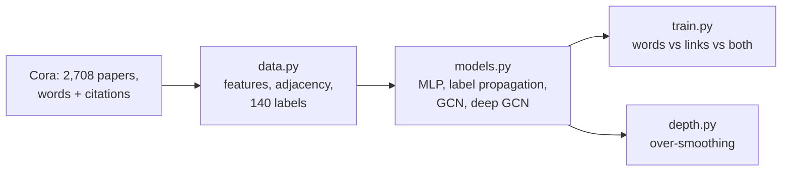

# Module project: classify research papers with a graph network

Some data isn't a grid of pixels or a sequence of words: it's a **network**. Papers cite papers, people follow people,
molecules have bonds. Chapter 13 shows how neural networks can learn from both what each node is and who it's connected
to. In this project you build a graph convolutional network (GCN) from scratch in PyTorch, on the most famous graph
benchmark, Cora, and find out how much the links are worth.

The setting is realistic: only 140 of the 2,708 papers are labelled. Labelling is expensive; links are free. The
notebook attached above builds and runs the whole project; the reference code is in the course files under
`projects/cora-gcn`.


## Attachments and data

- **Notebook**: `project-5-cora-gcn.ipynb`, attached to this lesson. It builds and runs the whole project; on the course's web page it opens in Google Colab.
- **Finished code**: the `projects/cora-gcn` folder in the course files, to check your work.
- **Data**: Cora citation graph (from the original GCN repository, Kipf & Welling). Source: [https://github.com/tkipf/pygcn/tree/master/data/cora](https://github.com/tkipf/pygcn/tree/master/data/cora) · about: [https://linqs.org/datasets/#cora](https://linqs.org/datasets/#cora) · licence: MIT (repository). `data.py` downloads it the first time you run it and keeps it in `data/`: `cora.cites`, `cora.content`, 7.5 MB.
- **All datasets in one zip**: [bishop-datasets.zip](https://github.com/mahmoudyosrimahmoud13/inpace-library/releases/download/bishop-datasets-v1/bishop-datasets.zip). Unzip it and copy the files of `cora` into your project's `data/` folder; `data.py` then skips the download. Useful offline, or if a source moves.

## What you'll build



## Set up the project

```bash
mkdir cora-gcn && cd cora-gcn
python -m venv .venv && source .venv/bin/activate
pip install torch numpy matplotlib
git init
```

```text
cora-gcn/
    .gitignore
    README.md
    data.py
    depth.py
    gcn.pt
    models.py
    requirements.txt
    train.py
    data/        (downloaded the first time you run it)
```

<!-- skip -->
```text
torch
numpy
matplotlib
```

<!-- skip -->
```text
data/
outputs/
__pycache__/
.venv/
```

## Step 1: the graph

Each paper has 1,433 yes/no features (does it use this word?), a topic, and citation links. We store the links as an
**adjacency matrix** `A` (section 13.1.2): `A[i, j] = 1` if papers i and j are linked. Citations have a direction, but
for topic prediction it doesn't matter who cited whom, so we make `A` symmetric.

<!-- skip -->
```python
# file: data.py
"""Cora: 2,708 machine-learning papers, the 5,429 citations between them, the words each paper uses (1,433 yes/no
features) and its topic (7 classes). From the repository of the original GCN paper (Kipf & Welling)."""
from pathlib import Path
from urllib.request import urlopen
import numpy as np
import torch

URL = "https://raw.githubusercontent.com/tkipf/pygcn/master/data/cora/"


def fetch(name):
    path = Path("data") / name
    if not path.exists():
        path.parent.mkdir(exist_ok=True)
        path.write_bytes(urlopen(URL + name).read())
    return path


def load():
    content = np.genfromtxt(fetch("cora.content"), dtype=str)
    ids = {pid: i for i, pid in enumerate(content[:, 0])}
    X = torch.tensor(content[:, 1:-1].astype(np.float32))
    topics = sorted(set(content[:, -1]))
    y = torch.tensor([topics.index(t) for t in content[:, -1]])
    edges = [(ids[a], ids[b]) for a, b in np.genfromtxt(fetch("cora.cites"), dtype=str) if a in ids and b in ids]
    A = torch.zeros(len(ids), len(ids))
    for i, j in edges:
        A[i, j] = A[j, i] = 1.0                    # a citation links two papers, whichever direction
    return X, y, A, topics


def split(y, seed=0):
    """The usual small-label setting: only 20 labelled papers per topic for training (140 in all),
    500 for validation, 1,000 for testing."""
    order = torch.randperm(len(y), generator=torch.Generator().manual_seed(seed))
    train = torch.cat([order[y[order] == k][:20] for k in range(int(y.max()) + 1)])
    rest = order[~torch.isin(order, train)]
    return train, rest[:500], rest[500:1500]


if __name__ == "__main__":
    X, y, A, topics = load()
    print(f"{X.shape[0]} papers, {int(A.sum().item() // 2)} citation links, {X.shape[1]} word features")
    print("topics:", ", ".join(f"{t} ({(y == k).sum().item()})" for k, t in enumerate(topics)))
    print(f"average citations per paper: {A.sum(1).mean():.1f}")
    same = sum(y[i] == y[j] for i, j in A.nonzero().tolist()) / len(A.nonzero())
    print(f"links between papers of the same topic: {same:.1%}")
```

```bash
python data.py
```

```output
2708 papers, 5278 citation links, 1433 word features
topics: Case_Based (298), Genetic_Algorithms (418), Neural_Networks (818), Probabilistic_Methods (426), Reinforcement_Learning (217), Rule_Learning (180), Theory (351)
average citations per paper: 3.9
links between papers of the same topic: 81.0%
```

The last line is the whole reason this project works: **81% of links connect papers on the same topic**. Papers cite
their own field. A paper's neighbours are strong evidence about its topic.

## Step 2: three models

- **MLP**: the words only, as if the papers were unconnected.
- **Label propagation**: the links only, no words and no learning. Start with the 140 known labels and repeatedly
  replace each paper's guess with the average of its neighbours' guesses. Labels "flow" along citations.
- **GCN** (section 13.2.2): each layer first transforms every paper's representation with a shared linear layer, then
  replaces it with a weighted average over the paper **and its neighbours**, using the normalized matrix
  `Â = D^(-1/2) (A + I) D^(-1/2)`. Adding `I` keeps each paper's own information; the degree scaling stops
  heavily-cited papers from dominating. Two layers means information from neighbours of neighbours.

<!-- skip -->
```python
# file: models.py
"""Three ways to guess a paper's topic (Bishop, chapter 13)."""
import torch
from torch import nn


def normalized_adjacency(A):
    """A_hat = D^-1/2 (A + I) D^-1/2: each paper averages itself and its neighbours, scaled by their degrees."""
    A = A + torch.eye(len(A))
    d = A.sum(1).rsqrt()
    return d[:, None] * A * d[None, :]


class MLP(nn.Module):
    """Uses each paper's words only. The citation graph is ignored."""
    def __init__(self, n_in, n_out, hidden=64):
        super().__init__()
        self.net = nn.Sequential(nn.Dropout(0.5), nn.Linear(n_in, hidden), nn.ReLU(), nn.Dropout(0.5), nn.Linear(hidden, n_out))

    def forward(self, X, A_hat):
        return self.net(X)


class GCN(nn.Module):
    """Graph convolutional network: in each layer, a paper's new representation is a learned transformation of
    the average of its own and its neighbours' representations (message passing, section 13.2)."""
    def __init__(self, n_in, n_out, hidden=64):
        super().__init__()
        self.lin1, self.lin2 = nn.Linear(n_in, hidden), nn.Linear(hidden, n_out)
        self.drop = nn.Dropout(0.5)

    def forward(self, X, A_hat):
        h = torch.relu(A_hat @ self.lin1(self.drop(X)))      # aggregate neighbours, then non-linearity
        return A_hat @ self.lin2(self.drop(h))               # a second hop: neighbours of neighbours


def label_propagation(A_hat, y, train, n_classes, steps=20):
    """Uses the graph only, no words, no learning: spread the known labels along citation links."""
    Y = torch.zeros(len(y), n_classes)
    Y[train, y[train]] = 1.0
    F = Y.clone()
    for _ in range(steps):
        F = A_hat @ F
        F[train] = Y[train]                                  # keep the known labels fixed
    return F


class DeepGCN(nn.Module):
    """A GCN with any number of message-passing layers, to watch over-smoothing happen (section 13.3.4)."""
    def __init__(self, n_in, n_out, layers, hidden=64):
        super().__init__()
        sizes = [n_in] + [hidden] * (layers - 1) + [n_out]
        self.lins = nn.ModuleList(nn.Linear(a, b) for a, b in zip(sizes, sizes[1:]))
        self.drop = nn.Dropout(0.5)

    def forward(self, X, A_hat, return_hidden=False):
        h = X
        for i, lin in enumerate(self.lins):
            h = A_hat @ lin(self.drop(h))
            if i < len(self.lins) - 1:
                h = torch.relu(h)
                hidden = h
        return (h, hidden) if return_hidden else h
```

The same weights are used for every paper, whatever its number of neighbours, and permuting the papers just permutes the
outputs: the equivariance that section 13.2 asks of any graph network. `Â` has only 0.2% non-zero entries, so we store it
as a sparse matrix.

## Step 3: words, links, or both?

Each network trains for 200 steps on the 140 labelled papers, keeping the weights with the best validation accuracy
(early stopping).

<!-- skip -->
```python
# file: train.py
"""Compare words-only, graph-only and words + graph, with just 140 labelled papers."""
import torch
import torch.nn.functional as F
from data import load, split
from models import MLP, GCN, normalized_adjacency, label_propagation

X, y, A, topics = load()
train, val, test = split(y)
A_hat = normalized_adjacency(A).to_sparse()               # 2,708 x 2,708 but only 0.2% non-zero
acc = lambda logits, idx: (logits[idx].argmax(1) == y[idx]).float().mean().item()


def fit(model, epochs=200):
    torch.manual_seed(0)
    opt = torch.optim.Adam(model.parameters(), lr=0.01, weight_decay=5e-4)
    best_val, best_state = 0.0, None
    for epoch in range(epochs):
        model.train()
        loss = F.cross_entropy(model(X, A_hat)[train], y[train])
        opt.zero_grad(); loss.backward(); opt.step()
        model.eval()
        with torch.no_grad():
            v = acc(model(X, A_hat), val)
        if v > best_val:
            best_val, best_state = v, {k: t.clone() for k, t in model.state_dict().items()}
    model.load_state_dict(best_state)                         # early stopping on validation accuracy
    return model, best_val


if __name__ == "__main__":
    print(f"labelled papers: {len(train)} of {len(y)}\n")
    print(f"{'method':32s} {'validation':>10s} {'test':>6s}")
    with torch.no_grad():
        lp = label_propagation(A_hat, y, train, len(topics))
    print(f"{'label propagation (graph only)':32s} {acc(lp, val):10.3f} {acc(lp, test):6.3f}")
    for name, model in [("MLP (words only)", MLP(X.shape[1], len(topics))),
                        ("GCN (words + graph)", GCN(X.shape[1], len(topics)))]:
        model, v = fit(model)
        model.eval()
        with torch.no_grad():
            t = acc(model(X, A_hat), test)
        print(f"{name:32s} {v:10.3f} {t:6.3f}")
        if name.startswith("GCN"):
            torch.save(model.state_dict(), "gcn.pt")
```

```bash
python train.py
```

```output
labelled papers: 140 of 2708

method                           validation   test
label propagation (graph only)        0.726  0.704
MLP (words only)                      0.558  0.534
GCN (words + graph)                   0.840  0.796
```

- Words alone: 0.534. With only 20 examples per topic, the MLP can't learn which of 1,433 words matter.
- Links alone: 0.704, with no learning at all.
- Both: **0.796**. The GCN gets 9 points over links alone and 26 over words alone. Neither source of information is
  enough; together they're strong.

That's the core message of graph learning: the structure of the data is information, and it costs nothing to use.

## Step 4: is deeper better?

If two layers reach neighbours of neighbours, would eight layers do even better? Section 13.3.4 warns about
**over-smoothing**: each layer averages a paper with its neighbourhood, and after many averages every paper looks like
the average of a large part of the graph. `depth.py` measures accuracy and how similar the papers' hidden
representations are (average cosine similarity; 1.00 means identical).

<!-- skip -->
```python
# file: depth.py
"""More layers = information from further away. Is deeper better? Watch over-smoothing (section 13.3.4)."""
import torch
import torch.nn.functional as F
from models import DeepGCN
from train import fit, acc, X, y, A_hat, test, topics

print(f"{'layers':>6s} {'validation':>10s} {'test':>6s} {'how alike papers look':>22s}")
for layers in [2, 3, 4, 6, 8]:
    model, v = fit(DeepGCN(X.shape[1], len(topics), layers))
    model.eval()
    with torch.no_grad():
        out, hidden = model(X, A_hat, return_hidden=True)
        h = F.normalize(hidden, dim=1)
        sample = h[torch.randperm(len(h), generator=torch.Generator().manual_seed(0))[:500]]
        alike = (sample @ sample.T).mean().item()               # average cosine similarity between papers
    print(f"{layers:6d} {v:10.3f} {acc(out, test):6.3f} {alike:22.2f}")
```

```bash
python depth.py
```

```output
layers validation   test  how alike papers look
     2      0.834  0.788                   0.65
     3      0.834  0.791                   0.61
     4      0.834  0.777                   0.52
     6      0.748  0.711                   0.52
     8      0.200  0.196                   1.00
```

Accuracy falls steadily with depth, and at 8 layers the network collapses: 0.196, barely better than always guessing
the most common topic, and a similarity of 1.00. Every paper has been averaged into the same vector. Two layers is the
best choice here, which is why most practical GCNs are shallow, or add residual connections (section 13.3.4 discusses
remedies).

## Step 5: write the README and publish

<!-- skip -->
````markdown
# Paper topic classifier with a graph convolutional network

Predicts the research topic of 2,708 machine-learning papers (the Cora citation graph) from their words and their
citations, with a graph convolutional network written in plain PyTorch. Only 140 papers (20 per topic) have labels.

## Results (1,000 test papers)

| method | uses | test accuracy |
|---|---|---|
| MLP | words only | 0.534 |
| label propagation | citations only | 0.704 |
| GCN, 2 layers | words + citations | **0.796** |

Over-smoothing with depth (section 13.3.4):

| GCN layers | test accuracy | average similarity between papers |
|---|---|---|
| 2 | 0.788 | 0.65 |
| 4 | 0.777 | 0.52 |
| 6 | 0.711 | 0.52 |
| 8 | 0.196 | 1.00 (all papers look the same) |

## Run it

```bash
pip install -r requirements.txt
python train.py    # three methods compared
python depth.py    # deeper GCNs and over-smoothing
```

## What I learned

- 81% of citations link papers on the same topic; a GCN turns that structure into accuracy.
- Words and links carry different information: together they beat either one alone by 9 to 26 points.
- More message-passing layers are not better: by 8 layers, every paper's representation has blurred into the same vector.

Based on chapter 13 of *Deep Learning: Foundations and Concepts* (Bishop & Bishop, 2024).
````

```bash
git add .
git commit -m "Cora topic classifier with a graph convolutional network"
git branch -M main
git remote add origin git@github.com:YOUR-USERNAME/cora-gcn.git
git push -u origin main
```

## Make it yours

- **Fewer labels.** Train with 5 labelled papers per topic instead of 20. Which method suffers least?
- **Residual connections.** Add `h = h + layer(h)` skip connections to `DeepGCN`. Does the 8-layer network still collapse?
- **Graph attention.** Replace the fixed average with learned attention weights over neighbours (section 13.3.1's
  graph attention networks). Does it beat 0.796?
- **Visualize.** Project the GCN's hidden layer to 2-D with PCA or t-SNE and colour the papers by topic.

## On your CV

> **Paper topic classifier** (PyTorch): graph convolutional network on the Cora citation graph (2,708 papers, 140
> labels); 79.6% test accuracy versus 53.4% for an MLP on words and 70.4% for label propagation on links; demonstrated
> over-smoothing as depth grows. github.com/YOUR-USERNAME/cora-gcn

## Check yourself

- [ ] You can explain what `Â` does, and why it adds `I`.
- [ ] You can explain why the GCN beats both the words-only and links-only methods.
- [ ] You can explain over-smoothing using your own similarity numbers.
