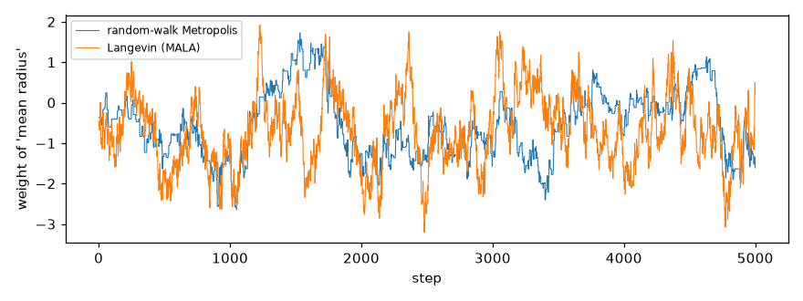

# Bayesian logistic regression with MCMC

Samples the posterior over the 31 weights of a logistic regression for breast cancer diagnosis (569 patients,
scikit-learn), with two samplers written in PyTorch: random-walk Metropolis and the Metropolis-adjusted Langevin
algorithm, which uses autograd gradients. Then predicts with the whole posterior instead of a single weight vector.



## Results

| sampler | acceptance | effective samples, worst / median weight (of 4,000) |
|---|---|---|
| random-walk Metropolis | 0.21 | 5 / 16 |
| Langevin (MALA) | 0.68 | 15 / 39 |

| prediction (169 test patients) | accuracy | log likelihood per patient |
|---|---|---|
| MAP weights | 0.970 | -0.076 |
| posterior average | 0.964 | **-0.062** |

For the hardest patients the posterior gives 90% intervals as wide as 0.00 to 0.98: the model knows it doesn't know.

## Run it

```bash
pip install -r requirements.txt
python run.py      # about 2 minutes
```

## What I learned

- MCMC replaces "the best weights" with thousands of plausible weights, and predictions average over them.
- Gradients help: Langevin explored about 3 times faster than a random walk, but correlated features make this posterior
  hard for both. Effective sample size, not the number of steps, says how much you've learned.
- Averaging over the posterior improved the probabilities more than the accuracy.

Based on chapter 14 of *Deep Learning: Foundations and Concepts* (Bishop & Bishop, 2024).
