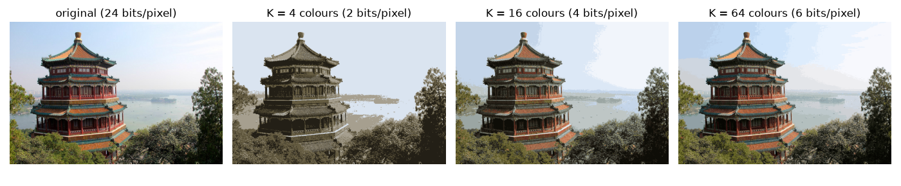

# Vector-quantization image codec

A working lossy image codec built on K-means (K-means++ initialization, written in PyTorch): it stores a palette of K
colours and, for each pixel, the index of its nearest colour packed into log2 K bits, optionally squeezed with zlib.
Files are written, read back and decoded, and compared with PNG and JPEG on the same photo.



## Results (640 x 427 photo, raw 819,840 bytes)

| format | bytes | bits/pixel | PSNR (dB) |
|---|---|---|---|
| PNG (lossless) | 489,058 | 14.32 | perfect |
| JPEG, quality 75 | 61,147 | 1.79 | 30.0 |
| VQ, K = 16 | 136,695 | 4.00 | 27.5 |
| VQ, K = 32 | 170,903 | 5.00 | 29.7 |
| VQ + zlib, K = 16 | 55,552 | 1.63 | 27.5 |
| VQ + zlib, K = 32 | 86,999 | 2.55 | 29.7 |

K-means++ initialization gave final distortions of 7.1 to 7.4 million over 5 seeds, against 7.2 to 8.1 million for
random starting points.

## Run it

```bash
pip install -r requirements.txt
python benchmark.py      # compress, decompress, compare with PNG and JPEG
python init_compare.py   # random vs K-means++ initialization
```

## What I learned

- K-means is vector quantization: each pixel is replaced by its nearest codebook colour, costing log2 K bits.
- Packing indices into a real file, and decoding it back, keeps the measurements honest.
- Entropy coding the indices more than halves the size; JPEG still wins by using transforms tuned to human vision.

Based on section 15.1 of *Deep Learning: Foundations and Concepts* (Bishop & Bishop, 2024).
