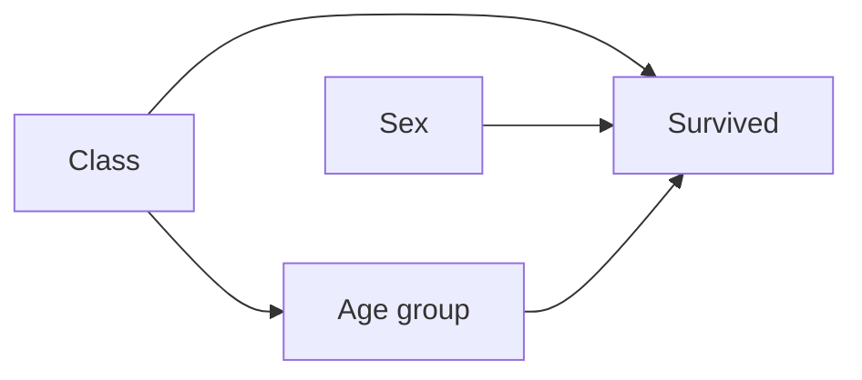

# Module project: a Bayesian network for the Titanic

Section 11.1 turns a joint probability distribution into a **graph**: one node per variable, arrows for direct
influences, and one small conditional table per node. In this project you build a Bayesian network from real data, the
passengers of the Titanic, and use it to answer questions in both directions: "would a woman in first class survive?"
and "given that someone survived, which class were they likely in?". Then you'll let the data judge between five
different graphs.

Everything is written from scratch with PyTorch tensors, so you see exactly what a graphical-model library does
inside. The notebook attached above builds and runs the whole project; the reference code is in the course files under
`projects/titanic-bayesnet`.


## Attachments and data

- **Notebook**: `project-1-titanic-bayesnet.ipynb`, attached to this lesson. It builds and runs the whole project; on the course's web page it opens in Google Colab.
- **Finished code**: the `projects/titanic-bayesnet` folder in the course files, to check your work.
- **Data**: Titanic passengers (training set). Source: [https://raw.githubusercontent.com/datasciencedojo/datasets/master/titanic.csv](https://raw.githubusercontent.com/datasciencedojo/datasets/master/titanic.csv) · about: [https://www.kaggle.com/c/titanic](https://www.kaggle.com/c/titanic) · licence: public domain (historical records). `data.py` downloads it the first time you run it and keeps it in `data/`: `titanic.csv`, 61 KB.
- **All datasets in one zip**: [bishop-datasets.zip](https://github.com/mahmoudyosrimahmoud13/inpace-library/releases/download/bishop-datasets-v1/bishop-datasets.zip). Unzip it and copy the files of `titanic` into your project's `data/` folder; `data.py` then skips the download. Useful offline, or if a source moves.

## What you'll build



That's the graph we'll start from: class influences age (first-class passengers were older; families with children
often travelled third), and class, sex and age all influence survival ("women and children first", and lifeboats were
closer to first-class cabins). By equation 11.6 it says:

```text
p(Class, Sex, Age, Survived) = p(Class) · p(Sex) · p(Age | Class) · p(Survived | Class, Sex, Age)
```

## Set up the project

```bash
mkdir titanic-bayesnet && cd titanic-bayesnet
python -m venv .venv && source .venv/bin/activate
pip install torch pandas
git init
```

```text
titanic-bayesnet/
    .gitignore
    README.md
    bayesnet.py
    compare_graphs.py
    data.py
    queries.py
    requirements.txt
    data/        (downloaded the first time you run it)
```

<!-- skip -->
```text
torch
pandas
```

<!-- skip -->
```text
data/
__pycache__/
.venv/
```

## Step 1: four discrete variables

We keep class, sex, an age group (child under 16, adult, or unknown: 177 ages are missing, and "missing" is itself
informative, so it becomes a value rather than a reason to drop the passenger) and survival.

<!-- skip -->
```python
# file: data.py
"""The 891 Titanic passengers of the well-known training set, reduced to four discrete variables."""
from pathlib import Path
import pandas as pd
import torch

URL = "https://raw.githubusercontent.com/datasciencedojo/datasets/master/titanic.csv"
CACHE = Path("data/titanic.csv")
VALUES = {"Class": ["1st", "2nd", "3rd"], "Sex": ["female", "male"],
          "Age": ["child", "adult", "unknown"], "Survived": ["no", "yes"]}


def load():
    if not CACHE.exists():
        CACHE.parent.mkdir(exist_ok=True)
        pd.read_csv(URL).to_csv(CACHE, index=False)
    t = pd.read_csv(CACHE)
    age = t.Age.apply(lambda a: "unknown" if pd.isna(a) else ("child" if a < 16 else "adult"))
    table = pd.DataFrame({"Class": t.Pclass.map({1: "1st", 2: "2nd", 3: "3rd"}), "Sex": t.Sex, "Age": age,
                          "Survived": t.Survived.map({0: "no", 1: "yes"})})
    # one integer column per variable
    return {v: torch.tensor([VALUES[v].index(x) for x in table[v]]) for v in VALUES}


if __name__ == "__main__":
    d = load()
    n = len(d["Survived"])
    print(f"{n} passengers, {d['Survived'].float().mean():.1%} survived")
    for v, vals in VALUES.items():
        print(f"{v:9s}", ", ".join(f"{x} {(d[v] == i).sum().item()}" for i, x in enumerate(vals)))
```

```bash
python data.py
```

```output
891 passengers, 38.4% survived
Class     1st 216, 2nd 184, 3rd 491
Sex       female 314, male 577
Age       child 83, adult 631, unknown 177
Survived  no 549, yes 342
```

## Step 2: the network

`BayesNet` has three jobs:

- **fit**: estimate each conditional table `p(node | parents)` by counting, plus a pseudo-count (as in every counting
  model of this course) so no combination gets probability zero.
- **joint**: multiply the tables into the full joint table, equation 11.6. With 3 × 2 × 3 × 2 = 36 combinations this
  is tiny; the work is in lining up each table's axes with the joint's.
- **query**: answer `p(target | evidence)` exactly: keep only the entries that match the evidence, sum out every other
  variable, and normalize. That's Bayes' theorem and the sum rule, nothing more.

<!-- skip -->
```python
# file: bayesnet.py
"""A discrete Bayesian network (Bishop, section 11.1): a graph, one conditional table per node, exact inference."""
import itertools
import torch
from data import VALUES


class BayesNet:
    def __init__(self, parents):
        """parents: {node: [its parents]}, e.g. {"Class": [], "Survived": ["Class", "Sex"]}"""
        self.parents = parents
        self.order = list(VALUES)                                      # fixed axis order for the joint table

    def fit(self, data, alpha=1.0):
        """Each conditional table p(node | parents) is estimated by counting, plus a pseudo-count alpha."""
        self.cpt = {}
        for node, pars in self.parents.items():
            shape = [len(VALUES[p]) for p in pars] + [len(VALUES[node])]
            counts = torch.full(shape, alpha)
            idx = tuple(data[p] for p in pars) + (data[node],)
            counts.index_put_(idx, torch.ones(len(data[node])), accumulate=True)
            self.cpt[node] = counts / counts.sum(-1, keepdim=True)
        return self

    def joint(self):
        """The full table p(Class, Sex, Age, Survived) as the product of the conditionals (equation 11.6)."""
        J = torch.ones([len(VALUES[v]) for v in self.order])
        for node, pars in self.parents.items():
            axes = [self.order.index(p) for p in pars] + [self.order.index(node)]
            shape = [1] * len(self.order)
            for a, size in zip(axes, self.cpt[node].shape):
                shape[a] = size
            t = self.cpt[node].permute(*sorted(range(len(axes)), key=lambda k: axes[k])).reshape(shape)
            J = J * t
        return J

    def query(self, target, **evidence):
        """p(target | evidence) by summing the joint over everything else, then normalizing (Bayes' theorem)."""
        J = self.joint()
        for v, value in evidence.items():
            keep = torch.zeros(len(VALUES[v])); keep[VALUES[v].index(value)] = 1
            shape = [1] * len(self.order); shape[self.order.index(v)] = -1
            J = J * keep.reshape(shape)
        axis = self.order.index(target)
        p = J.sum(dim=[a for a in range(len(self.order)) if a != axis])
        return dict(zip(VALUES[target], (p / p.sum()).tolist()))

    def log_likelihood(self, data):
        J = self.joint()
        return J[tuple(data[v] for v in self.order)].log().sum().item()

    def n_parameters(self):
        return sum(t[..., :-1].numel() for t in self.cpt.values())     # the last column of each table is implied
```

## Step 3: ask questions

<!-- skip -->
```python
# file: queries.py
"""Ask the network questions, in both directions: from causes to effects and back."""
from data import load
from bayesnet import BayesNet

GRAPH = {"Class": [], "Sex": [], "Age": ["Class"], "Survived": ["Class", "Sex", "Age"]}
net = BayesNet(GRAPH).fit(load())

def show(target, **ev):
    p = net.query(target, **ev)
    cond = ", ".join(f"{k}={v}" for k, v in ev.items()) or "nothing"
    print(f"p({target} | {cond}): " + ", ".join(f"{k} {v:.2f}" for k, v in p.items()))

print("Predicting (causes -> effect):")
show("Survived")
show("Survived", Sex="female", Class="1st")
show("Survived", Sex="male", Class="3rd")
show("Survived", Sex="male", Class="2nd", Age="child")
show("Survived", Sex="male", Class="2nd", Age="adult")
print("\nReasoning backwards (effect -> causes):")
show("Class")
show("Class", Survived="yes")
show("Age", Survived="yes", Sex="male")
```

```bash
python queries.py
```

```output
Predicting (causes -> effect):
p(Survived | nothing): no 0.62, yes 0.38
p(Survived | Sex=female, Class=1st): no 0.06, yes 0.94
p(Survived | Sex=male, Class=3rd): no 0.85, yes 0.15
p(Survived | Sex=male, Class=2nd, Age=child): no 0.09, yes 0.91
p(Survived | Sex=male, Class=2nd, Age=adult): no 0.92, yes 0.08

Reasoning backwards (effect -> causes):
p(Class | nothing): 1st 0.24, 2nd 0.21, 3rd 0.55
p(Class | Survived=yes): 1st 0.37, 2nd 0.24, 3rd 0.39
p(Age | Survived=yes, Sex=male): child 0.23, adult 0.63, unknown 0.14
```

**Predicting.** A woman in first class had a 94% chance of surviving, a man in third class 15%. The most striking line:
boys in second class 91%, men in second class 8%. "Women and children first" is right there in the numbers.

**Reasoning backwards.** Before you know anything, a passenger is in first class with probability 0.24. Learn that they
survived, and it rises to 0.37: survival is **evidence** about class. The same tables answer questions in either
direction, which is what makes graphical models so useful for diagnosis (from symptoms back to causes).

## Step 4: which graph?

Our graph is an assumption. For example, it has no arrow between class and sex, so it claims they're independent. Are
they? Five candidate graphs, each scored on passengers it didn't see (5-fold cross-validation), by held-out log
likelihood (how well it predicts **everything** about a new passenger) and by survival accuracy:

<!-- skip -->
```python
# file: compare_graphs.py
"""Which graph is right? Score five structures by how well they predict passengers they never saw (5-fold
cross-validation), and by how well they predict survival."""
import torch
from data import load
from bayesnet import BayesNet

GRAPHS = {
    "no edges (all independent)": {"Class": [], "Sex": [], "Age": [], "Survived": []},
    "naive Bayes (Survived -> all)": {"Survived": [], "Class": ["Survived"], "Sex": ["Survived"], "Age": ["Survived"]},
    "our graph": {"Class": [], "Sex": [], "Age": ["Class"], "Survived": ["Class", "Sex", "Age"]},
    "our graph + Class -> Sex": {"Class": [], "Sex": ["Class"], "Age": ["Class"], "Survived": ["Class", "Sex", "Age"]},
    "every edge (full table)": {"Class": [], "Sex": ["Class"], "Age": ["Class", "Sex"], "Survived": ["Class", "Sex", "Age"]},
}
data = load()
n = len(data["Survived"])
folds = torch.randperm(n, generator=torch.Generator().manual_seed(0)) % 5

print(f"{'graph':32s} {'parameters':>10s} {'held-out log p per passenger':>29s} {'survival accuracy':>18s}")
for name, graph in GRAPHS.items():
    ll = right = 0.0
    for k in range(5):
        tr = {v: x[folds != k] for v, x in data.items()}
        te = {v: x[folds == k] for v, x in data.items()}
        net = BayesNet(graph).fit(tr)
        ll += net.log_likelihood(te)
        J = net.joint()                                    # predict survival from the other three variables
        p_yes = J[te["Class"], te["Sex"], te["Age"], 1] / J[te["Class"], te["Sex"], te["Age"]].sum(-1)
        right += ((p_yes > 0.5).long() == te["Survived"]).sum().item()
    print(f"{name:32s} {net.n_parameters():10d} {ll / n:29.3f} {right / n:18.3f}")
```

```bash
python compare_graphs.py
```

```output
graph                            parameters  held-out log p per passenger  survival accuracy
no edges (all independent)                6                        -3.110              0.616
naive Bayes (Survived -> all)            11                        -2.895              0.787
our graph                                27                        -2.837              0.807
our graph + Class -> Sex                 29                        -2.829              0.807
every edge (full table)                  35                        -2.824              0.807
```

- **No edges** is the worst, obviously: it predicts survival without looking at anything.
- **Naive Bayes** (section 11.2.4), survival as the single cause of everything, is much better, but its assumption (class,
  sex and age independent once you know survival) is wrong, and it shows.
- **Our graph** and both richer graphs predict survival equally well (0.807): once survival has arrows from class, sex
  and age, the rest of the graph doesn't matter for that question.
- On held-out likelihood, adding `Class → Sex` helps a little (there were proportionally more women in first class than
  in third), and the **full table** is best of all.

That last point deserves an honest sentence: with four variables, 891 passengers are enough to estimate all 35 numbers of
the full table, so leaving edges out only loses information. Graphs earn their keep when there are **many** variables:
with 30 binary variables, the full table would need over a billion numbers, while a sparse graph might need a few
hundred. That's the argument of section 11.1, and the reason the course moves on to models where the graph is the only
practical option.

## Step 5: write the README and publish

<!-- skip -->
````markdown
# Titanic survival as a Bayesian network

A discrete Bayesian network over four variables of the 891 Titanic passengers (class, sex, age group, survival), written
from scratch with PyTorch tensors: conditional tables learned by counting, exact inference by summing the joint table,
and five graph structures compared by cross-validation.

## Questions answered

| question | answer |
|---|---|
| p(survived) | 0.38 |
| p(survived \| woman, 1st class) | 0.94 |
| p(survived \| man, 3rd class) | 0.15 |
| p(survived \| boy, 2nd class) vs man, 2nd class | 0.91 vs 0.08 |
| p(1st class) before vs after learning someone survived | 0.24 -> 0.37 |

## Which graph? (5-fold cross-validation)

| graph | parameters | held-out log p per passenger | survival accuracy |
|---|---|---|---|
| no edges | 6 | -3.110 | 0.616 |
| naive Bayes | 11 | -2.895 | 0.787 |
| class -> age; class, sex, age -> survived | 27 | -2.837 | 0.807 |
| + class -> sex | 29 | -2.829 | 0.807 |
| every edge (full table) | 35 | -2.824 | 0.807 |

## Run it

```bash
pip install -r requirements.txt
python queries.py
python compare_graphs.py
```

## What I learned

- A graph turns a joint distribution into small conditional tables (equation 11.6), and every question is answered by
  the same procedure: multiply, sum out what you don't know, normalize.
- Inference runs both ways: from class to survival, and from survival back to class.
- With 4 variables and 891 rows, even the full table can be estimated; graphs pay off when there are many variables.

Based on chapter 11 of *Deep Learning: Foundations and Concepts* (Bishop & Bishop, 2024).
````

```bash
git add .
git commit -m "Titanic Bayesian network: exact inference and structure comparison"
git branch -M main
git remote add origin git@github.com:YOUR-USERNAME/titanic-bayesnet.git
git push -u origin main
```

## Make it yours

- **Add variables.** Add the port of embarkation and family size (alone / small / large). How large does the full table
  get, and does a sparse graph start to win on held-out likelihood?
- **Explaining away** (section 11.2.2). Find a pair of variables that are independent in your graph, but become dependent
  once you know survival. Show it with two queries.
- **Learn the structure.** Write a greedy search that adds the single edge that most improves cross-validated
  likelihood, until nothing helps. Which graph does it find?
- **Compare with a classifier.** Train logistic regression on the same four variables. Does it beat 0.807?

## On your CV

> **Titanic Bayesian network** (Python, PyTorch): discrete Bayesian network learned from data with exact inference
> (predictive and diagnostic queries); compared five graph structures by cross-validated log likelihood; 80.7% survival
> accuracy. github.com/YOUR-USERNAME/titanic-bayesnet

## Check yourself

- [ ] You can write the factorization of any small graph from its arrows.
- [ ] You can explain how `query` answers a question, in three steps.
- [ ] You can explain why the full table won here, and when it wouldn't.
