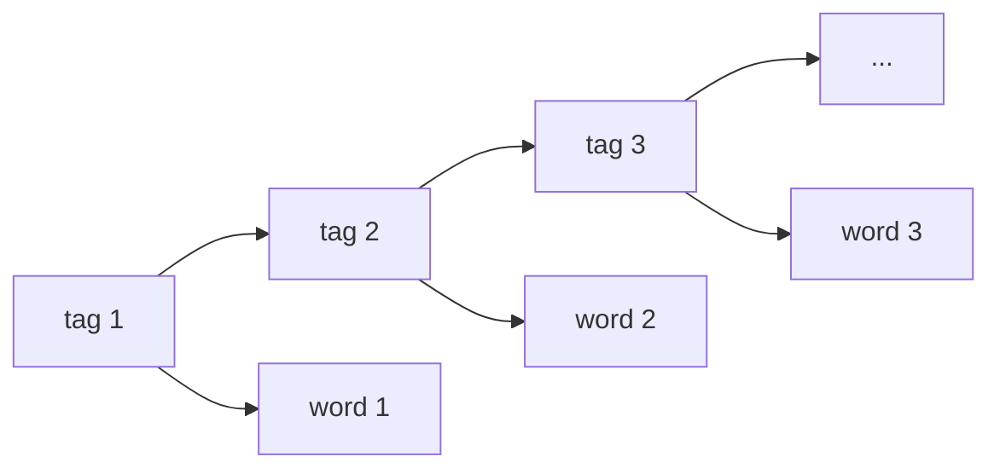

# Module project: build a part-of-speech tagger

Section 11.3 introduces sequence models, and among them the **hidden Markov model**: a chain of hidden states, each
producing one observation. It's the graphical-model way of thinking about sequences, and it powered speech recognition and
text processing for decades. In this project you build one for a classic language task: **part-of-speech tagging**, labelling
every word of a sentence as a noun, a verb, a determiner and so on.

The book stops at the model. Using it needs two algorithms the book doesn't cover, so this project teaches them: **Viterbi**
to find the best tag sequence, and the **forward algorithm** to compute the probability of a sentence. Both are short,
both are dynamic programming, and both come up in interviews. The notebook attached above builds and runs the whole project;
the reference code is in the course files under `projects/hmm-tagger`.


## Attachments and data

- **Notebook**: `project-2-hmm-tagger.ipynb`, attached to this lesson. It builds and runs the whole project; on the course's web page it opens in Google Colab.
- **Finished code**: the `projects/hmm-tagger` folder in the course files, to check your work.
- **Data**: Part-of-speech tagged news sentences (Hugging Face: batterydata/pos_tagging). Source: [https://huggingface.co/datasets/batterydata/pos_tagging](https://huggingface.co/datasets/batterydata/pos_tagging) · about: [https://huggingface.co/datasets/batterydata/pos_tagging](https://huggingface.co/datasets/batterydata/pos_tagging) · licence: Apache-2.0. `data.py` downloads it the first time you run it and keeps it in `data/`: `pos_test.parquet`, `pos_train.parquet`, 1.2 MB.
- **All datasets in one zip**: [bishop-datasets.zip](https://github.com/mahmoudyosrimahmoud13/inpace-library/releases/download/bishop-datasets-v1/bishop-datasets.zip). Unzip it and copy the files of `pos-tagging` into your project's `data/` folder; `data.py` then skips the download. Useful offline, or if a source moves.

## What you'll build



That's the model as a graph (section 11.1): each tag depends only on the previous tag, and each word only on its own tag.
Its joint distribution factorizes along the graph:

```text
p(words, tags) = p(tag1) · Π p(tag_t | tag_t−1) · Π p(word_t | tag_t)
```

Training is just counting. The interesting part is using it: the tags are **hidden**, and we must infer them.

## Set up the project

```bash
mkdir hmm-tagger && cd hmm-tagger
python -m venv .venv && source .venv/bin/activate
pip install torch pandas pyarrow
git init
```

```text
hmm-tagger/
    .gitignore
    README.md
    data.py
    evaluate.py
    hmm.py
    requirements.txt
    data/        (downloaded the first time you run it)
```

<!-- skip -->
```text
torch
pandas
pyarrow
```

<!-- skip -->
```text
data/
__pycache__/
.venv/
```

## Step 1: the data

Real news sentences with a tag on every word, in the Penn Treebank tag set: `NN` noun, `NNS` plural noun, `VB` verb,
`VBD` past-tense verb, `DT` determiner, `IN` preposition, `MD` modal verb, `JJ` adjective, `RB` adverb, 48 tags in all.

<!-- skip -->
```python
# file: data.py
"""14,505 news sentences where every word is tagged with its part of speech (noun, verb, ...), in the Penn Treebank
tag set (NN = noun, VBD = past-tense verb, DT = determiner, ...). From the Hugging Face hub."""
from pathlib import Path
import pandas as pd

URL = "https://huggingface.co/api/datasets/batterydata/pos_tagging/parquet/default/{}/0.parquet"


def load(split):
    cache = Path(f"data/pos_{split}.parquet")
    if not cache.exists():
        cache.parent.mkdir(exist_ok=True)
        pd.read_parquet(URL.format(split)).to_parquet(cache)
    t = pd.read_parquet(cache)
    return [(list(w), list(l)) for w, l in zip(t.words, t.labels)]


if __name__ == "__main__":
    train, test = load("train"), load("test")
    print(f"train {len(train):,} sentences ({sum(len(w) for w, _ in train):,} words), test {len(test):,} sentences")
    words, tags = train[0]
    print(" ".join(f"{w}/{t}" for w, t in zip(words[:10], tags[:10])))
```

```bash
python data.py
```

```output
train 13,054 sentences (321,815 words), test 1,451 sentences
Confidence/NN in/IN the/DT pound/NN is/VBZ widely/RB expected/VBN to/TO take/VB another/DT
```

## Step 2: the model and its two algorithms

**Fitting** counts three things: how often each tag starts a sentence, how often each tag follows each other tag
(the 48 × 48 **transition** table), and how often each tag produces each word (the **emission** table). As in the spam
filter of part 1, a small pseudo-count keeps unseen combinations from getting probability zero.

**Unknown words** are the hard part: 4.4% of test words never appear in training. We replace rare training words with
their **shape** (ends in "-ing", starts with a capital, contains a digit...), so the model learns, for example, that
unknown words ending in "-ed" are usually past-tense verbs, and capitalized ones usually proper nouns.

**Viterbi** finds the most probable tag sequence. Trying all 48ⁿ sequences of a 25-word sentence is impossible, but the
best path to each tag at position t only depends on the best paths to each tag at position t−1. So we keep, for each
tag, the score of its best path so far and where it came from, move one word at a time, and trace the best path back at
the end: 25 × 48 × 48 steps instead of 48²⁵.

**The forward algorithm** is the same loop with `logsumexp` (a sum of probabilities) in place of `max`: it adds up the
probabilities of all tag sequences, giving `p(words)`.

<!-- skip -->
```python
# file: hmm.py
"""A hidden Markov model tagger (Bishop, section 11.3.1): hidden states = tags, observations = words.

p(words, tags) = p(tag_1) * prod_t p(tag_t | tag_t-1) * prod_t p(word_t | tag_t)
Everything is estimated by counting, then Viterbi finds the most probable tag sequence for a new sentence."""
import math
from collections import Counter, defaultdict
import torch


def shape(word):
    """A stand-in for words never seen in training: what they look like (suffix, capital, digits)."""
    if any(c.isdigit() for c in word):
        return "<num>"
    if word[0].isupper():
        return "<Cap>"
    for suffix in ("ing", "ed", "ly", "s", "tion", "able", "al", "ive", "est", "er"):
        if word.endswith(suffix):
            return "<-" + suffix + ">"
    return "<unk>"


class HMMTagger:
    def fit(self, sentences, rare=1):
        word_count = Counter(w for words, _ in sentences for w in words)
        self.known = {w for w, c in word_count.items() if c > rare}       # rare words teach the 'unknown' shapes
        self.tags = sorted({t for _, tags in sentences for t in tags})
        T = len(self.tags); ti = {t: i for i, t in enumerate(self.tags)}
        start, trans = torch.ones(T), torch.ones(T, T)                     # +1: nothing is impossible
        emit = defaultdict(lambda: torch.full((T,), 0.01))
        for words, tags in sentences:
            start[ti[tags[0]]] += 1
            for a, b in zip(tags, tags[1:]):
                trans[ti[a], ti[b]] += 1
            for w, t in zip(words, tags):
                emit[self.token(w)][ti[t]] += 1
        self.log_start = (start / start.sum()).log()
        self.log_trans = (trans / trans.sum(1, keepdim=True)).log()        # p(next tag | tag)
        tag_totals = sum(emit.values())
        self.log_emit = {w: (c / tag_totals).log() for w, c in emit.items()}  # p(word | tag)
        return self

    def token(self, w):
        return w if w in self.known else shape(w)

    def emissions(self, words):
        return torch.stack([self.log_emit.get(self.token(w), self.log_emit["<unk>"]) for w in words])

    def viterbi(self, words):
        """The most probable tag sequence: the Viterbi algorithm, dynamic programming over positions."""
        E = self.emissions(words)
        score = self.log_start + E[0]
        back = []
        for t in range(1, len(words)):
            total = score[:, None] + self.log_trans                         # (previous tag, next tag)
            score, best_prev = total.max(0)
            score = score + E[t]
            back.append(best_prev)
        path = [int(score.argmax())]
        for bp in reversed(back):
            path.append(int(bp[path[-1]]))
        return [self.tags[i] for i in reversed(path)]

    def log_prob(self, words):
        """log p(words), summing over ALL tag sequences: the forward algorithm (sum instead of max)."""
        E = self.emissions(words)
        alpha = self.log_start + E[0]
        for t in range(1, len(words)):
            alpha = torch.logsumexp(alpha[:, None] + self.log_trans, 0) + E[t]
        return torch.logsumexp(alpha, 0).item()
```

## Step 3: evaluate

The baseline gives each word the tag it had most often in training, with no context at all.

<!-- skip -->
```python
# file: evaluate.py
"""Compare a no-context baseline with the HMM on 1,451 test sentences, then use the forward algorithm."""
from collections import Counter, defaultdict
from data import load
from hmm import HMMTagger

train, test = load("train"), load("test")
seen = Counter(w for words, _ in train for w in words)

# Baseline: each word gets the tag it had most often in training (unknown words: the most common tag, NN)
by_word = defaultdict(Counter)
for words, tags in train:
    for w, t in zip(words, tags):
        by_word[w][t] += 1
baseline = lambda words: [by_word[w].most_common(1)[0][0] if w in by_word else "NN" for w in words]

hmm = HMMTagger().fit(train)
results = {"most frequent tag": baseline, "HMM + Viterbi": hmm.viterbi}
for name, tagger in results.items():
    right = right_unk = n = n_unk = 0
    for words, tags in test:
        for w, guess, truth in zip(words, tagger(words), tags):
            n += 1; right += guess == truth
            if w not in seen:
                n_unk += 1; right_unk += guess == truth
    print(f"{name:18s} accuracy {right / n:.3f}   on words never seen in training ({n_unk / n:.1%} of words): {right_unk / n_unk:.3f}")

# Context resolves ambiguity: 'can' and 'back' have several possible tags
for sentence in ["I can open the can .", "They will back the plan to go back home ."]:
    words = sentence.split()
    print("\n" + " ".join(f"{w}/{t}" for w, t in zip(words, hmm.viterbi(words))))

# The forward algorithm: how probable is a sentence under the model? A scrambled one should be far less likely.
s = "The company said its profit rose sharply in the third quarter ."
scrambled = "quarter the rose The profit its company sharply said third in ."
print(f"\nlog p(sentence)  = {hmm.log_prob(s.split()):.1f}")
print(f"log p(scrambled) = {hmm.log_prob(scrambled.split()):.1f}")
```

```bash
python evaluate.py
```

```output
most frequent tag  accuracy 0.912   on words never seen in training (4.4% of words): 0.160
HMM + Viterbi      accuracy 0.957   on words never seen in training (4.4% of words): 0.804

I/PRP can/MD open/VB the/DT can/NN ./.

They/PRP will/MD back/RB the/DT plan/NN to/TO go/VB back/JJ home/NN ./.

log p(sentence)  = -60.8
log p(scrambled) = -81.7
```

- The baseline already reaches 0.912: most words have one usual tag. But on unknown words it's nearly useless (0.160).
- The HMM reaches **0.957**, and **0.804 on unknown words**: the word-shape trick plus the context of the neighbouring tags.
- "I **can** open the **can**": the HMM tags the first as a modal verb (`MD`) and the second as a noun (`NN`). Same word,
  different tags, decided by context.
- "They will **back** the plan to go **back** home" shows the limits. "will back the plan" should make "back" a verb, and
  the HMM gets it wrong; the second "back" should be an adverb. With only the previous tag as memory, the model can't see
  enough of the sentence. Modern taggers use networks that read the whole sentence, like the transformers of part 3, and
  reach about 97%.
- The forward algorithm scores the real sentence about e²¹, a billion times, more likely than the same words scrambled:
  the model has learned something about English word order.

## Step 4: write the README and publish

<!-- skip -->
````markdown
# Part-of-speech tagger with a hidden Markov model

Tags every word of an English sentence with its part of speech (noun, verb, determiner, ...) using a hidden Markov model
trained by counting on 13,054 tagged news sentences, with the Viterbi algorithm for decoding and the forward algorithm
for sentence probabilities. Written with PyTorch tensors.

## Results (1,451 test sentences)

| tagger | accuracy | accuracy on words never seen in training (4.4%) |
|---|---|---|
| most frequent tag for each word | 0.912 | 0.160 |
| HMM + Viterbi, word-shape model for unknown words | **0.957** | **0.804** |

Forward algorithm: log p("The company said its profit rose sharply in the third quarter .") = -60.8; the same words
scrambled: -81.7, about e^21 (a billion) times less likely.

## Run it

```bash
pip install -r requirements.txt
python evaluate.py
```

## What I learned

- An HMM is a graphical model: a chain of hidden tags, each emitting one observed word.
- Dynamic programming makes it practical: Viterbi (max) and forward (sum) cost O(length x tags^2), not tags^length.
- Context fixes ambiguity ("I can open the can"), but one tag of memory is not enough for everything ("will back the plan").

Based on section 11.3 of *Deep Learning: Foundations and Concepts* (Bishop & Bishop, 2024).
````

```bash
git add .
git commit -m "HMM part-of-speech tagger with Viterbi and forward algorithms"
git branch -M main
git remote add origin git@github.com:YOUR-USERNAME/hmm-tagger.git
git push -u origin main
```

## Make it yours

- **Second-order HMM.** Let each tag depend on the two previous tags. Does "will back the plan" come out right? How much
  bigger are the tables, and does accuracy go up?
- **Error analysis.** Count the 10 most common (true tag, guessed tag) confusions. Which ones are understandable even for
  humans?
- **Generate text.** Sample tags from the transition table and words from the emission table. What does the model's
  idea of English look like?
- **A tagging web page.** Put `viterbi` behind a small Streamlit page where anyone can type a sentence.

## On your CV

> **Part-of-speech tagger** (Python, PyTorch): hidden Markov model trained on 13k tagged news sentences, with Viterbi
> decoding, the forward algorithm and word-shape handling of unknown words; 95.7% test accuracy (80.4% on unseen words)
> versus 91.2% for a most-frequent-tag baseline. github.com/YOUR-USERNAME/hmm-tagger

## Check yourself

- [ ] You can draw the HMM as a graph and write its factorization.
- [ ] You can explain why Viterbi costs length × tags², not tags^length.
- [ ] You can explain the one change that turns Viterbi into the forward algorithm.
