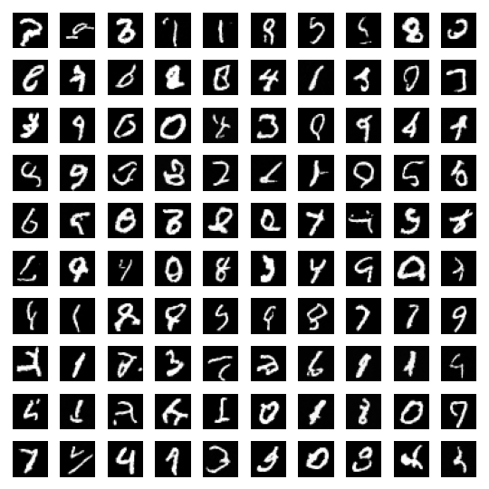

# Diffusion model that draws handwritten digits

A denoising diffusion model (DDPM) written from scratch in PyTorch: a small U-Net with time and label embeddings,
trained on MNIST to predict the noise added to an image, then used to turn pure noise into new digits in 500 steps.



## Results (100 digits generated with no label)

| measure | value |
|---|---|
| U-Net parameters | 237,217 |
| training | 6,000 steps of 128 images, about 30 minutes on a laptop CPU |
| final noise-prediction loss | 0.024 (1.23 at the start) |
| judge accuracy on real test digits | 98.7% |
| generated digits the judge is at least 90% sure about | 54% |
| digits per class among the 100 samples | 5 to 15 (10 would be perfectly even) |

## Run it

```bash
pip install -r requirements.txt
python train.py      # saves diffusion.pt
python judge.py      # saves judge.pt, a CNN that scores the samples
python generate.py   # saves outputs/generated.png
```

## What I learned

- Training a diffusion model is simple: pick a random noise level, add noise in one step (the closed-form kernel),
  and train the network to predict that noise with a squared error.
- The network has to be told how noisy its input is; the time embedding does that.
- Sampling is the slow part: 500 network passes per image, against one per example in training.
- Hiding the label 15% of the time during training gives one network that can draw with or without a label.

Based on chapter 20 of *Deep Learning: Foundations and Concepts* (Bishop & Bishop, 2024).
