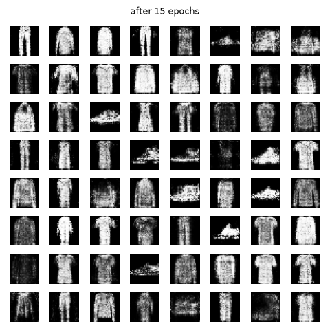

# A GAN that draws clothes

A generative adversarial network written in PyTorch (MLP generator and discriminator, non-saturating loss) trained on
Fashion-MNIST, and evaluated by a separate CNN "judge" for quality, variety (mode collapse) and novelty.



## Results (1,000 generated images, judged by a CNN with 88.8% test accuracy)

| | judge at least 90% sure | kinds of clothes (effective, of 10) | distance to nearest training image |
|---|---|---|---|
| real test images | 68% | 9.9 | 7.5 |
| GAN samples | 26% | 9.5 | 8.9 |

The GAN makes all ten kinds of clothes (no mode collapse) and doesn't copy training images, but its samples are grainy:
the judge is confident about far fewer of them than about real photos.

## Run it

```bash
pip install -r requirements.txt
python train.py      # about 3 minutes on a laptop CPU
python evaluate.py
```

## What I learned

- GAN losses don't measure image quality: both stayed near 1.0 while the pictures improved a lot.
- An independent judge makes quality, variety and copying measurable.
- A small fully connected GAN gets the shapes right; sharp detail needs convolutional networks and longer training.

Based on chapter 17 of *Deep Learning: Foundations and Concepts* (Bishop & Bishop, 2024).
