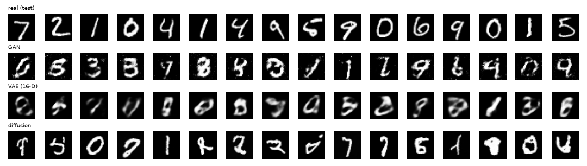

# GAN vs VAE vs diffusion on the same digits

Three generative models written in PyTorch and trained on the same MNIST digits, then measured the same way: one CNN
judge, 200 samples each, four measurements. Real test digits, which no model saw, are the reference row.



## Results (200 samples per model)

| model | judge at least 90% sure | digit variety (max 10) | median distance to nearest training digit | ms per image |
|---|---|---|---|---|
| real test digits | 96% | 9.7 | 9.1 | - |
| GAN (MLP) | **56%** | 9.1 | 10.8 | under 0.1 |
| VAE (16-D latent) | 29% | 9.0 | 9.7 | under 0.1 |
| diffusion (DDPM, 500 steps) | 54% | **9.4** | 11.4 | 1,100 |

- **Quality:** the GAN and diffusion are close; the VAE's samples are blurry.
- **Variety:** all three draw every digit, so no mode collapse.
- **Novelty:** no model copies its training data (every distance is above that of real test digits).
- **Speed:** diffusion is more than ten thousand times slower to sample, because each image needs 500 network passes.

## Run it

```bash
pip install -r requirements.txt
python train_gan.py
python train_vae.py --latent 16
python train_diffusion.py
python judge.py
python compare.py   # saves outputs/side_by_side.png
```

## What I learned

- Each model fails in its own way: GAN samples are noisy, VAE samples are blurry, diffusion samples are clean but
  sometimes oddly shaped.
- One shared judge and shared measurements make models comparable; each project's own metric didn't.
- Diffusion trades sampling speed for easy, stable training with a single loss.

Based on chapters 17 to 20 of *Deep Learning: Foundations and Concepts* (Bishop & Bishop, 2024).
