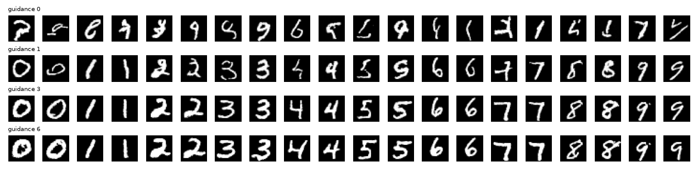

# Classifier-free guidance: what it buys and what it costs

A label-conditioned diffusion model on MNIST (a U-Net trained with the label hidden 15% of the time), sampled with
classifier-free guidance at four scales. A separate CNN judge measures how often the right digit appears, how clean
the digits are, and how varied the samples of each digit are.



## Results (10 samples of each digit per guidance scale)

| guidance λ | right digit | judge at least 90% sure | variety within a digit (mean pixel distance) |
|---|---|---|---|
| 0 (no label) | 8% | 54% | 19.9 |
| 1 | 90% | 89% | 18.1 |
| 3 | **100%** | **100%** | 16.6 |
| 6 | **100%** | **100%** | 15.9 |

## Run it

```bash
pip install -r requirements.txt
python train.py    # or copy diffusion.pt from the ddpm-digits project
python judge.py    # or copy judge.pt
python guide.py    # saves outputs/guidance.png
```

## What I learned

- One network can give both `p(x | digit)` and `p(x)` if the label is hidden for some training examples.
- Guidance mixes the two predictions: `λ · conditional + (1 − λ) · unconditional`.
- λ = 1 already gets most digits right; larger λ makes every digit right and clean, but the samples look more alike.

Based on section 20.4 of *Deep Learning: Foundations and Concepts* (Bishop & Bishop, 2024).
