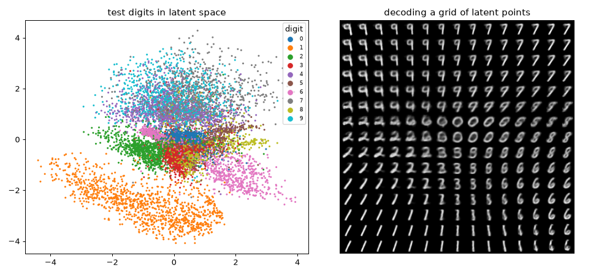
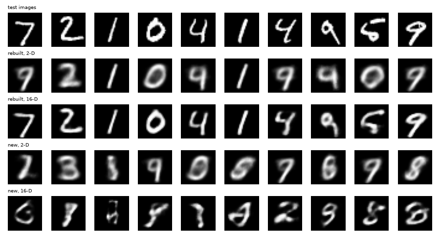

# Variational autoencoder for handwritten digits

A variational autoencoder written in PyTorch (MLP encoder and decoder, reparameterization trick, closed-form KL term),
trained on MNIST with a 2-D and a 16-D latent space, then explored: reconstructions, brand-new digits, and a map of the
2-D latent space.



## Results (10,000 test digits, 10 epochs)

| latent size | test ELBO (nats per image) | reconstruction term | KL term |
|---|---|---|---|
| 2 | -156.5 | -150.8 | 5.6 |
| 16 | **-106.2** | -83.3 | 22.9 |

In the 2-D latent space, 51.6% of each test digit's 5 nearest neighbours are the same digit (10% by chance), although
the VAE never saw a label.



## Run it

```bash
pip install -r requirements.txt
python train.py --latent 2
python train.py --latent 16
python explore.py
```

## What I learned

- A VAE trades reconstruction against a KL term that keeps the codes close to the prior; the latent size moves that balance.
- A 2-D code reconstructs blurrily but organizes the digits into a smooth, readable map.
- A 16-D code reconstructs sharply, but its random samples are worse: random codes can fall in regions no training
  digit occupies.

Based on chapter 19 of *Deep Learning: Foundations and Concepts* (Bishop & Bishop, 2024).
