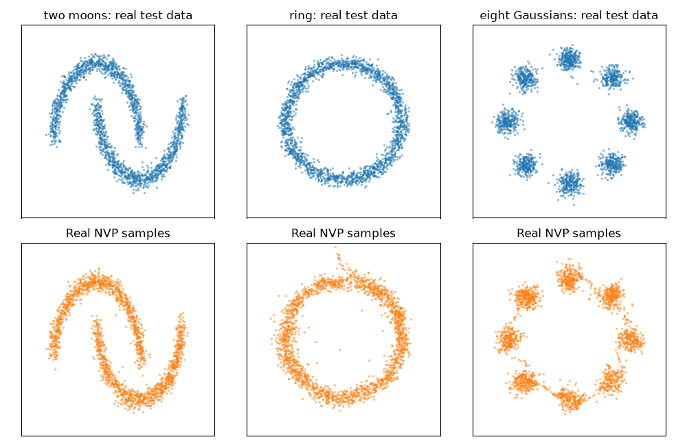

# Real NVP from scratch

A normalizing flow (real NVP, 8 affine coupling layers) written from scratch in PyTorch, trained by exact maximum
likelihood on three 2-D shapes, and compared with a single Gaussian and a 10-component Gaussian mixture.



## Results (test log-likelihood per point, higher is better)

| data set | Gaussian | mixture of 10 Gaussians | Real NVP |
|---|---|---|---|
| two moons | -2.687 | -1.358 | -1.364 |
| ring | -2.961 | -1.378 | -1.444 |
| eight Gaussians | -3.097 | **-1.140** | -1.332 |

Real NVP learns every shape far better than a Gaussian and matches a 10-component mixture on two moons. It's behind on
eight separate clusters: a flow is a smooth, invertible map of one Gaussian blob, so it leaves thin "bridges" of
probability between the clusters (visible in the samples).

## Run it

```bash
pip install -r requirements.txt
python train.py    # about a minute on a laptop CPU
```

## What I learned

- A flow gives an exact likelihood through the change-of-variables formula, so training is plain maximum likelihood.
- Coupling layers are invertible by construction and have a triangular Jacobian, so the log-determinant is a sum.
- A continuous invertible map can't separate disconnected clusters cleanly; mixtures can, but they don't scale to images.

Based on chapter 18 of *Deep Learning: Foundations and Concepts* (Bishop & Bishop, 2024).
