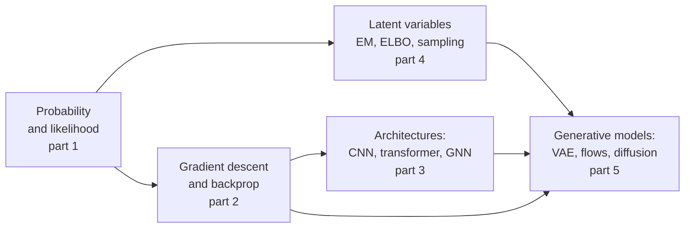

# Looking back: the whole series in one page

You've now read the whole of *Deep Learning: Foundations and Concepts*, built a small library of your own, and published
around 25 projects. It's worth stepping back to see how the pieces connect, because the same few ideas carry the whole
book.

## Five ideas that kept coming back

1. **Maximum likelihood, and its fixes.** From fitting a polynomial (part 1) to normalizing flows (part 5), most
   training is "make the data probable". When the likelihood can't be computed, you bound it (EM, VAEs, diffusion) or
   avoid it (GANs).
2. **Regularization as prior knowledge.** Weight decay is a Gaussian prior (part 1); augmentation, convolution and
   attention build in what you know about the data (parts 2 and 3). The right inductive bias beat every trick in your
   small-data study.
3. **Gradients, computed automatically.** You wrote backpropagation by hand, then an autograd engine (part 2). The same
   machinery gave saliency maps and adversarial attacks (part 3), Langevin samplers (part 4) and scores (part 5).
4. **Latent variables.** Hidden causes appear as mixture components (part 4), VAE codes and diffusion's noisy images
   (part 5). The evidence lower bound handles all of them.
5. **Sampling.** From ancestral sampling in a graph (part 4) to Langevin dynamics, and finally to diffusion models that
   are, at heart, very well-trained Langevin samplers.

## What you can now do

- Read a deep-learning paper and recognize its parts: the likelihood or bound, the architecture, the optimizer, the
  regularizers, the evaluation.
- Build a model from scratch, check its gradients, train it, and evaluate it honestly against a baseline.
- Explain trade-offs: GANs versus diffusion models, a flow's exact likelihood versus a VAE's bound, a transformer versus a
  bag of words.

The next lesson turns that into a report, and points to where to go next.
