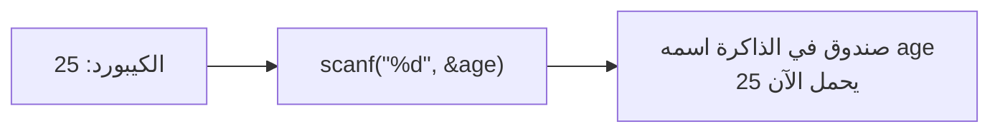

# الـ variables والأنواع والإدخال

**الـ variable** صندوق له اسم في الذاكرة يحمل قيمة. وفي C، كل variable له **نوع (type)** يحدد ماذا يحمل وكم بايتًا يستخدم.

## الأنواع الأساسية

| النوع | يحمل | مثال | رمز printf |
|---|---|---|---|
| `int` | أعداد صحيحة | `int age = 25;` | `%d` |
| `double` | أعداد بفاصلة عشرية | `double price = 9.99;` | `%f` (أو `%.2f` لرقمين بعد الفاصلة) |
| `char` | حرف واحد | `char grade = 'A';` | `%c` |
| `char[]` | نص (string) | `char name[] = "Sara";` | `%s` |

```c
#include <stdio.h>

int main(void) {
    int age = 25;
    double height = 1.72;
    char grade = 'A';
    char name[] = "Sara";

    printf("%s is %d years old.\n", name, age);
    printf("Height: %.2f m, grade: %c\n", height, grade);
    return 0;
}
```

```output
Sara is 25 years old.
Height: 1.72 m, grade: A
```

الرموز `%d` و`%f` و`%c` و`%s` داخل النص **أماكن محجوزة**: تستبدلها `printf` بالترتيب بالقيم التي بعد الفاصلة.

## العمليات الحسابية

`+ - * /` تعمل كما تتوقع، ومعها `%` (باقي القسمة). وفخ كبير: **قسمة عددين صحيحين تعطي عددًا صحيحًا**، والجزء العشري يُرمى.

```c
#include <stdio.h>

int main(void) {
    int a = 7, b = 2;
    printf("%d / %d = %d\n", a, b, a / b);
    printf("%d %% %d = %d\n", a, b, a % b);
    printf("as a decimal: %.1f\n", (double)a / b);
    return 0;
}
```

```output
7 / 2 = 3
7 % 2 = 1
as a decimal: 3.5
```

`(double)a` تحوّل `a` إلى `double` أولًا. وهذا اسمه **التحويل (cast)**. (و`%%` تطبع علامة `%` حقيقية.)

## تغيير الـ variables

```c
int score = 10;
score = score + 5;   // now 15
score += 5;          // short form: now 20
score++;             // add one: now 21
```

`=` معناها "خزّن"، لا "يساوي". اقرأ `score = score + 5` هكذا: "score تصبح score زائد 5".

## الثوابت

استخدم `const` للقيم التي لا يجب أن تتغير أبدًا: `const double PI = 3.14159;`. ولو حاولت تغييرها، يرفض الـ compiler.

## قراءة الإدخال بـ scanf

<!-- diagram -->


<!-- stdin: 30\n -->
```c
#include <stdio.h>

int main(void) {
    int age;
    printf("How old are you? ");
    scanf("%d", &age);
    printf("Next year you will be %d.\n", age + 1);
    return 0;
}
```

```output
How old are you? Next year you will be 31.
```

(عندما تكتب الإجابة بنفسك، تظهر بعد السؤال.) لاحظ **`&`** قبل `age`: إنها تعطي `scanf` **address** الـ variable حتى تخزّن الرقم فيه. ستفهم هذا تمامًا في درس الـ pointers؛ الآن، استخدم `&` مع `scanf` للأرقام والحروف.

## كم حجم كل نوع؟

`sizeof` تخبرك كم بايتًا يستخدم النوع. على كمبيوتر عادي 64 بت، `int` غالبًا 4 بايت و`double` ثمانية. و`int` من 4 بايت يحمل أعدادًا حتى حوالي 2.1 مليار؛ وتجاوزها يسبب **فيضانًا (overflow)**، وهو مصدر حقيقي للأخطاء.

## جرّب بنفسك

اكتب برنامجًا يقرأ سعر منتج وكميته، ويطبع الإجمالي برقمين بعد الفاصلة.

**الإجابة:**

<!-- stdin: 2.5 4\n -->
```c
#include <stdio.h>

int main(void) {
    double price;
    int qty;
    printf("Price and quantity: ");
    scanf("%lf %d", &price, &qty);
    printf("Total: %.2f\n", price * qty);
    return 0;
}
```

```output
Price and quantity: Total: 10.00
```

ملاحظة: لـ**قراءة** `double` بـ `scanf` استخدم `%lf`؛ ولطباعته بـ `printf` يكفي `%f`.

## فيديوهات اختيارية

الدرس أعلاه كامل وحده. هذه الفيديوهات للتعمق إن كنت تحب التعلم بالمشاهدة. الفيديوهات المكتوب بجانبها (بالإنجليزية) يمكنك تشغيل الترجمة لها (**CC**)، ثم **الإعدادات ← الترجمة ← ترجمة تلقائية ← العربية**.

**CS50x 2024, Lecture 1: C (Harvard, David J. Malan) (بالإنجليزية)**

https://www.youtube.com/watch?v=cwtpLIWylAw
