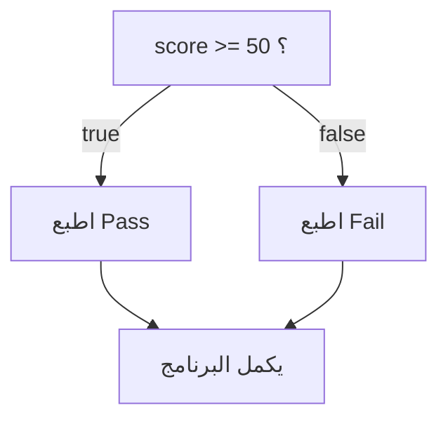

# اتخاذ القرارات: if وelse وswitch

البرامج تصبح مفيدة عندما تستطيع أن تختار ماذا تفعل.

## if وelse

<!-- diagram -->


```c
#include <stdio.h>

int main(void) {
    int temperature = 31;

    if (temperature > 30) {
        printf("It's hot. Drink water.\n");
    } else if (temperature > 15) {
        printf("Nice weather.\n");
    } else {
        printf("Take a jacket.\n");
    }
    return 0;
}
```

```output
It's hot. Drink water.
```

الشرط يوضع بين **قوسين**، والكود الذي يُنفّذ بين **أقواس معقوفة**. وC تفحص الشروط من الأعلى للأسفل، وتنفّذ **أول** شرط صحيح فقط.

## المقارنة والمنطق

| العملية | المعنى |
|---|---|
| `==` | يساوي (علامتا يساوي!) |
| `!=` | لا يساوي |
| `<` و`>` و`<=` و`>=` | أصغر، أكبر، أصغر أو يساوي، أكبر أو يساوي |
| `&&` | و: الاثنان يجب أن يكونا صحيحين |
| `\|\|` | أو: واحد على الأقل صحيح |
| `!` | ليس (النفي) |

```c
if (age >= 18 && hasTicket) { ... }
if (day == 6 || day == 7) { ... }
```

**الخطأ الكلاسيكي:** كتابة `if (x = 5)` بدلًا من `if (x == 5)`. الأولى **تخزّن** 5 في `x` وتكون صحيحة دائمًا. ومع `-Wall` يحذّرك gcc منها.

## الصح والخطأ في C

في C، **الصفر يعني خطأ (false) وأي رقم آخر يعني صح (true)**. والمقارنات تعطي 1 (صح) أو 0 (خطأ). ومنذ C99 تستطيع أيضًا `#include <stdbool.h>` واستخدام `bool` و`true` و`false`، وهذا يجعل الكود أوضح.

## switch

عندما تقارن variable واحدًا بقيم ثابتة كثيرة، `switch` أنظف:

```c
#include <stdio.h>

int main(void) {
    int day = 3;
    switch (day) {
        case 1: printf("Monday\n"); break;
        case 2: printf("Tuesday\n"); break;
        case 3: printf("Wednesday\n"); break;
        default: printf("Another day\n");
    }
    return 0;
}
```

```output
Wednesday
```

لا تنسَ **`break`**: بدونها تستمر C في تنفيذ الحالات التالية أيضًا (وهذا اسمه "السقوط").

## العملية الثلاثية

if/else قصيرة تعطي قيمة: `الشرط ? القيمة_لو_صح : القيمة_لو_خطأ`.

```c
int max = (a > b) ? a : b;
```

## جرّب بنفسك

اكتب برنامجًا يقرأ درجة من 0 إلى 100 ويطبع التقدير: 90 فأكثر A، و80 فأكثر B، و70 فأكثر C، و60 فأكثر D، وأقل من 60 F. واطبع "invalid" للأرقام خارج 0–100.

**الإجابة:**

<!-- stdin: 84\n -->
```c
#include <stdio.h>

int main(void) {
    int mark;
    scanf("%d", &mark);
    if (mark < 0 || mark > 100) {
        printf("invalid\n");
    } else if (mark >= 90) {
        printf("A\n");
    } else if (mark >= 80) {
        printf("B\n");
    } else if (mark >= 70) {
        printf("C\n");
    } else if (mark >= 60) {
        printf("D\n");
    } else {
        printf("F\n");
    }
    return 0;
}
```

```output
B
```

## فيديوهات اختيارية

الدرس أعلاه كامل وحده. هذه الفيديوهات للتعمق إن كنت تحب التعلم بالمشاهدة. الفيديوهات المكتوب بجانبها (بالإنجليزية) يمكنك تشغيل الترجمة لها (**CC**)، ثم **الإعدادات ← الترجمة ← ترجمة تلقائية ← العربية**. فيديوهات عادل نسيم تستخدم C++، لكن الفكرة هي نفسها في C.

**‏#11 [c++] - Switch Statement (عادل نسيم)**

https://www.youtube.com/watch?v=-MTeqw7gZf0

**CS50x 2024, Lecture 1: C (Harvard, David J. Malan) (بالإنجليزية)**

https://www.youtube.com/watch?v=cwtpLIWylAw
