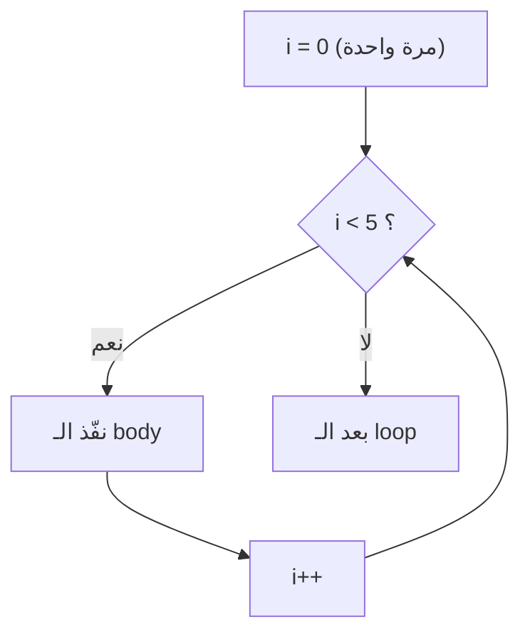

# الـ loops التكرارية: while وfor

**الـ loop** تكرر الكود. والكمبيوتر ممتاز في فعل نفس الشيء مليون مرة دون أن يمل.

## while

`while` تكرر طالما الشرط صحيح:

```c
#include <stdio.h>

int main(void) {
    int count = 1;
    while (count <= 5) {
        printf("%d ", count);
        count++;
    }
    printf("\n");
    return 0;
}
```

```output
1 2 3 4 5 
```

لو نسيت `count++`، يبقى الشرط صحيحًا للأبد: **loop لا نهائية**. اضغط **Ctrl+C** في الطرفية لإيقاف برنامج عالق.

## for

`for` تضع البداية والشرط والخطوة في سطر واحد. وهي أشهر loop عندما تعرف عدد مرات التكرار:

<!-- diagram -->


```c
#include <stdio.h>

int main(void) {
    for (int i = 1; i <= 10; i++) {
        printf("7 x %d = %d\n", i, 7 * i);
    }
    return 0;
}
```

```output
7 x 1 = 7
7 x 2 = 14
7 x 3 = 21
7 x 4 = 28
7 x 5 = 35
7 x 6 = 42
7 x 7 = 49
7 x 8 = 56
7 x 9 = 63
7 x 10 = 70
```

اقرأها هكذا: ابدأ بـ `i = 1`؛ وطالما `i <= 10`، نفّذ الجسم ثم `i++`.

## do-while

تنفّذ الجسم **مرة على الأقل** ثم تفحص الشرط. مفيدة للقوائم والتحقق من الإدخال:

```c
int n;
do {
    printf("Enter a positive number: ");
    scanf("%d", &n);
} while (n <= 0);
```

## break وcontinue

- `break` تخرج من الـ loop فورًا.
- `continue` تتخطى إلى الدورة التالية.

```c
#include <stdio.h>

int main(void) {
    for (int i = 1; i <= 10; i++) {
        if (i % 2 == 0) continue;   // skip even numbers
        if (i > 7) break;           // stop after 7
        printf("%d ", i);
    }
    printf("\n");
    return 0;
}
```

```output
1 3 5 7 
```

## loops داخل loops

```c
#include <stdio.h>

int main(void) {
    for (int row = 1; row <= 3; row++) {
        for (int col = 1; col <= row; col++) {
            printf("*");
        }
        printf("\n");
    }
    return 0;
}
```

```output
*
**
***
```

## جرّب بنفسك

اكتب برنامجًا يجمع كل الأعداد من 1 إلى 100 ويطبع المجموع.

**الإجابة:**

```c
#include <stdio.h>

int main(void) {
    int total = 0;
    for (int i = 1; i <= 100; i++) {
        total += i;
    }
    printf("%d\n", total);
    return 0;
}
```

```output
5050
```

## فيديوهات اختيارية

الدرس أعلاه كامل وحده. هذه الفيديوهات للتعمق إن كنت تحب التعلم بالمشاهدة. الفيديوهات المكتوب بجانبها (بالإنجليزية) يمكنك تشغيل الترجمة لها (**CC**)، ثم **الإعدادات ← الترجمة ← ترجمة تلقائية ← العربية**. فيديوهات عادل نسيم تستخدم C++، لكن الفكرة هي نفسها في C.

**‏#13 [c++] - For loop (عادل نسيم)**

https://www.youtube.com/watch?v=cgpgpGuXIZk

**CS50x 2024, Lecture 1: C (Harvard, David J. Malan) (بالإنجليزية)**

https://www.youtube.com/watch?v=cwtpLIWylAw
