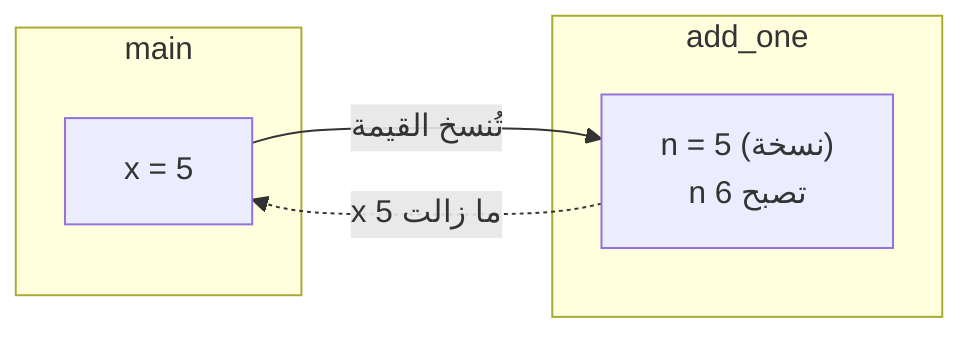

# الـ functions

**الـ function** قطعة كود لها اسم تستخدمها مرة بعد مرة. أنت استخدمت `printf` و`main` من قبل، والآن ستكتب دوالك الخاصة.

## كتابة function

```c
#include <stdio.h>

int square(int x) {
    return x * x;
}

int main(void) {
    printf("%d\n", square(4));
    printf("%d\n", square(9));
    return 0;
}
```

```output
16
81
```

- `int` قبل الاسم هو **نوع القيمة المرجعة**: ما تعطيه الـ function.
- `(int x)` هو **المعامل (parameter)**: المدخل. عندما تستدعي `square(4)`، تكون قيمة `x` داخل الـ function 4.
- `return` ترسل النتيجة لمن استدعى الـ function.

## functions لا ترجع شيئًا

استخدم `void` عندما تفعل الـ function شيئًا فقط ولا ترجع قيمة:

```c
#include <stdio.h>

void greet(const char name[], int times) {
    for (int i = 0; i < times; i++) {
        printf("Hello, %s!\n", name);
    }
}

int main(void) {
    greet("Lina", 2);
    return 0;
}
```

```output
Hello, Lina!
Hello, Lina!
```

## صرّح قبل الاستخدام

C تقرأ الملف من الأعلى للأسفل. لو كانت `main` تستدعي function مكتوبة **تحتها**، ضع **نموذجًا (prototype)** للـ function (السطر الأول فقط، مع فاصلة منقوطة) فوق `main`:

```c
#include <stdio.h>

double average(int a, int b);   // prototype

int main(void) {
    printf("%.1f\n", average(3, 4));
    return 0;
}

double average(int a, int b) {
    return (a + b) / 2.0;
}
```

```output
3.5
```

(القسمة على `2.0`، وهو `double`، تتجنب فخ القسمة الصحيحة.)

## نُسخ، لا أصول

عندما تمرر variable لـ function، C تمرر **نسخة** من قيمته. وتغيير المعامل لا يغيّر الأصل:

<!-- diagram -->


```c
#include <stdio.h>

void addTen(int n) {
    n += 10;
}

int main(void) {
    int score = 5;
    addTen(score);
    printf("%d\n", score);
    return 0;
}
```

```output
5
```

لتسمح لـ function بتغيير متغيرك، ستمرر **عنوانه**: وهذا ما تفعله الـ pointers (الوحدة 4).

## النطاق (scope)

الـ variable الذي يُنشأ داخل function (أو داخل `{ }`) موجود هناك فقط. إنه **محلي (local)**. وfunctions تستطيع كل منهما أن يكون لها `i` خاص بها دون تداخل. والـ variables خارج كل الـ functions **عامة (global)**؛ تجنّبها قدر الإمكان، لأن أي function تستطيع تغييرها فيصعب العثور على الأخطاء.

## الاستدعاء الذاتي (recursion)

الـ function تستطيع أن تستدعي نفسها، وتحتاج **حالة أساسية** لتتوقف:

```c
#include <stdio.h>

long factorial(int n) {
    if (n <= 1) return 1;          // base case
    return n * factorial(n - 1);   // calls itself with a smaller n
}

int main(void) {
    printf("%ld\n", factorial(10));
    return 0;
}
```

```output
3628800
```

## لماذا الـ functions مهمة

الـ functions الصغيرة ذات الأسماء الواضحة تجعل البرامج سهلة القراءة والاختبار والإصلاح. قاعدة جيدة: لو لم تستطع وصف ما تفعله الـ function في جملة واحدة، قسّمها.

## جرّب بنفسك

اكتب function `int isEven(int n)` ترجع 1 لو كان `n` زوجيًا و0 لو لم يكن، واستخدمها لطباعة الأعداد الزوجية من 1 إلى 10.

**الإجابة:**

```c
#include <stdio.h>

int isEven(int n) {
    return n % 2 == 0;
}

int main(void) {
    for (int i = 1; i <= 10; i++) {
        if (isEven(i)) printf("%d ", i);
    }
    printf("\n");
    return 0;
}
```

```output
2 4 6 8 10 
```

## فيديوهات اختيارية

الدرس أعلاه كامل وحده. هذه الفيديوهات للتعمق إن كنت تحب التعلم بالمشاهدة. الفيديوهات المكتوب بجانبها (بالإنجليزية) يمكنك تشغيل الترجمة لها (**CC**)، ثم **الإعدادات ← الترجمة ← ترجمة تلقائية ← العربية**. فيديوهات عادل نسيم تستخدم C++، لكن الفكرة هي نفسها في C.

**‏#19 [c++] - Function part 2 (عادل نسيم)**

https://www.youtube.com/watch?v=pRVrMNd694I

**CS50x 2024, Lecture 1: C (Harvard, David J. Malan) (بالإنجليزية)**

https://www.youtube.com/watch?v=cwtpLIWylAw
