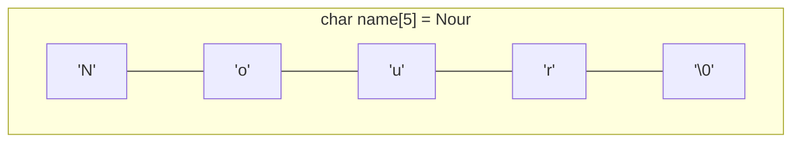

# الـ arrays والنصوص

## الـ arrays

**الـ array** تحمل عدة قيم من نفس النوع، بجوار بعضها في الذاكرة:

```c
#include <stdio.h>

int main(void) {
    int marks[5] = {70, 85, 90, 65, 80};
    int total = 0;

    for (int i = 0; i < 5; i++) {
        total += marks[i];
    }
    printf("First: %d, last: %d\n", marks[0], marks[4]);
    printf("Average: %.1f\n", total / 5.0);
    return 0;
}
```

```output
First: 70, last: 80
Average: 78.0
```

- الفهارس تبدأ من **0**: array من 5 عناصر فيها المواقع من 0 إلى 4.
- **C لا تتحقق من الحدود.** كتابة `marks[5]` أو `marks[100]` تُترجم، ثم تقرأ أو تكتب فوق ذاكرة عشوائية. هذا من أشهر مصادر الأخطاء والثغرات الأمنية في C. تأكد دائمًا أن الفهرس صحيح.

حيلة شائعة لمعرفة طول الـ array (فقط في المكان الذي عُرّفت فيه):

```c
int count = sizeof(marks) / sizeof(marks[0]);
```

## تمرير الـ arrays للـ functions

الـ array التي تُمرر لـ function **لا تُنسخ**: الـ function تعمل على الأصل. ولأن الـ function لا تعرف الطول، مرّره أيضًا:

```c
#include <stdio.h>

int largest(const int values[], int n) {
    int best = values[0];
    for (int i = 1; i < n; i++) {
        if (values[i] > best) best = values[i];
    }
    return best;
}

int main(void) {
    int temps[] = {21, 25, 19, 30, 27};
    printf("%d\n", largest(temps, 5));
    return 0;
}
```

```output
30
```

`const` وعد بأن الـ function لن تغيّر الـ array.

## النصوص arrays حروف

C ليس فيها نوع خاص للنصوص. النص array من `char` تنتهي **بحرف null** مخفي `'\0'` يحدد النهاية:

<!-- diagram -->


```
"Sara"  →  'S' 'a' 'r' 'a' '\0'   (5 chars)
```

إذن `char name[5]` تحمل اسمًا من 4 حروف على الأكثر.

مكتبة `<string.h>` فيها أدوات النصوص الأساسية:

```c
#include <stdio.h>
#include <string.h>

int main(void) {
    char first[20] = "Ahmed";
    char full[40];

    printf("Length: %zu\n", strlen(first));
    strcpy(full, first);          // copy
    strcat(full, " Hassan");      // add to the end
    printf("%s\n", full);
    if (strcmp(first, "Ahmed") == 0) {
        printf("Same text\n");
    }
    return 0;
}
```

```output
Length: 5
Ahmed Hassan
Same text
```

- `strlen` تعدّ الحروف (بدون `'\0'`).
- قارن النصوص بـ **`strcmp`**، وأبدًا لا تقارنها بـ `==` (فهي تقارن الـ addresses).
- `strcpy` و`strcat` لا تتحققان من المساحة المتاحة. تأكد أن الوجهة كبيرة بما يكفي، أو استخدم `snprintf`، التي لا تكتب أبدًا أكثر من الحجم الذي تعطيه لها:

```c
snprintf(full, sizeof(full), "%s %s", first, "Hassan");
```

## قراءة سطر نصي

`scanf("%s")` تتوقف عند أول مسافة. ولتقرأ سطرًا كاملًا بأمان استخدم `fgets`:

<!-- stdin: Mona Ali\n -->
```c
#include <stdio.h>
#include <string.h>

int main(void) {
    char line[50];
    printf("Your full name: ");
    fgets(line, sizeof(line), stdin);
    line[strcspn(line, "\n")] = '\0';   // remove the newline fgets keeps
    printf("Hello, %s!\n", line);
    return 0;
}
```

```output
Your full name: Hello, Mona Ali!
```

## الـ arrays ثنائية الأبعاد

```c
int grid[3][4];   // 3 rows, 4 columns
grid[1][2] = 7;   // row 1, column 2
```

## جرّب بنفسك

اكتب function تعدّ كم مرة يظهر حرف في نص، واختبرها بـ "banana" والحرف 'a'.

**الإجابة:**

```c
#include <stdio.h>

int countChar(const char s[], char c) {
    int count = 0;
    for (int i = 0; s[i] != '\0'; i++) {
        if (s[i] == c) count++;
    }
    return count;
}

int main(void) {
    printf("%d\n", countChar("banana", 'a'));
    return 0;
}
```

```output
3
```

## فيديوهات اختيارية

الدرس أعلاه كامل وحده. هذه الفيديوهات للتعمق إن كنت تحب التعلم بالمشاهدة. الفيديوهات المكتوب بجانبها (بالإنجليزية) يمكنك تشغيل الترجمة لها (**CC**)، ثم **الإعدادات ← الترجمة ← ترجمة تلقائية ← العربية**.

**CS50x 2024, Lecture 2: Arrays (Harvard) (بالإنجليزية)**

https://www.youtube.com/watch?v=4vU4aEFmTSo
