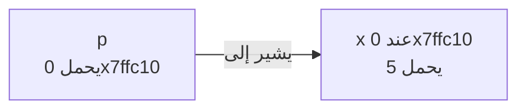

# الـ pointers: الـ addresses في الذاكرة

الـ pointers هي أكثر جزء يخاف منه الناس في C. وهي أبسط من سمعتها: **الـ pointer variable يحمل address في الذاكرة**.

## لكل variable address

ذاكرة الكمبيوتر صف طويل من البايتات المرقّمة. وكل variable يعيش في address ما. والعملية `&` تعطيك هذا الـ address:

```c
#include <stdio.h>

int main(void) {
    int age = 30;
    printf("value: %d\n", age);
    printf("size: %zu bytes\n", sizeof age);
    return 0;
}
```

```output
value: 30
size: 4 bytes
```

(تستطيع طباعة الـ address نفسه بـ `printf("%p\n", (void *)&age);`. سترى شيئًا مثل `0x7ffd5e8a3c4c`؛ ويتغير مع كل تشغيل.)

## pointer variables

<!-- diagram -->


```c
int age = 30;
int *p = &age;   // p is a "pointer to int", holding the address of age
```

- `int *p` تعلن عن pointer إلى `int`.
- `*p` (داخل تعبير) معناها "**القيمة الموجودة في الـ address الذي في p**". وهذا اسمه **dereferencing**.

```c
#include <stdio.h>

int main(void) {
    int age = 30;
    int *p = &age;

    printf("%d\n", *p);   // read through the pointer
    *p = 31;              // write through the pointer
    printf("%d\n", age);  // age changed!
    return 0;
}
```

```output
30
31
```

صورة تساعد:

```
 age            p
+------+      +-------------+
|  31  | <--- | address of  |
+------+      |    age      |
              +-------------+
```

## لماذا الـ pointers؟ تغيير variable داخل function

تذكّر أن الـ functions تأخذ نُسخًا. مرّر pointer، وتستطيع الـ function تغيير الأصل:

```c
#include <stdio.h>

void addTen(int *n) {
    *n += 10;
}

void swap(int *a, int *b) {
    int tmp = *a;
    *a = *b;
    *b = tmp;
}

int main(void) {
    int score = 5;
    addTen(&score);
    printf("%d\n", score);

    int x = 1, y = 2;
    swap(&x, &y);
    printf("x=%d y=%d\n", x, y);
    return 0;
}
```

```output
15
x=2 y=1
```

الآن تفهم `scanf("%d", &age)`: `scanf` تحتاج الـ address حتى تخزّن الرقم في متغيرك.

## إرجاع أكثر من نتيجة

الـ function ترجع قيمة واحدة فقط، لكنها تستطيع ملء عدة قيم عبر الـ pointers:

```c
#include <stdio.h>

void minMax(const int v[], int n, int *min, int *max) {
    *min = *max = v[0];
    for (int i = 1; i < n; i++) {
        if (v[i] < *min) *min = v[i];
        if (v[i] > *max) *max = v[i];
    }
}

int main(void) {
    int data[] = {4, 9, 1, 7};
    int lo, hi;
    minMax(data, 4, &lo, &hi);
    printf("min=%d max=%d\n", lo, hi);
    return 0;
}
```

```output
min=1 max=9
```

## NULL

الـ pointer الذي لا يشير لأي شيء يجب أن يكون **`NULL`**. وdereferencing عن `NULL` (أو عن pointer لم تعطه قيمة) يوقف البرنامج بخطأ "segmentation fault". تحقق قبل الاستخدام: `if (p != NULL) { ... }`.

## القواعد الثلاث

1. `&x` = address `x`.
2. `int *p` = p يحمل address int.
3. `*p` = القيمة الموجودة في ذلك الـ address.

## جرّب بنفسك

اكتب function `void doubleIt(int *n)` تضاعف الرقم الذي تشير إليه، واستدعها على variable قيمته 21.

**الإجابة:**

```c
#include <stdio.h>

void doubleIt(int *n) {
    *n *= 2;
}

int main(void) {
    int value = 21;
    doubleIt(&value);
    printf("%d\n", value);
    return 0;
}
```

```output
42
```

## فيديوهات اختيارية

الدرس أعلاه كامل وحده. هذه الفيديوهات للتعمق إن كنت تحب التعلم بالمشاهدة. الفيديوهات المكتوب بجانبها (بالإنجليزية) يمكنك تشغيل الترجمة لها (**CC**)، ثم **الإعدادات ← الترجمة ← ترجمة تلقائية ← العربية**. فيديوهات عادل نسيم تستخدم C++، لكن الفكرة هي نفسها في C.

**‏#35 [c++] - pointer (عادل نسيم)**

https://www.youtube.com/watch?v=f7I4cnJ5KJo

**Introduction to pointers in C/C++ (mycodeschool) (بالإنجليزية)**

https://www.youtube.com/watch?v=h-HBipu_1P0

**Pointers as function arguments: call by reference (mycodeschool) (بالإنجليزية)**

https://www.youtube.com/watch?v=LW8Rfh6TzGg
