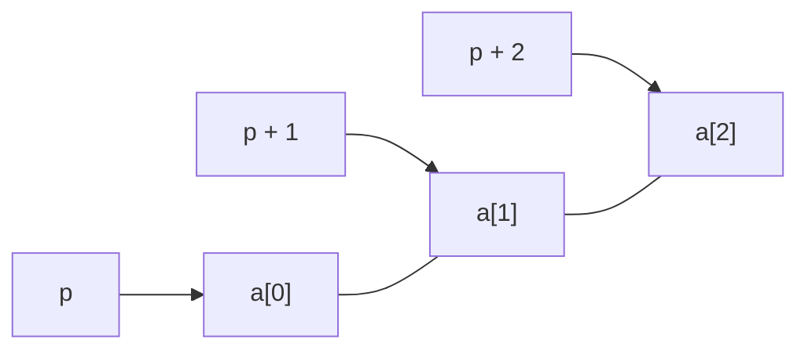

# الـ pointers والـ arrays

الـ pointers والـ arrays صديقان مقرّبان في C، وفهم العلاقة بينهما يشرح كثيرًا من سلوك C.

## اسم الـ array (تقريبًا) pointer

عندما تستخدم اسم الـ array في تعبير، يصبح **pointer إلى أول عنصر**:

```c
#include <stdio.h>

int main(void) {
    int nums[] = {10, 20, 30, 40};
    int *p = nums;          // same as &nums[0]

    printf("%d\n", *p);         // 10
    printf("%d\n", *(p + 1));   // 20
    printf("%d\n", p[2]);       // 30: p[i] means *(p + i)
    return 0;
}
```

```output
10
20
30
```

## حساب الـ pointers

`p + 1` لا تضيف بايتًا واحدًا: إنها تنتقل إلى **العنصر التالي**. ومع `int` (4 بايت)، `p + 1` أبعد بأربعة بايتات. لهذا نوع الـ pointer مهم.

<!-- diagram -->


المرور على array بpointer:

```c
#include <stdio.h>

int main(void) {
    int nums[] = {3, 6, 9, 12};
    int n = 4;
    for (int *p = nums; p < nums + n; p++) {
        printf("%d ", *p);
    }
    printf("\n");
    return 0;
}
```

```output
3 6 9 12 
```

## لماذا لا تعرف الـ functions طول الـ array

عندما تمرر array لـ function، يُمرر **pointer أول عنصر** فقط. لذلك هذان السطران متطابقان تمامًا:

```c
int sum(int values[], int n);
int sum(int *values, int n);
```

وداخل الـ function، `sizeof(values)` هو حجم pointer (8 بايت)، لا حجم الـ array. ولهذا تمرر الطول دائمًا.

## النصوص والـ pointers

يمكن الإشارة إلى نص ثابت مباشرة:

```c
const char *greeting = "Hello";
```

استخدم `const` هنا: النصوص الثابتة تعيش في ذاكرة للقراءة فقط، وتغييرها يوقف البرنامج.

وهذه `strlen` مكتوبة يدويًا، تمشي بpointer حتى `'\0'`:

```c
#include <stdio.h>

size_t myStrlen(const char *s) {
    const char *start = s;
    while (*s != '\0') {
        s++;
    }
    return (size_t)(s - start);
}

int main(void) {
    printf("%zu\n", myStrlen("pointer"));
    return 0;
}
```

```output
7
```

طرح مؤشرين داخل نفس الـ array يعطي عدد العناصر بينهما.

## arrays النصوص

```c
#include <stdio.h>

int main(void) {
    const char *days[] = {"Mon", "Tue", "Wed"};
    for (int i = 0; i < 3; i++) {
        printf("%s\n", days[i]);
    }
    return 0;
}
```

```output
Mon
Tue
Wed
```

`days` array من 3 pointers، كل منها يشير إلى نص.

## أخطاء شائعة

- **تجاوز النهاية:** `p < nums + n` صحيح؛ أما `*(nums + n)` فتقرأ بعد آخر الـ array.
- **إرجاع pointer لـ variable محلي:** الـ variable المحلي يختفي عندما ترجع الـ function، فيشير الـ pointer بعدها إلى قمامة. سترى في الوحدة التالية كيف تنشئ ذاكرة تبقى.
- **نسيان `'\0'`** عند بناء النصوص يدويًا.

## جرّب بنفسك

اكتب function `void reverse(int *a, int n)` تعكس array في مكانها باستخدام مؤشرين، واحد في كل طرف.

**الإجابة:**

```c
#include <stdio.h>

void reverse(int *a, int n) {
    int *left = a, *right = a + n - 1;
    while (left < right) {
        int tmp = *left;
        *left = *right;
        *right = tmp;
        left++;
        right--;
    }
}

int main(void) {
    int v[] = {1, 2, 3, 4, 5};
    reverse(v, 5);
    for (int i = 0; i < 5; i++) printf("%d ", v[i]);
    printf("\n");
    return 0;
}
```

```output
5 4 3 2 1 
```

## فيديوهات اختيارية

الدرس أعلاه كامل وحده. هذه الفيديوهات للتعمق إن كنت تحب التعلم بالمشاهدة. الفيديوهات المكتوب بجانبها (بالإنجليزية) يمكنك تشغيل الترجمة لها (**CC**)، ثم **الإعدادات ← الترجمة ← ترجمة تلقائية ← العربية**. فيديوهات عادل نسيم تستخدم C++، لكن الفكرة هي نفسها في C.

**‏#36 [c++] - Pointer part 2: Array vs Pointer (عادل نسيم)**

https://www.youtube.com/watch?v=ibSjFL607QA

**Pointers and arrays (mycodeschool) (بالإنجليزية)**

https://www.youtube.com/watch?v=ASVB8KAFypk

**Pointers in C / C++, full course (freeCodeCamp.org) (بالإنجليزية)**

https://www.youtube.com/watch?v=zuegQmMdy8M
