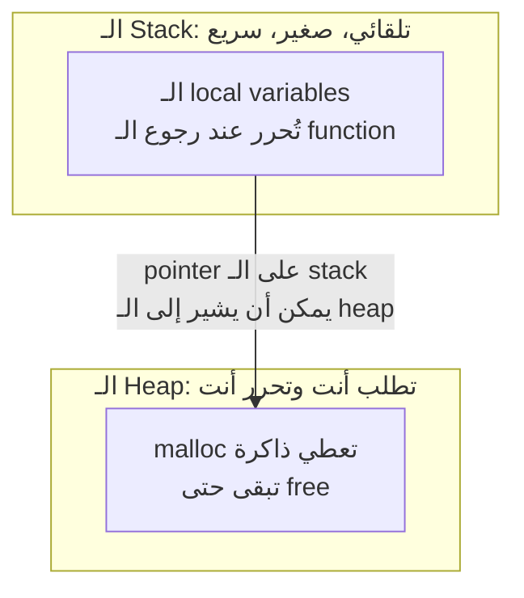

# الذاكرة الديناميكية: malloc وfree

حتى الآن، كل array كان لها حجم ثابت اخترته وأنت تكتب الكود. لكن كثيرًا ما لا تعرف كم ذاكرة تحتاج إلا **أثناء تشغيل البرنامج**: كم طالبًا سيكتب المستخدم، أو كم حجم ملف. وهذا دور **الذاكرة الديناميكية**.

## الـ stack والكومة (heap)

- **الـ stack:** الـ variables المحلية تعيش هنا. سريع وتلقائي: الذاكرة تُحرر عندما ترجع الـ function.
- **الكومة:** مخزن كبير من الذاكرة تطلبه بنفسك بـ `malloc` وترجعه بـ `free`. ويبقى حتى **تحرره أنت**.

<!-- diagram -->


## malloc وfree

```c
#include <stdio.h>
#include <stdlib.h>

int main(void) {
    int n = 5;
    int *squares = malloc(n * sizeof(int));   // room for 5 ints
    if (squares == NULL) {
        printf("Out of memory\n");
        return 1;
    }

    for (int i = 0; i < n; i++) {
        squares[i] = i * i;
    }
    for (int i = 0; i < n; i++) {
        printf("%d ", squares[i]);
    }
    printf("\n");

    free(squares);      // give the memory back
    squares = NULL;     // don't keep a pointer to freed memory
    return 0;
}
```

```output
0 1 4 9 16 
```

- `malloc(bytes)` ترجع pointer إلى هذا العدد من البايتات، أو **`NULL`** لو فشلت. تحقق دائمًا.
- اضرب في `sizeof(النوع)`: أنت تطلب **بايتات** لا عناصر.
- استخدم الذاكرة مثل array.
- **كل `malloc` يحتاج `free` واحدًا بالضبط.**

و`calloc(n, sizeof(int))` تفعل الشيء نفسه لكنها تملأ الذاكرة أصفارًا.

## التكبير بـ realloc

`realloc` تغيّر حجم كتلة الذاكرة، وتنسخ البيانات القديمة لو اضطرت لنقلها:

```c
#include <stdio.h>
#include <stdlib.h>

int main(void) {
    int capacity = 2, count = 0;
    int *list = malloc(capacity * sizeof(int));
    if (!list) return 1;

    for (int value = 10; value <= 50; value += 10) {
        if (count == capacity) {
            capacity *= 2;
            int *bigger = realloc(list, capacity * sizeof(int));
            if (!bigger) { free(list); return 1; }
            list = bigger;
        }
        list[count++] = value;
    }

    for (int i = 0; i < count; i++) printf("%d ", list[i]);
    printf("(capacity %d)\n", capacity);
    free(list);
    return 0;
}
```

```output
10 20 30 40 50 (capacity 8)
```

مضاعفة السعة كل مرة هي طريقة عمل القوائم المتنامية في كل اللغات تقريبًا، ومنها قوائم بايثون و`vector` في C++.

## أخطاء الذاكرة الأربعة الكلاسيكية

| الخطأ | ماذا يحدث |
|---|---|
| **memory leak:** نسيان `free` | البرنامج يستهلك ذاكرة أكثر وأكثر |
| **الاستخدام بعد التحرير:** استخدام الذاكرة بعد `free` | نتائج عشوائية أو توقف |
| **الـ double free:** تحرير نفس الكتلة مرتين | توقف أو تلف |
| **تجاوز المخزن (buffer overflow):** الكتابة بعد النهاية | تلف بيانات أخرى؛ ثغرة أمنية كلاسيكية |

## دع الأدوات تجدها

لا تحتاج لاكتشاف هذه الأخطاء بعينك. ترجم مع **AddressSanitizer**، وسيتوقف البرنامج بتقرير واضح عند السطر بالضبط:

```
gcc -Wall -Wextra -g -fsanitize=address,undefined program.c -o program
./program
```

وفي Linux، **Valgrind** يفعل الشيء نفسه دون إعادة الترجمة: `valgrind ./program`. استخدم أحدهما في كل مرة تعمل فيها مع `malloc`. (كل أمثلة هذا الكورس اختُبرت بهذه الطريقة.)

## إرجاع ذاكرة من function

ذاكرة الكومة تبقى بعد انتهاء الـ function التي أنشأتها، لذلك إرجاعها آمن:

```c
#include <stdio.h>
#include <stdlib.h>
#include <string.h>

char *repeat(const char *word, int times) {
    size_t len = strlen(word);
    char *out = malloc(len * times + 1);   // +1 for '\0'
    if (!out) return NULL;
    out[0] = '\0';
    for (int i = 0; i < times; i++) strcat(out, word);
    return out;   // the caller must free it
}

int main(void) {
    char *s = repeat("ha", 3);
    if (s) {
        printf("%s\n", s);
        free(s);
    }
    return 0;
}
```

```output
hahaha
```

اكتب في تعليق من المسؤول عن تحرير الذاكرة. فهذا جزء من عقد الـ function.

## جرّب بنفسك

اقرأ رقمًا `n`، واحجز array من `n` قيمة `double`، واملأها بـ `1.0, 1.5, 2.0, ...` (بزيادة 0.5 كل مرة)، واطبع مجموعها، ثم حرر الذاكرة.

**الإجابة:**

<!-- stdin: 4\n -->
```c
#include <stdio.h>
#include <stdlib.h>

int main(void) {
    int n;
    if (scanf("%d", &n) != 1 || n <= 0) return 1;
    double *v = malloc(n * sizeof(double));
    if (!v) return 1;
    double sum = 0;
    for (int i = 0; i < n; i++) {
        v[i] = 1.0 + 0.5 * i;
        sum += v[i];
    }
    printf("%.1f\n", sum);
    free(v);
    return 0;
}
```

```output
7.0
```

## فيديوهات اختيارية

الدرس أعلاه كامل وحده. هذه الفيديوهات للتعمق إن كنت تحب التعلم بالمشاهدة. الفيديوهات المكتوب بجانبها (بالإنجليزية) يمكنك تشغيل الترجمة لها (**CC**)، ثم **الإعدادات ← الترجمة ← ترجمة تلقائية ← العربية**.

**Pointers and dynamic memory: stack vs heap (mycodeschool) (بالإنجليزية)**

https://www.youtube.com/watch?v=_8-ht2AKyH4

**Dynamic memory allocation in C: malloc, calloc, realloc, free (mycodeschool) (بالإنجليزية)**

https://www.youtube.com/watch?v=xDVC3wKjS64

**CS50x 2024, Lecture 4: Memory (Harvard) (بالإنجليزية)**

https://www.youtube.com/watch?v=F9-yqoS7b8w
