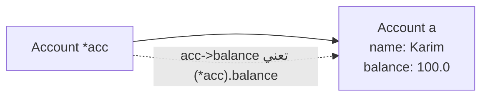

# الـ structs: أنواع بياناتك الخاصة

البيانات الحقيقية تأتي في مجموعات: للطالب اسم وعمر ودرجة. و**الـ struct** يجمع القيم المترابطة في نوع واحد.

## تعريف struct واستخدامه

```c
#include <stdio.h>

struct Student {
    char name[30];
    int age;
    double grade;
};

int main(void) {
    struct Student s = {"Nour", 20, 88.5};
    printf("%s (%d): %.1f\n", s.name, s.age, s.grade);

    s.grade = 91.0;   // change one field with the dot
    printf("New grade: %.1f\n", s.grade);
    return 0;
}
```

```output
Nour (20): 88.5
New grade: 91.0
```

## typedef: اسم أقصر

`typedef` تسمح لك بكتابة `Student` بدلًا من `struct Student`:

```c
typedef struct {
    char name[30];
    int age;
    double grade;
} Student;
```

## arrays من الـ structs

```c
#include <stdio.h>

typedef struct {
    char name[30];
    double grade;
} Student;

int main(void) {
    Student cls[] = {{"Nour", 88.5}, {"Ali", 92.0}, {"Mona", 79.5}};
    int n = sizeof(cls) / sizeof(cls[0]);

    int best = 0;
    for (int i = 1; i < n; i++) {
        if (cls[i].grade > cls[best].grade) best = i;
    }
    printf("Top student: %s with %.1f\n", cls[best].name, cls[best].grade);
    return 0;
}
```

```output
Top student: Ali with 92.0
```

## pointers الـ structs و ->

الـ structs تُنسخ عندما تمررها لـ functions، وهذا قد يكون بطيئًا للـ structs الكبيرة ولا يسمح بتغيير الأصل. مرّر **pointer** بدلًا من ذلك. ومع الـ pointer استخدم **`->`** للوصول لحقل: `p->grade` معناها `(*p).grade`.

<!-- diagram -->


```c
#include <stdio.h>

typedef struct {
    char name[30];
    double balance;
} Account;

void deposit(Account *acc, double amount) {
    acc->balance += amount;
}

void show(const Account *acc) {
    printf("%s: %.2f\n", acc->name, acc->balance);
}

int main(void) {
    Account a = {"Karim", 100.0};
    deposit(&a, 50.25);
    show(&a);
    return 0;
}
```

```output
Karim: 150.25
```

## structs في الكومة

```c
#include <stdio.h>
#include <stdlib.h>
#include <string.h>

typedef struct {
    char title[40];
    int year;
} Book;

int main(void) {
    int n = 2;
    Book *shelf = malloc(n * sizeof(Book));
    if (!shelf) return 1;
    strcpy(shelf[0].title, "Cairo Trilogy");
    shelf[0].year = 1956;
    strcpy(shelf[1].title, "Season of Migration");
    shelf[1].year = 1966;
    for (int i = 0; i < n; i++) printf("%d %s\n", shelf[i].year, shelf[i].title);
    free(shelf);
    return 0;
}
```

```output
1956 Cairo Trilogy
1966 Season of Migration
```

## التعدادات (enums)

`enum` يعطي أسماء لمجموعة من الأرقام، فيصبح الكود أسهل في القراءة بكثير:

```c
typedef enum { PENDING, PAID, SHIPPED } OrderStatus;
OrderStatus status = PAID;
if (status == PAID) { /* ... */ }
```

## جرّب بنفسك

أنشئ struct `Point` فيه `double x, y`، وfunction `double distance(Point a, Point b)` ترجع المسافة بين نقطتين. اختبرها بـ (0,0) و(3,4). (ستحتاج `sqrt` من `<math.h>`، وفي Linux أضف `-lm` عند الترجمة.)

**الإجابة:**

```c
#include <stdio.h>
#include <math.h>

typedef struct {
    double x, y;
} Point;

double distance(Point a, Point b) {
    double dx = a.x - b.x, dy = a.y - b.y;
    return sqrt(dx * dx + dy * dy);
}

int main(void) {
    Point p = {0, 0}, q = {3, 4};
    printf("%.1f\n", distance(p, q));
    return 0;
}
```

```output
5.0
```

## فيديوهات اختيارية

الدرس أعلاه كامل وحده. هذه الفيديوهات للتعمق إن كنت تحب التعلم بالمشاهدة. الفيديوهات المكتوب بجانبها (بالإنجليزية) يمكنك تشغيل الترجمة لها (**CC**)، ثم **الإعدادات ← الترجمة ← ترجمة تلقائية ← العربية**. فيديوهات عادل نسيم تستخدم C++، لكن الفكرة هي نفسها في C.

**‏#37 [c++] - struct (عادل نسيم)**

https://www.youtube.com/watch?v=1oB0Tz3ITjY

**CS50x 2024, Lecture 5: Data Structures (Harvard) (بالإنجليزية)**

https://www.youtube.com/watch?v=0euvEdPwQnQ
