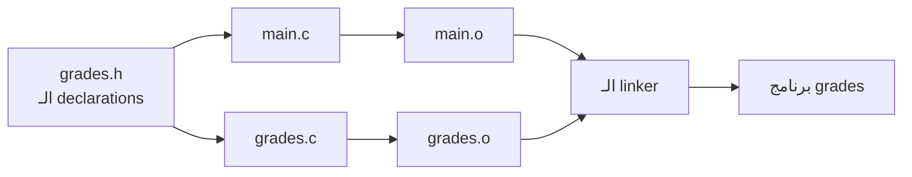

# الملفات والبرامج الأكبر

## الكتابة في الملفات والقراءة منها

```c
#include <stdio.h>

int main(void) {
    FILE *f = fopen("scores.txt", "w");   // "w" = write (creates or empties)
    if (f == NULL) {
        printf("Can't open the file\n");
        return 1;
    }
    fprintf(f, "Ali 90\nMona 85\nOmar 77\n");
    fclose(f);

    f = fopen("scores.txt", "r");          // "r" = read
    if (!f) return 1;
    char name[30];
    int score, total = 0, count = 0;
    while (fscanf(f, "%29s %d", name, &score) == 2) {
        printf("%s scored %d\n", name, score);
        total += score;
        count++;
    }
    fclose(f);
    printf("Average: %.1f\n", (double)total / count);
    return 0;
}
```

```output
Ali scored 90
Mona scored 85
Omar scored 77
Average: 84.0
```

- `fopen(name, mode)`: `"r"` قراءة، و`"w"` كتابة (تمسح المحتوى)، و`"a"` إضافة (تضيف في الآخر). وترجع `NULL` لو فشلت: تحقق دائمًا.
- `fprintf` و`fscanf` تعملان مثل `printf` و`scanf`، لكن مع ملف.
- `fscanf` ترجع عدد القيم التي قرأتها؛ والـ loop تتوقف عند نهاية الملف.
- `%29s` تحدد الاسم بـ 29 حرفًا حتى لا يتجاوز الـ array ذات الـ 30 حرفًا.
- **أغلق الملف دائمًا بـ `fclose`** عندما تنتهي.

لقراءة ملف سطرًا بسطر، استخدم `fgets(line, sizeof line, f)` في loop حتى ترجع `NULL`.

## تقسيم البرنامج إلى ملفات

عندما تكبر البرامج، تقسّمها. التنظيم المعتاد:

<!-- diagram -->


```
project/
  main.c        the program's start
  grades.h      declarations: what the module offers
  grades.c      definitions: how it works
```

`grades.h`:

```c
#ifndef GRADES_H
#define GRADES_H

double average(const int marks[], int n);
char letter(double avg);

#endif
```

أسطر `#ifndef ... #endif` هي **include guard**: تمنع تضمين الملف مرتين.

`grades.c`:

```c
#include "grades.h"

double average(const int marks[], int n) {
    int total = 0;
    for (int i = 0; i < n; i++) total += marks[i];
    return (double)total / n;
}

char letter(double avg) {
    if (avg >= 90) return 'A';
    if (avg >= 80) return 'B';
    if (avg >= 70) return 'C';
    return 'F';
}
```

`main.c`:

<!-- skip -->
```c
#include <stdio.h>
#include "grades.h"

int main(void) {
    int marks[] = {88, 92, 79};
    double avg = average(marks, 3);
    printf("%.1f %c\n", avg, letter(avg));
    return 0;
}
```

ترجم الملفين `.c` معًا:

```
gcc -Wall -Wextra main.c grades.c -o grades
./grades
```

هذا يطبع `86.3 B`. استخدم `<...>` لملفات النظام و`"..."` لملفاتك أنت.

## Make: ابنِ بكلمة واحدة

كتابة أوامر gcc الطويلة تصبح مملة. و**Makefile** يتذكرها لك:

```make
CFLAGS = -Wall -Wextra -g

grades: main.c grades.c grades.h
	gcc $(CFLAGS) main.c grades.c -o grades
```

الآن اكتب `make` فقط. (السطر تحت الهدف يجب أن يبدأ بـ **tab**، لا بمسافات.) وMake لا يعيد البناء إلا عندما يتغير ملف.

## معاملات سطر الأوامر

`main` تستطيع أن تستقبل ما كتبه المستخدم بعد اسم البرنامج:

```c
#include <stdio.h>

int main(int argc, char *argv[]) {
    printf("%d arguments\n", argc);
    for (int i = 0; i < argc; i++) printf("argv[%d] = %s\n", i, argv[i]);
    return 0;
}
```

تشغيل `./args hello 42` يطبع 3 معاملات: `./args` و`hello` و`42`. واستخدم `atoi(argv[2])` (من `<stdlib.h>`) لتحويل `"42"` إلى رقم.

## جرّب بنفسك

اكتب برنامجًا يعدّ أسطر ملف اسمه هو المعامل الأول، ويطبع رسالة خطأ لو لم يستطع فتح الملف.

**الإجابة:**

<!-- skip -->
```c
#include <stdio.h>

int main(int argc, char *argv[]) {
    if (argc < 2) {
        printf("Usage: %s FILE\n", argv[0]);
        return 1;
    }
    FILE *f = fopen(argv[1], "r");
    if (!f) {
        printf("Can't open %s\n", argv[1]);
        return 1;
    }
    int lines = 0, c;
    while ((c = fgetc(f)) != EOF) {
        if (c == '\n') lines++;
    }
    fclose(f);
    printf("%d lines\n", lines);
    return 0;
}
```

## فيديوهات اختيارية

الدرس أعلاه كامل وحده. هذه الفيديوهات للتعمق إن كنت تحب التعلم بالمشاهدة. الفيديوهات المكتوب بجانبها (بالإنجليزية) يمكنك تشغيل الترجمة لها (**CC**)، ثم **الإعدادات ← الترجمة ← ترجمة تلقائية ← العربية**.

**CS50x 2024, Lecture 4: Memory (Harvard) (بالإنجليزية)**

https://www.youtube.com/watch?v=F9-yqoS7b8w
