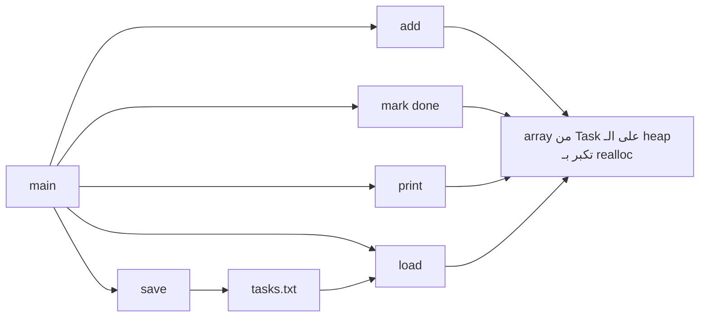

# مشروع وتصحيح أخطاء: مدير مهام صغير

حان وقت جمع كل شيء: الـ structs والذاكرة الديناميكية والـ functions والـ loops والملفات. ستبني قائمة مهام تعمل من سطر الأوامر وتحفظ في ملف.

## الخطة

- struct `Task` فيه address وعلامة إنجاز.
- array مهام تكبر في الكومة (مثل مثال `realloc`).
- functions: إضافة، وتعليم كمُنجز، وطباعة، وحفظ، وتحميل.

<!-- diagram -->


## الكود

```c
#include <stdio.h>
#include <stdlib.h>
#include <string.h>

typedef struct {
    char title[60];
    int done;
} Task;

typedef struct {
    Task *items;
    int count, capacity;
} TaskList;

int addTask(TaskList *list, const char *title) {
    if (list->count == list->capacity) {
        int cap = list->capacity ? list->capacity * 2 : 4;
        Task *bigger = realloc(list->items, cap * sizeof(Task));
        if (!bigger) return 0;
        list->items = bigger;
        list->capacity = cap;
    }
    Task *t = &list->items[list->count++];
    snprintf(t->title, sizeof t->title, "%s", title);
    t->done = 0;
    return 1;
}

void markDone(TaskList *list, int index) {
    if (index >= 0 && index < list->count) list->items[index].done = 1;
}

void printTasks(const TaskList *list) {
    for (int i = 0; i < list->count; i++) {
        printf("%d. [%c] %s\n", i + 1, list->items[i].done ? 'x' : ' ', list->items[i].title);
    }
}

int saveTasks(const TaskList *list, const char *path) {
    FILE *f = fopen(path, "w");
    if (!f) return 0;
    for (int i = 0; i < list->count; i++) {
        fprintf(f, "%d|%s\n", list->items[i].done, list->items[i].title);
    }
    fclose(f);
    return 1;
}

int loadTasks(TaskList *list, const char *path) {
    FILE *f = fopen(path, "r");
    if (!f) return 0;
    char line[80];
    while (fgets(line, sizeof line, f)) {
        line[strcspn(line, "\n")] = '\0';
        char *bar = strchr(line, '|');
        if (!bar) continue;
        *bar = '\0';
        if (addTask(list, bar + 1)) list->items[list->count - 1].done = atoi(line);
    }
    fclose(f);
    return 1;
}

int main(void) {
    TaskList list = {NULL, 0, 0};
    addTask(&list, "Buy groceries");
    addTask(&list, "Finish C course");
    addTask(&list, "Call grandma");
    markDone(&list, 1);
    saveTasks(&list, "tasks.txt");

    TaskList loaded = {NULL, 0, 0};
    loadTasks(&loaded, "tasks.txt");
    printTasks(&loaded);

    free(list.items);
    free(loaded.items);
    return 0;
}
```

```output
1. [ ] Buy groceries
2. [x] Finish C course
3. [ ] Call grandma
```

اقرأه ببطء: كل جزء فيه شيء تعلّمته. `snprintf` تمنع الـ addresses الطويلة من التجاوز؛ و`strchr` تجد علامة `|` التي تفصل علامة الإنجاز عن الـ address.

## اجعله تفاعليًا

وسّع `main` بloop قائمة: اقرأ أمرًا (`add` أو `done` أو `list` أو `quit`) بـ `fgets`، واستدعِ الـ function المناسبة. احفظ عندما يخرج المستخدم، وحمّل عندما يبدأ البرنامج.

## تصحيح الأخطاء كالمحترفين

**1. اقرأ التحذيرات.** ترجم بـ `-Wall -Wextra`. وتعامل مع التحذيرات كأخطاء لم تصطدم بها بعد.

**2. استخدم الـ sanitizers** لأخطاء الذاكرة: `-fsanitize=address,undefined -g`. والتقرير يبيّن السطر الذي أخطأت فيه بالضبط.

**3. استخدم مصحح الأخطاء (debugger).** `gdb` يسمح لك بإيقاف البرنامج والنظر داخله:

```
gcc -g todo.c -o todo
gdb ./todo
(gdb) break addTask      stop when addTask is called
(gdb) run
(gdb) next               run one line
(gdb) print list->count  look at a value
(gdb) backtrace          which functions called this one
(gdb) continue
```

وVS Code يفعل الشيء نفسه بالأزرار، مع إضافة C/C++.

**4. اطبع، لكن بذكاء.** `printf` قبل السطر المشكوك فيه وبعده ما زالت من أسرع الأدوات. اطبع إلى `stderr` (`fprintf(stderr, ...)`) حتى لا تختلط بالمخرجات العادية.

## إلى أين بعد ذلك

- **Assembly** (الكورس التالي في مسار برمجة الأنظمة) تبيّن ما يصبح عليه كود C داخل المعالج.
- **C++** و**Rust** تبنيان على كل ما تعلمته هنا، بأدوات تمنع كثيرًا من أخطاء الذاكرة التي قابلتها.
- كتاب كلاسيكي: *The C Programming Language* لكيرنيغان وريتشي. وتمارين مجانية: مسار C في exercism.org.

## جرّب بنفسك

أضف function `int countDone(const TaskList *list)` واطبع "1 of 3 done" للمثال السابق.

**الإجابة:**

```c
#include <stdio.h>

typedef struct { char title[60]; int done; } Task;
typedef struct { Task *items; int count, capacity; } TaskList;

int countDone(const TaskList *list) {
    int n = 0;
    for (int i = 0; i < list->count; i++) n += list->items[i].done;
    return n;
}

int main(void) {
    Task t[] = {{"Buy groceries", 0}, {"Finish C course", 1}, {"Call grandma", 0}};
    TaskList list = {t, 3, 3};
    printf("%d of %d done\n", countDone(&list), list.count);
    return 0;
}
```

```output
1 of 3 done
```

## فيديوهات اختيارية

الدرس أعلاه كامل وحده. هذه الفيديوهات للتعمق إن كنت تحب التعلم بالمشاهدة. الفيديوهات المكتوب بجانبها (بالإنجليزية) يمكنك تشغيل الترجمة لها (**CC**)، ثم **الإعدادات ← الترجمة ← ترجمة تلقائية ← العربية**.

**Debugging: GDB tutorial (Chris Bourke) (بالإنجليزية)**

https://www.youtube.com/watch?v=bWH-nL7v5F4
