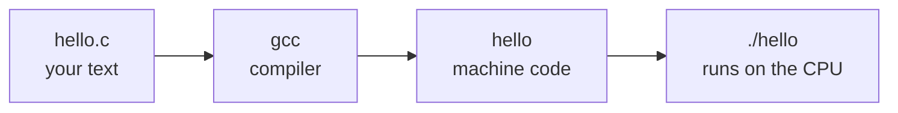

# Your first C program

C is one of the most important programming languages ever made. Linux, Windows, Python itself, game engines, the code in your car and your washing machine: much of it is written in C. Learning C teaches you **how a computer really works**: memory, bytes, and what your code turns into.

## What you need

You need a **compiler**, a program that turns your C code into a program the computer can run.

- **Linux:** you probably have it already. Open a terminal and type `gcc --version`. If it says "command not found", install it with `sudo apt install build-essential` (Ubuntu/Debian).
- **Windows:** install **MSYS2** (msys2.org), then in its terminal run `pacman -S mingw-w64-ucrt-x86_64-gcc`. Or use **WSL** (Windows Subsystem for Linux) and follow the Linux steps.
- **Mac:** run `xcode-select --install` in the Terminal.
- **No install at all:** use an online compiler such as onlinegdb.com or godbolt.org to start today.

Write your code in any editor. **VS Code** with the C/C++ extension is a good free choice.

## Hello, world

Create a file called `hello.c`:

<!-- diagram -->


```c
#include <stdio.h>

int main(void) {
    printf("Hello, world!\n");
    return 0;
}
```

```output
Hello, world!
```

Now compile and run it in the terminal, in the folder where the file is:

```
gcc hello.c -o hello
./hello
```

- `gcc hello.c -o hello` means: compile `hello.c` and call the result `hello`.
- `./hello` runs it. (On Windows it's `hello.exe`.)

## What each line means

- `#include <stdio.h>` brings in the **standard input/output** library, which contains `printf`.
- `int main(void)` is where every C program **starts**. `int` means it gives back a whole number when it finishes.
- `{` and `}` mark the start and end of the function's body.
- `printf("Hello, world!\n");` prints text. `\n` means **new line**. Every statement ends with a **semicolon** `;`.
- `return 0;` tells the operating system "finished, no errors".

## Compile errors are normal

Remove the semicolon after `printf(...)` and compile again. The compiler stops and tells you the **file, line and problem**, for example `hello.c:4:30: error: expected ';' before 'return'`. Read the first error first; later errors are often caused by it. Fixing compile errors is half of programming, so don't be discouraged.

Always compile with warnings on; they catch real bugs:

```
gcc -Wall -Wextra hello.c -o hello
```

## Comments

```c
// A comment on one line
/* A comment
   over several lines */
```

The compiler ignores comments. Use them to explain **why**, not what.

## Try it

Change the program so it prints your name on one line and your city on the next, using one `printf` per line.

**Answer:**

```c
#include <stdio.h>

int main(void) {
    printf("My name is Omar\n");
    printf("I live in Cairo\n");
    return 0;
}
```

```output
My name is Omar
I live in Cairo
```

## Optional videos

The lesson above is complete on its own. These videos go deeper, if you like learning by watching.

**CS50x 2024, Lecture 1: C (Harvard, David J. Malan)**

https://www.youtube.com/watch?v=cwtpLIWylAw

**C Programming Tutorial for Beginners (freeCodeCamp.org)**

https://www.youtube.com/watch?v=KJgsSFOSQv0
