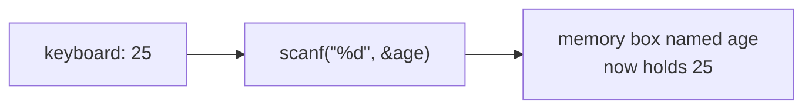

# Variables, types and input

A **variable** is a named box in memory that holds a value. In C, every variable has a **type** that says what kind of value it holds and how many bytes it uses.

## The basic types

| Type | Holds | Example | printf code |
|---|---|---|---|
| `int` | whole numbers | `int age = 25;` | `%d` |
| `double` | numbers with a decimal point | `double price = 9.99;` | `%f` (or `%.2f` for 2 decimals) |
| `char` | one character | `char grade = 'A';` | `%c` |
| `char[]` | text (a string) | `char name[] = "Sara";` | `%s` |

```c
#include <stdio.h>

int main(void) {
    int age = 25;
    double height = 1.72;
    char grade = 'A';
    char name[] = "Sara";

    printf("%s is %d years old.\n", name, age);
    printf("Height: %.2f m, grade: %c\n", height, grade);
    return 0;
}
```

```output
Sara is 25 years old.
Height: 1.72 m, grade: A
```

The `%d`, `%f`, `%c`, `%s` in the text are **placeholders**: `printf` replaces them, in order, with the values after the comma.

## Arithmetic

`+ - * /` work as you expect, plus `%` (remainder). One big trap: **dividing two ints gives an int**, and the decimal part is thrown away.

```c
#include <stdio.h>

int main(void) {
    int a = 7, b = 2;
    printf("%d / %d = %d\n", a, b, a / b);
    printf("%d %% %d = %d\n", a, b, a % b);
    printf("as a decimal: %.1f\n", (double)a / b);
    return 0;
}
```

```output
7 / 2 = 3
7 % 2 = 1
as a decimal: 3.5
```

`(double)a` converts `a` to a `double` first. This is called a **cast**. (`%%` prints a real `%` sign.)

## Changing variables

```c
int score = 10;
score = score + 5;   // now 15
score += 5;          // short form: now 20
score++;             // add one: now 21
```

`=` means "store", not "is equal". Read `score = score + 5` as "score becomes score plus 5".

## Constants

Use `const` for values that should never change: `const double PI = 3.14159;`. If you try to change it, the compiler refuses.

## Reading input with scanf

<!-- diagram -->


<!-- stdin: 30\n -->
```c
#include <stdio.h>

int main(void) {
    int age;
    printf("How old are you? ");
    scanf("%d", &age);
    printf("Next year you will be %d.\n", age + 1);
    return 0;
}
```

```output
How old are you? Next year you will be 31.
```

(When you type the answer yourself, it appears after the question.) Notice the **`&`** before `age`: it gives `scanf` the **address** of the variable so it can store the number there. You'll understand this fully in the pointers lesson; for now, use `&` with `scanf` for numbers and characters.

## How big is each type?

`sizeof` tells you how many bytes a type uses. On a normal 64-bit computer, `int` is usually 4 bytes and `double` 8. An `int` of 4 bytes can hold numbers up to about 2.1 billion; go beyond that and it **overflows**, which is a real source of bugs.

## Try it

Write a program that reads the price of an item and a quantity, and prints the total with 2 decimals.

**Answer:**

<!-- stdin: 2.5 4\n -->
```c
#include <stdio.h>

int main(void) {
    double price;
    int qty;
    printf("Price and quantity: ");
    scanf("%lf %d", &price, &qty);
    printf("Total: %.2f\n", price * qty);
    return 0;
}
```

```output
Price and quantity: Total: 10.00
```

Note: to **read** a `double` with `scanf`, use `%lf`; to print it with `printf`, `%f` is fine.

## Optional videos

The lesson above is complete on its own. These videos go deeper, if you like learning by watching.

**CS50x 2024, Lecture 1: C (Harvard, David J. Malan)**

https://www.youtube.com/watch?v=cwtpLIWylAw
