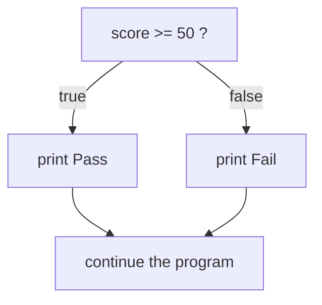

# Making decisions: if, else and switch

Programs become useful when they can choose what to do.

## if and else

<!-- diagram -->


```c
#include <stdio.h>

int main(void) {
    int temperature = 31;

    if (temperature > 30) {
        printf("It's hot. Drink water.\n");
    } else if (temperature > 15) {
        printf("Nice weather.\n");
    } else {
        printf("Take a jacket.\n");
    }
    return 0;
}
```

```output
It's hot. Drink water.
```

The condition goes in **parentheses**, and the code to run goes in **braces**. C checks the conditions from top to bottom and runs only the **first** one that's true.

## Comparison and logic

| Operator | Meaning |
|---|---|
| `==` | equal to (two equals signs!) |
| `!=` | not equal to |
| `<`, `>`, `<=`, `>=` | less, greater, less or equal, greater or equal |
| `&&` | and: both must be true |
| `\|\|` | or: at least one must be true |
| `!` | not |

```c
if (age >= 18 && hasTicket) { ... }
if (day == 6 || day == 7) { ... }
```

**The classic bug:** writing `if (x = 5)` instead of `if (x == 5)`. The first one **stores** 5 in `x` and is always true. With `-Wall`, gcc warns you about it.

## True and false in C

In C, **0 means false and any other number means true**. Comparisons give 1 (true) or 0 (false). Since C99 you can also `#include <stdbool.h>` and use `bool`, `true` and `false`, which makes code clearer.

## switch

When you compare one variable against many fixed values, `switch` is neater:

```c
#include <stdio.h>

int main(void) {
    int day = 3;
    switch (day) {
        case 1: printf("Monday\n"); break;
        case 2: printf("Tuesday\n"); break;
        case 3: printf("Wednesday\n"); break;
        default: printf("Another day\n");
    }
    return 0;
}
```

```output
Wednesday
```

Don't forget **`break`**: without it, C keeps running the next cases too (this is called "falling through").

## The ternary operator

A short if/else that gives a value: `condition ? value_if_true : value_if_false`.

```c
int max = (a > b) ? a : b;
```

## Try it

Write a program that reads a mark from 0 to 100 and prints the grade: 90+ A, 80+ B, 70+ C, 60+ D, below 60 F. Print "invalid" for numbers outside 0–100.

**Answer:**

<!-- stdin: 84\n -->
```c
#include <stdio.h>

int main(void) {
    int mark;
    scanf("%d", &mark);
    if (mark < 0 || mark > 100) {
        printf("invalid\n");
    } else if (mark >= 90) {
        printf("A\n");
    } else if (mark >= 80) {
        printf("B\n");
    } else if (mark >= 70) {
        printf("C\n");
    } else if (mark >= 60) {
        printf("D\n");
    } else {
        printf("F\n");
    }
    return 0;
}
```

```output
B
```

## Optional videos

The lesson above is complete on its own. These videos go deeper, if you like learning by watching.

**CS50x 2024, Lecture 1: C (Harvard, David J. Malan)**

https://www.youtube.com/watch?v=cwtpLIWylAw
