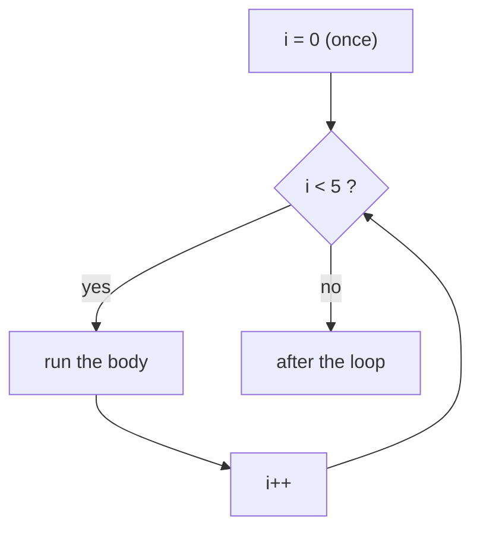

# Loops: while and for

A **loop** repeats code. Computers are great at doing the same thing a million times without getting bored.

## while

`while` repeats as long as a condition is true:

```c
#include <stdio.h>

int main(void) {
    int count = 1;
    while (count <= 5) {
        printf("%d ", count);
        count++;
    }
    printf("\n");
    return 0;
}
```

```output
1 2 3 4 5 
```

If you forget `count++`, the condition stays true forever: an **infinite loop**. Press **Ctrl+C** in the terminal to stop a stuck program.

## for

`for` puts the start, the condition and the step on one line. It's the most common loop when you know how many times to repeat:

<!-- diagram -->


```c
#include <stdio.h>

int main(void) {
    for (int i = 1; i <= 10; i++) {
        printf("7 x %d = %d\n", i, 7 * i);
    }
    return 0;
}
```

```output
7 x 1 = 7
7 x 2 = 14
7 x 3 = 21
7 x 4 = 28
7 x 5 = 35
7 x 6 = 42
7 x 7 = 49
7 x 8 = 56
7 x 9 = 63
7 x 10 = 70
```

Read it as: start with `i = 1`; while `i <= 10`, run the body, then do `i++`.

## do-while

Runs the body **at least once**, then checks. Useful for menus and input checking:

```c
int n;
do {
    printf("Enter a positive number: ");
    scanf("%d", &n);
} while (n <= 0);
```

## break and continue

- `break` leaves the loop immediately.
- `continue` skips to the next round.

```c
#include <stdio.h>

int main(void) {
    for (int i = 1; i <= 10; i++) {
        if (i % 2 == 0) continue;   // skip even numbers
        if (i > 7) break;           // stop after 7
        printf("%d ", i);
    }
    printf("\n");
    return 0;
}
```

```output
1 3 5 7 
```

## Loops inside loops

```c
#include <stdio.h>

int main(void) {
    for (int row = 1; row <= 3; row++) {
        for (int col = 1; col <= row; col++) {
            printf("*");
        }
        printf("\n");
    }
    return 0;
}
```

```output
*
**
***
```

## Try it

Write a program that adds up all the numbers from 1 to 100 and prints the total.

**Answer:**

```c
#include <stdio.h>

int main(void) {
    int total = 0;
    for (int i = 1; i <= 100; i++) {
        total += i;
    }
    printf("%d\n", total);
    return 0;
}
```

```output
5050
```

## Optional videos

The lesson above is complete on its own. These videos go deeper, if you like learning by watching.

**CS50x 2024, Lecture 1: C (Harvard, David J. Malan)**

https://www.youtube.com/watch?v=cwtpLIWylAw
