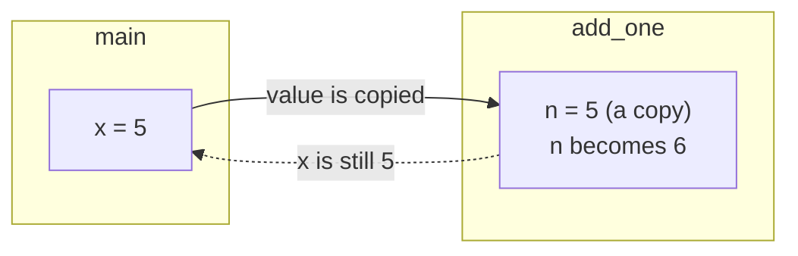

# Functions

A **function** is a named piece of code you can use again and again. You've already used `printf` and `main`. Now you'll write your own.

## Writing a function

```c
#include <stdio.h>

int square(int x) {
    return x * x;
}

int main(void) {
    printf("%d\n", square(4));
    printf("%d\n", square(9));
    return 0;
}
```

```output
16
81
```

- `int` before the name is the **return type**: what the function gives back.
- `(int x)` is the **parameter**: the input. When you call `square(4)`, `x` is 4 inside the function.
- `return` sends the result back to whoever called it.

## Functions that return nothing

Use `void` when a function only does something and returns no value:

```c
#include <stdio.h>

void greet(const char name[], int times) {
    for (int i = 0; i < times; i++) {
        printf("Hello, %s!\n", name);
    }
}

int main(void) {
    greet("Lina", 2);
    return 0;
}
```

```output
Hello, Lina!
Hello, Lina!
```

## Declare before use

C reads your file from top to bottom. If `main` calls a function that's written **below** it, put a **prototype** (just the first line, with a semicolon) above `main`:

```c
#include <stdio.h>

double average(int a, int b);   // prototype

int main(void) {
    printf("%.1f\n", average(3, 4));
    return 0;
}

double average(int a, int b) {
    return (a + b) / 2.0;
}
```

```output
3.5
```

(Dividing by `2.0`, a `double`, avoids the integer-division trap.)

## Copies, not originals

When you pass a variable to a function, C passes a **copy** of its value. Changing the parameter doesn't change the original:

<!-- diagram -->


```c
#include <stdio.h>

void addTen(int n) {
    n += 10;
}

int main(void) {
    int score = 5;
    addTen(score);
    printf("%d\n", score);
    return 0;
}
```

```output
5
```

To let a function change your variable, you'll pass its **address**: that's what pointers are for (Module 4).

## Scope

A variable created inside a function (or inside `{ }`) exists only there. It's **local**. Two functions can each have their own `i` without interfering. Variables outside all functions are **global**; avoid them when you can, because any function can change them and bugs get hard to find.

## Recursion

A function can call itself. It needs a **base case** to stop:

```c
#include <stdio.h>

long factorial(int n) {
    if (n <= 1) return 1;          // base case
    return n * factorial(n - 1);   // calls itself with a smaller n
}

int main(void) {
    printf("%ld\n", factorial(10));
    return 0;
}
```

```output
3628800
```

## Why functions matter

Small functions with clear names make programs easy to read, test and fix. A good rule: if you can't describe what a function does in one sentence, split it.

## Try it

Write a function `int isEven(int n)` that returns 1 if `n` is even and 0 otherwise, and use it to print the even numbers from 1 to 10.

**Answer:**

```c
#include <stdio.h>

int isEven(int n) {
    return n % 2 == 0;
}

int main(void) {
    for (int i = 1; i <= 10; i++) {
        if (isEven(i)) printf("%d ", i);
    }
    printf("\n");
    return 0;
}
```

```output
2 4 6 8 10 
```

## Optional videos

The lesson above is complete on its own. These videos go deeper, if you like learning by watching.

**CS50x 2024, Lecture 1: C (Harvard, David J. Malan)**

https://www.youtube.com/watch?v=cwtpLIWylAw
