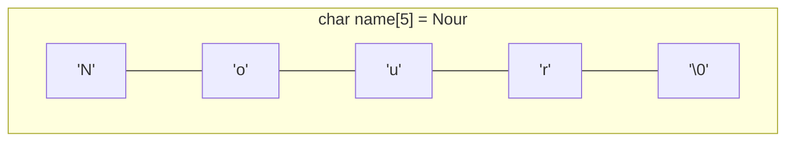

# Arrays and strings

## Arrays

An **array** holds several values of the same type, side by side in memory:

```c
#include <stdio.h>

int main(void) {
    int marks[5] = {70, 85, 90, 65, 80};
    int total = 0;

    for (int i = 0; i < 5; i++) {
        total += marks[i];
    }
    printf("First: %d, last: %d\n", marks[0], marks[4]);
    printf("Average: %.1f\n", total / 5.0);
    return 0;
}
```

```output
First: 70, last: 80
Average: 78.0
```

- Indexes start at **0**: an array of 5 has positions 0 to 4.
- **C does not check the bounds.** Writing `marks[5]` or `marks[100]` compiles, then reads or overwrites random memory. This is one of the most famous sources of bugs and security holes in C. Always make sure your index is valid.

A common trick to get the length of an array (only where it was declared):

```c
int count = sizeof(marks) / sizeof(marks[0]);
```

## Passing arrays to functions

An array passed to a function is **not copied**: the function works on the original. Because the function can't know the length, pass it too:

```c
#include <stdio.h>

int largest(const int values[], int n) {
    int best = values[0];
    for (int i = 1; i < n; i++) {
        if (values[i] > best) best = values[i];
    }
    return best;
}

int main(void) {
    int temps[] = {21, 25, 19, 30, 27};
    printf("%d\n", largest(temps, 5));
    return 0;
}
```

```output
30
```

`const` promises the function won't change the array.

## Strings are char arrays

C has no special string type. A string is an array of `char` that ends with a hidden **null character** `'\0'`, which marks the end:

<!-- diagram -->


```
"Sara"  →  'S' 'a' 'r' 'a' '\0'   (5 chars)
```

So `char name[5]` can hold a name of at most 4 letters.

The `<string.h>` library has the basic string tools:

```c
#include <stdio.h>
#include <string.h>

int main(void) {
    char first[20] = "Ahmed";
    char full[40];

    printf("Length: %zu\n", strlen(first));
    strcpy(full, first);          // copy
    strcat(full, " Hassan");      // add to the end
    printf("%s\n", full);
    if (strcmp(first, "Ahmed") == 0) {
        printf("Same text\n");
    }
    return 0;
}
```

```output
Length: 5
Ahmed Hassan
Same text
```

- `strlen` counts letters (not the `'\0'`).
- Compare strings with **`strcmp`**, never with `==` (that compares addresses).
- `strcpy` and `strcat` don't check the space you have. Make sure the destination is big enough, or use `snprintf`, which never writes past the size you give it:

```c
snprintf(full, sizeof(full), "%s %s", first, "Hassan");
```

## Reading a line of text

`scanf("%s")` stops at the first space. To read a whole line safely, use `fgets`:

<!-- stdin: Mona Ali\n -->
```c
#include <stdio.h>
#include <string.h>

int main(void) {
    char line[50];
    printf("Your full name: ");
    fgets(line, sizeof(line), stdin);
    line[strcspn(line, "\n")] = '\0';   // remove the newline fgets keeps
    printf("Hello, %s!\n", line);
    return 0;
}
```

```output
Your full name: Hello, Mona Ali!
```

## 2D arrays

```c
int grid[3][4];   // 3 rows, 4 columns
grid[1][2] = 7;   // row 1, column 2
```

## Try it

Write a function that counts how many times a character appears in a string, and test it with "banana" and 'a'.

**Answer:**

```c
#include <stdio.h>

int countChar(const char s[], char c) {
    int count = 0;
    for (int i = 0; s[i] != '\0'; i++) {
        if (s[i] == c) count++;
    }
    return count;
}

int main(void) {
    printf("%d\n", countChar("banana", 'a'));
    return 0;
}
```

```output
3
```

## Optional videos

The lesson above is complete on its own. These videos go deeper, if you like learning by watching.

**CS50x 2024, Lecture 2: Arrays (Harvard)**

https://www.youtube.com/watch?v=4vU4aEFmTSo
