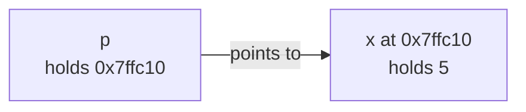

# Pointers: addresses in memory

Pointers are the part of C people fear most. They're simpler than their reputation: a **pointer is a variable that holds a memory address**.

## Every variable has an address

Your computer's memory is a long row of numbered bytes. Each variable lives at some address. The `&` operator gives you that address:

```c
#include <stdio.h>

int main(void) {
    int age = 30;
    printf("value: %d\n", age);
    printf("size: %zu bytes\n", sizeof age);
    return 0;
}
```

```output
value: 30
size: 4 bytes
```

(You can print the address itself with `printf("%p\n", (void *)&age);`. You'll see something like `0x7ffd5e8a3c4c`; it changes every run.)

## Pointer variables

<!-- diagram -->


```c
int age = 30;
int *p = &age;   // p is a "pointer to int", holding the address of age
```

- `int *p` declares a pointer to an `int`.
- `*p` (in an expression) means "**the value at the address in p**". This is called **dereferencing**.

```c
#include <stdio.h>

int main(void) {
    int age = 30;
    int *p = &age;

    printf("%d\n", *p);   // read through the pointer
    *p = 31;              // write through the pointer
    printf("%d\n", age);  // age changed!
    return 0;
}
```

```output
30
31
```

A picture helps:

```
 age            p
+------+      +-------------+
|  31  | <--- | address of  |
+------+      |    age      |
              +-------------+
```

## Why pointers? Changing a variable in a function

Remember that functions get copies. Pass a pointer, and the function can change the original:

```c
#include <stdio.h>

void addTen(int *n) {
    *n += 10;
}

void swap(int *a, int *b) {
    int tmp = *a;
    *a = *b;
    *b = tmp;
}

int main(void) {
    int score = 5;
    addTen(&score);
    printf("%d\n", score);

    int x = 1, y = 2;
    swap(&x, &y);
    printf("x=%d y=%d\n", x, y);
    return 0;
}
```

```output
15
x=2 y=1
```

Now you understand `scanf("%d", &age)`: `scanf` needs the address so it can store the number in your variable.

## Returning more than one result

A function can return only one value, but it can fill in several through pointers:

```c
#include <stdio.h>

void minMax(const int v[], int n, int *min, int *max) {
    *min = *max = v[0];
    for (int i = 1; i < n; i++) {
        if (v[i] < *min) *min = v[i];
        if (v[i] > *max) *max = v[i];
    }
}

int main(void) {
    int data[] = {4, 9, 1, 7};
    int lo, hi;
    minMax(data, 4, &lo, &hi);
    printf("min=%d max=%d\n", lo, hi);
    return 0;
}
```

```output
min=1 max=9
```

## NULL

A pointer that points nowhere should be set to **`NULL`**. Dereferencing `NULL` (or a pointer you never set) crashes the program with a "segmentation fault". Check before you use: `if (p != NULL) { ... }`.

## The three rules

1. `&x` = address of `x`.
2. `int *p` = p holds the address of an int.
3. `*p` = the value at that address.

## Try it

Write a function `void doubleIt(int *n)` that doubles the number it points to, and call it on a variable that holds 21.

**Answer:**

```c
#include <stdio.h>

void doubleIt(int *n) {
    *n *= 2;
}

int main(void) {
    int value = 21;
    doubleIt(&value);
    printf("%d\n", value);
    return 0;
}
```

```output
42
```

## Optional videos

The lesson above is complete on its own. These videos go deeper, if you like learning by watching.

**Introduction to pointers in C/C++ (mycodeschool)**

https://www.youtube.com/watch?v=h-HBipu_1P0

**Pointers as function arguments: call by reference (mycodeschool)**

https://www.youtube.com/watch?v=LW8Rfh6TzGg
