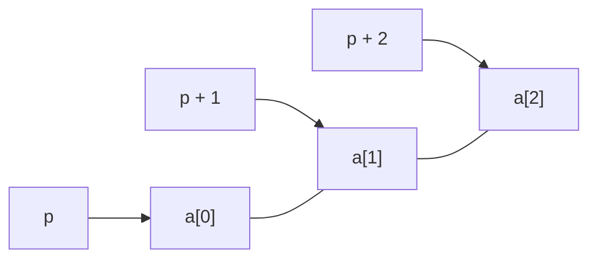

# Pointers and arrays

Pointers and arrays are close friends in C. Understanding how they connect explains a lot of C's behaviour.

## An array name is (almost) a pointer

When you use an array's name in an expression, it becomes a **pointer to its first element**:

```c
#include <stdio.h>

int main(void) {
    int nums[] = {10, 20, 30, 40};
    int *p = nums;          // same as &nums[0]

    printf("%d\n", *p);         // 10
    printf("%d\n", *(p + 1));   // 20
    printf("%d\n", p[2]);       // 30: p[i] means *(p + i)
    return 0;
}
```

```output
10
20
30
```

## Pointer arithmetic

`p + 1` doesn't add 1 byte: it moves to the **next element**. For an `int` (4 bytes), `p + 1` is 4 bytes further. That's why the pointer's type matters.

<!-- diagram -->


Walking through an array with a pointer:

```c
#include <stdio.h>

int main(void) {
    int nums[] = {3, 6, 9, 12};
    int n = 4;
    for (int *p = nums; p < nums + n; p++) {
        printf("%d ", *p);
    }
    printf("\n");
    return 0;
}
```

```output
3 6 9 12 
```

## Why functions don't know an array's length

When you pass an array to a function, only the **pointer to the first element** is passed. So these two are exactly the same:

```c
int sum(int values[], int n);
int sum(int *values, int n);
```

Inside the function, `sizeof(values)` is the size of a pointer (8 bytes), not of the array. That's why you always pass the length.

## Strings and pointers

A string literal can be pointed to directly:

```c
const char *greeting = "Hello";
```

Use `const` here: string literals live in read-only memory, and changing them crashes the program.

Here's `strlen` written by hand, walking with a pointer until the `'\0'`:

```c
#include <stdio.h>

size_t myStrlen(const char *s) {
    const char *start = s;
    while (*s != '\0') {
        s++;
    }
    return (size_t)(s - start);
}

int main(void) {
    printf("%zu\n", myStrlen("pointer"));
    return 0;
}
```

```output
7
```

Subtracting two pointers into the same array gives the number of elements between them.

## Arrays of strings

```c
#include <stdio.h>

int main(void) {
    const char *days[] = {"Mon", "Tue", "Wed"};
    for (int i = 0; i < 3; i++) {
        printf("%s\n", days[i]);
    }
    return 0;
}
```

```output
Mon
Tue
Wed
```

`days` is an array of 3 pointers, each pointing to a string.

## Common mistakes

- **Going past the end:** `p < nums + n` is fine; `*(nums + n)` reads past the array.
- **Returning a pointer to a local variable:** the local variable disappears when the function returns, and the pointer then points at garbage. You'll see how to create memory that survives in the next module.
- **Forgetting the `'\0'`** when building strings by hand.

## Try it

Write a function `void reverse(int *a, int n)` that reverses an array in place using two pointers, one at each end.

**Answer:**

```c
#include <stdio.h>

void reverse(int *a, int n) {
    int *left = a, *right = a + n - 1;
    while (left < right) {
        int tmp = *left;
        *left = *right;
        *right = tmp;
        left++;
        right--;
    }
}

int main(void) {
    int v[] = {1, 2, 3, 4, 5};
    reverse(v, 5);
    for (int i = 0; i < 5; i++) printf("%d ", v[i]);
    printf("\n");
    return 0;
}
```

```output
5 4 3 2 1 
```

## Optional videos

The lesson above is complete on its own. These videos go deeper, if you like learning by watching.

**Pointers and arrays (mycodeschool)**

https://www.youtube.com/watch?v=ASVB8KAFypk

**Pointers in C / C++, full course (freeCodeCamp.org)**

https://www.youtube.com/watch?v=zuegQmMdy8M
