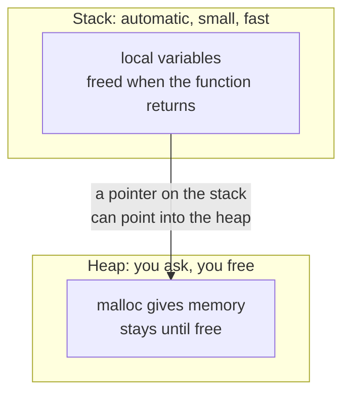

# Dynamic memory: malloc and free

So far, every array had a fixed size you chose when writing the code. But often you only know how much memory you need **while the program runs**: how many students the user will type, how big a file is. That's what **dynamic memory** is for.

## Stack and heap

- **The stack:** local variables live here. It's fast and automatic: memory is freed when the function returns.
- **The heap:** a big pool of memory you ask for yourself with `malloc` and give back with `free`. It lives until **you** free it.

<!-- diagram -->


## malloc and free

```c
#include <stdio.h>
#include <stdlib.h>

int main(void) {
    int n = 5;
    int *squares = malloc(n * sizeof(int));   // room for 5 ints
    if (squares == NULL) {
        printf("Out of memory\n");
        return 1;
    }

    for (int i = 0; i < n; i++) {
        squares[i] = i * i;
    }
    for (int i = 0; i < n; i++) {
        printf("%d ", squares[i]);
    }
    printf("\n");

    free(squares);      // give the memory back
    squares = NULL;     // don't keep a pointer to freed memory
    return 0;
}
```

```output
0 1 4 9 16 
```

- `malloc(bytes)` returns a pointer to that many bytes, or **`NULL`** if it fails. Always check.
- Multiply by `sizeof(type)`: you ask for **bytes**, not elements.
- Use the memory like an array.
- **Every `malloc` needs exactly one `free`.**

`calloc(n, sizeof(int))` does the same but fills the memory with zeros.

## Growing with realloc

`realloc` resizes a block, copying the old data if it has to move:

```c
#include <stdio.h>
#include <stdlib.h>

int main(void) {
    int capacity = 2, count = 0;
    int *list = malloc(capacity * sizeof(int));
    if (!list) return 1;

    for (int value = 10; value <= 50; value += 10) {
        if (count == capacity) {
            capacity *= 2;
            int *bigger = realloc(list, capacity * sizeof(int));
            if (!bigger) { free(list); return 1; }
            list = bigger;
        }
        list[count++] = value;
    }

    for (int i = 0; i < count; i++) printf("%d ", list[i]);
    printf("(capacity %d)\n", capacity);
    free(list);
    return 0;
}
```

```output
10 20 30 40 50 (capacity 8)
```

Doubling the capacity each time is how growing lists work in almost every language, including Python's lists and C++'s `vector`.

## The four classic memory bugs

| Bug | What happens |
|---|---|
| **Memory leak:** forgetting `free` | the program uses more and more memory |
| **Use after free:** using memory after `free` | random results or crashes |
| **Double free:** freeing the same block twice | crash or corruption |
| **Buffer overflow:** writing past the end | corrupts other data; a classic security hole |

## Let tools find them

You don't have to find these bugs by eye. Compile with **AddressSanitizer**, and the program stops with a clear report at the exact line:

```
gcc -Wall -Wextra -g -fsanitize=address,undefined program.c -o program
./program
```

On Linux, **Valgrind** does the same without recompiling: `valgrind ./program`. Use one of them every time you work with `malloc`. (Every example in this course was tested this way.)

## Returning memory from a function

Heap memory survives the function that created it, so it's safe to return:

```c
#include <stdio.h>
#include <stdlib.h>
#include <string.h>

char *repeat(const char *word, int times) {
    size_t len = strlen(word);
    char *out = malloc(len * times + 1);   // +1 for '\0'
    if (!out) return NULL;
    out[0] = '\0';
    for (int i = 0; i < times; i++) strcat(out, word);
    return out;   // the caller must free it
}

int main(void) {
    char *s = repeat("ha", 3);
    if (s) {
        printf("%s\n", s);
        free(s);
    }
    return 0;
}
```

```output
hahaha
```

Write in a comment who must free the memory. It's part of the function's contract.

## Try it

Read a number `n`, allocate an array of `n` doubles, fill it with `1.0, 1.5, 2.0, ...` (adding 0.5 each time), print their sum, and free the memory.

**Answer:**

<!-- stdin: 4\n -->
```c
#include <stdio.h>
#include <stdlib.h>

int main(void) {
    int n;
    if (scanf("%d", &n) != 1 || n <= 0) return 1;
    double *v = malloc(n * sizeof(double));
    if (!v) return 1;
    double sum = 0;
    for (int i = 0; i < n; i++) {
        v[i] = 1.0 + 0.5 * i;
        sum += v[i];
    }
    printf("%.1f\n", sum);
    free(v);
    return 0;
}
```

```output
7.0
```

## Optional videos

The lesson above is complete on its own. These videos go deeper, if you like learning by watching.

**Pointers and dynamic memory: stack vs heap (mycodeschool)**

https://www.youtube.com/watch?v=_8-ht2AKyH4

**Dynamic memory allocation in C: malloc, calloc, realloc, free (mycodeschool)**

https://www.youtube.com/watch?v=xDVC3wKjS64

**CS50x 2024, Lecture 4: Memory (Harvard)**

https://www.youtube.com/watch?v=F9-yqoS7b8w
