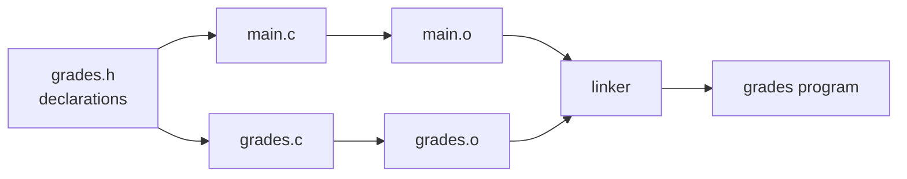

# Files and bigger programs

## Writing and reading files

```c
#include <stdio.h>

int main(void) {
    FILE *f = fopen("scores.txt", "w");   // "w" = write (creates or empties)
    if (f == NULL) {
        printf("Can't open the file\n");
        return 1;
    }
    fprintf(f, "Ali 90\nMona 85\nOmar 77\n");
    fclose(f);

    f = fopen("scores.txt", "r");          // "r" = read
    if (!f) return 1;
    char name[30];
    int score, total = 0, count = 0;
    while (fscanf(f, "%29s %d", name, &score) == 2) {
        printf("%s scored %d\n", name, score);
        total += score;
        count++;
    }
    fclose(f);
    printf("Average: %.1f\n", (double)total / count);
    return 0;
}
```

```output
Ali scored 90
Mona scored 85
Omar scored 77
Average: 84.0
```

- `fopen(name, mode)`: `"r"` read, `"w"` write (erases), `"a"` append (adds to the end). It returns `NULL` if it fails: always check.
- `fprintf` and `fscanf` work like `printf` and `scanf`, but with a file.
- `fscanf` returns how many values it read; the loop stops at the end of the file.
- `%29s` limits the name to 29 characters so it can't overflow the 30-char array.
- **Always `fclose`** when you're done.

To read a file line by line, use `fgets(line, sizeof line, f)` in a loop until it returns `NULL`.

## Splitting a program into files

As programs grow, you split them. A typical layout:

<!-- diagram -->


```
project/
  main.c        the program's start
  grades.h      declarations: what the module offers
  grades.c      definitions: how it works
```

`grades.h`:

```c
#ifndef GRADES_H
#define GRADES_H

double average(const int marks[], int n);
char letter(double avg);

#endif
```

The `#ifndef ... #endif` lines are an **include guard**: they stop the header from being included twice.

`grades.c`:

```c
#include "grades.h"

double average(const int marks[], int n) {
    int total = 0;
    for (int i = 0; i < n; i++) total += marks[i];
    return (double)total / n;
}

char letter(double avg) {
    if (avg >= 90) return 'A';
    if (avg >= 80) return 'B';
    if (avg >= 70) return 'C';
    return 'F';
}
```

`main.c`:

<!-- skip -->
```c
#include <stdio.h>
#include "grades.h"

int main(void) {
    int marks[] = {88, 92, 79};
    double avg = average(marks, 3);
    printf("%.1f %c\n", avg, letter(avg));
    return 0;
}
```

Compile both `.c` files together:

```
gcc -Wall -Wextra main.c grades.c -o grades
./grades
```

This prints `86.3 B`. Use `<...>` for system headers and `"..."` for your own.

## Make: build with one word

Typing long gcc commands gets old. A **Makefile** remembers them:

```make
CFLAGS = -Wall -Wextra -g

grades: main.c grades.c grades.h
	gcc $(CFLAGS) main.c grades.c -o grades
```

Now just type `make`. (The line under the target must start with a **tab**, not spaces.) Make only rebuilds when a file changed.

## Command-line arguments

`main` can receive what the user typed after the program name:

```c
#include <stdio.h>

int main(int argc, char *argv[]) {
    printf("%d arguments\n", argc);
    for (int i = 0; i < argc; i++) printf("argv[%d] = %s\n", i, argv[i]);
    return 0;
}
```

Running `./args hello 42` prints 3 arguments: `./args`, `hello` and `42`. Use `atoi(argv[2])` (from `<stdlib.h>`) to turn `"42"` into a number.

## Try it

Write a program that counts the lines in a file whose name is given as the first argument, printing an error if the file can't be opened.

**Answer:**

<!-- skip -->
```c
#include <stdio.h>

int main(int argc, char *argv[]) {
    if (argc < 2) {
        printf("Usage: %s FILE\n", argv[0]);
        return 1;
    }
    FILE *f = fopen(argv[1], "r");
    if (!f) {
        printf("Can't open %s\n", argv[1]);
        return 1;
    }
    int lines = 0, c;
    while ((c = fgetc(f)) != EOF) {
        if (c == '\n') lines++;
    }
    fclose(f);
    printf("%d lines\n", lines);
    return 0;
}
```

## Optional videos

The lesson above is complete on its own. These videos go deeper, if you like learning by watching.

**CS50x 2024, Lecture 4: Memory (Harvard)**

https://www.youtube.com/watch?v=F9-yqoS7b8w
