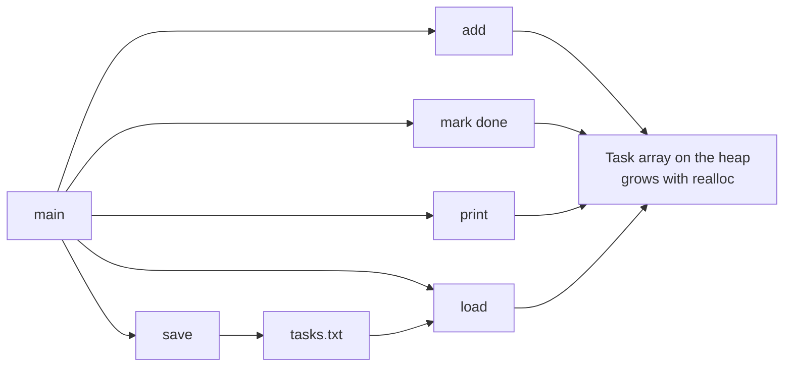

# Project and debugging: a small to-do manager

Time to put it all together: structs, dynamic memory, functions, loops and files. You'll build a command-line to-do list that saves to a file.

## The plan

- A `Task` struct with a title and a done flag.
- A growing array of tasks on the heap (like the `realloc` example).
- Functions: add, mark done, print, save, load.

<!-- diagram -->


## The code

```c
#include <stdio.h>
#include <stdlib.h>
#include <string.h>

typedef struct {
    char title[60];
    int done;
} Task;

typedef struct {
    Task *items;
    int count, capacity;
} TaskList;

int addTask(TaskList *list, const char *title) {
    if (list->count == list->capacity) {
        int cap = list->capacity ? list->capacity * 2 : 4;
        Task *bigger = realloc(list->items, cap * sizeof(Task));
        if (!bigger) return 0;
        list->items = bigger;
        list->capacity = cap;
    }
    Task *t = &list->items[list->count++];
    snprintf(t->title, sizeof t->title, "%s", title);
    t->done = 0;
    return 1;
}

void markDone(TaskList *list, int index) {
    if (index >= 0 && index < list->count) list->items[index].done = 1;
}

void printTasks(const TaskList *list) {
    for (int i = 0; i < list->count; i++) {
        printf("%d. [%c] %s\n", i + 1, list->items[i].done ? 'x' : ' ', list->items[i].title);
    }
}

int saveTasks(const TaskList *list, const char *path) {
    FILE *f = fopen(path, "w");
    if (!f) return 0;
    for (int i = 0; i < list->count; i++) {
        fprintf(f, "%d|%s\n", list->items[i].done, list->items[i].title);
    }
    fclose(f);
    return 1;
}

int loadTasks(TaskList *list, const char *path) {
    FILE *f = fopen(path, "r");
    if (!f) return 0;
    char line[80];
    while (fgets(line, sizeof line, f)) {
        line[strcspn(line, "\n")] = '\0';
        char *bar = strchr(line, '|');
        if (!bar) continue;
        *bar = '\0';
        if (addTask(list, bar + 1)) list->items[list->count - 1].done = atoi(line);
    }
    fclose(f);
    return 1;
}

int main(void) {
    TaskList list = {NULL, 0, 0};
    addTask(&list, "Buy groceries");
    addTask(&list, "Finish C course");
    addTask(&list, "Call grandma");
    markDone(&list, 1);
    saveTasks(&list, "tasks.txt");

    TaskList loaded = {NULL, 0, 0};
    loadTasks(&loaded, "tasks.txt");
    printTasks(&loaded);

    free(list.items);
    free(loaded.items);
    return 0;
}
```

```output
1. [ ] Buy groceries
2. [x] Finish C course
3. [ ] Call grandma
```

Read it slowly: every piece is something you learned. `snprintf` keeps long titles from overflowing; `strchr` finds the `|` that separates the done flag from the title.

## Make it interactive

Extend `main` with a menu loop: read a command (`add`, `done`, `list`, `quit`) with `fgets`, and call the right function. Save when the user quits and load when the program starts.

## Debugging like a professional

**1. Read the warnings.** Compile with `-Wall -Wextra`. Treat warnings as errors you haven't hit yet.

**2. Use the sanitizers** for memory bugs: `-fsanitize=address,undefined -g`. The report shows the exact line where you went wrong.

**3. Use a debugger.** `gdb` lets you stop the program and look inside:

```
gcc -g todo.c -o todo
gdb ./todo
(gdb) break addTask      stop when addTask is called
(gdb) run
(gdb) next               run one line
(gdb) print list->count  look at a value
(gdb) backtrace          which functions called this one
(gdb) continue
```

VS Code can do the same with buttons, using the C/C++ extension.

**4. Print, but wisely.** A `printf` before and after a suspicious line is still one of the fastest tools. Print to `stderr` (`fprintf(stderr, ...)`) so it doesn't mix with normal output.

## Where to go next

- **Assembly** (the next course in the systems path) shows what your C code becomes inside the CPU.
- **C++** and **Rust** build on everything here, with tools that prevent many of the memory bugs you met.
- Classic book: *The C Programming Language* by Kernighan and Ritchie. Free practice: exercism.org's C track.

## Try it

Add a function `int countDone(const TaskList *list)` and print "1 of 3 done" for the example above.

**Answer:**

```c
#include <stdio.h>

typedef struct { char title[60]; int done; } Task;
typedef struct { Task *items; int count, capacity; } TaskList;

int countDone(const TaskList *list) {
    int n = 0;
    for (int i = 0; i < list->count; i++) n += list->items[i].done;
    return n;
}

int main(void) {
    Task t[] = {{"Buy groceries", 0}, {"Finish C course", 1}, {"Call grandma", 0}};
    TaskList list = {t, 3, 3};
    printf("%d of %d done\n", countDone(&list), list.count);
    return 0;
}
```

```output
1 of 3 done
```

## Optional videos

The lesson above is complete on its own. These videos go deeper, if you like learning by watching.

**Debugging: GDB tutorial (Chris Bourke)**

https://www.youtube.com/watch?v=bWH-nL7v5F4
