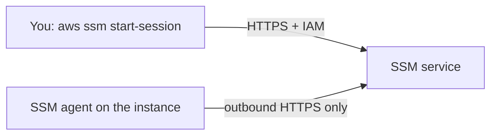

# Session Manager: shell access without SSH

**AWS Systems Manager (SSM) Session Manager** gives you a shell on an instance through the AWS API:



- **No inbound port 22**, no bastion, no SSH keys to manage.
- Access is controlled by **IAM** (who may start sessions to which instances, by tag).
- Every session can be **logged** to CloudWatch Logs or S3 and is recorded in CloudTrail.

## Requirements

1. The SSM agent (preinstalled on Amazon Linux and Ubuntu AMIs).
2. An instance role with `AmazonSSMManagedInstanceCore`.
3. Outbound HTTPS to the SSM endpoints: through a NAT gateway, or VPC interface endpoints (`ssm`, `ssmmessages`, `ec2messages`) for fully private subnets.

```bash
aws ssm describe-instance-information --query 'InstanceInformationList[].[InstanceId,PingStatus,PlatformName]' --output table
aws ssm start-session --target i-0abc123
# Port forwarding to a database behind the instance, like ssh -L:
aws ssm start-session --target i-0abc123 --document-name AWS-StartPortForwardingSessionToRemoteHost \
  --parameters '{"host":["mydb.xxxx.rds.amazonaws.com"],"portNumber":["5432"],"localPortNumber":["5433"]}'
```

## Still want SSH tools?

ssh, scp and rsync can run **over** Session Manager with a ProxyCommand, so your SSH course skills still apply without opening port 22:

```text
Host i-* mi-*
  ProxyCommand sh -c "aws ssm start-session --target %h --document-name AWS-StartSSHSession --parameters 'portNumber=%p'"
```

## Run Command

Run one command on many instances at once (by tag), with output collected for you:

```bash
aws ssm send-command --document-name AWS-RunShellScript --targets Key=tag:env,Values=staging \
  --parameters 'commands=["uptime","df -h /"]'
```
