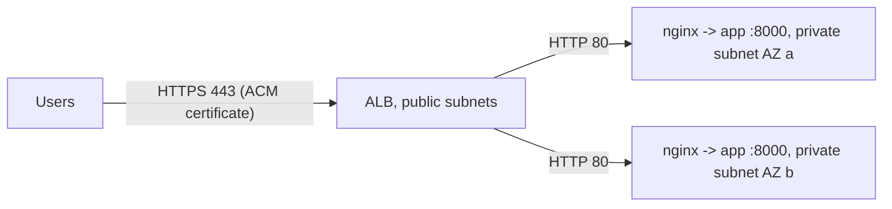

# Serving an app: nginx behind a load balancer with TLS



TLS ends at the load balancer, with a free, auto-renewing certificate from **ACM**. The instances don't need certificates at all (encrypt behind the ALB too if your rules demand it).

## The app as a systemd service

```ini
# /etc/systemd/system/app.service
[Unit]
Description=Shop API
After=network-online.target
[Service]
User=app
EnvironmentFile=/etc/app/env
ExecStart=/opt/app/venv/bin/gunicorn -b 127.0.0.1:8000 app:app
Restart=on-failure
[Install]
WantedBy=multi-user.target
```

## nginx in front

```nginx
server {
    listen 80;
    location = /health { return 200 "ok\n"; }
    location / {
        proxy_pass http://127.0.0.1:8000;
        proxy_set_header Host $host;
        proxy_set_header X-Forwarded-For $proxy_add_x_forwarded_for;
        proxy_set_header X-Forwarded-Proto $http_x_forwarded_proto;
    }
}
```

`set_real_ip_from 10.0.0.0/16; real_ip_header X-Forwarded-For;` makes nginx's logs show users' real IPs instead of the ALB's.

## Security groups

- ALB: 443 (and 80, redirected) from `0.0.0.0/0`.
- Instances: 80 **from the ALB security group only**. No 22.

A `/health` that checks only nginx says "the server is up"; one that also pings the app (and maybe the database) says "this server can serve users". Choose deliberately: too deep, and a database blip marks every instance unhealthy at once.
