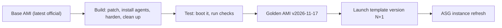

# Golden AMIs

A **golden AMI** is your own image with the OS patched and your common setup baked in: agents, hardening, users, packages. Instances boot ready in seconds instead of installing for minutes.



## Ways to build

| Tool | Notes |
|---|---|
| **EC2 Image Builder** | AWS-managed pipelines, components, tests, schedules, sharing across accounts |
| **Packer** (HashiCorp) | Images as code, works for every cloud and VirtualBox; fits next to Terraform |
| By hand: `aws ec2 create-image` | Fine for learning; not repeatable |

## What goes in, what doesn't

| Bake in | Keep out |
|---|---|
| OS updates, CloudWatch and SSM agents | Secrets of any kind |
| Your hardening (SSH config, sysctl, auditd) | Per-environment config (fetch at boot) |
| Runtime: Python, Node, nginx | SSH host keys and machine-id (cloud-init regenerates them; clean them up before imaging) |
| Your app (optional: "immutable" images) | Logs and shell history |

```bash
sudo cloud-init clean --logs --machine-id   # before creating an image by hand
aws ec2 create-image --instance-id i-0abc --name "shop-base-$(date +%F)" --no-reboot
```

Version your AMIs by date, keep the last few, and deregister old ones (and delete their snapshots).
