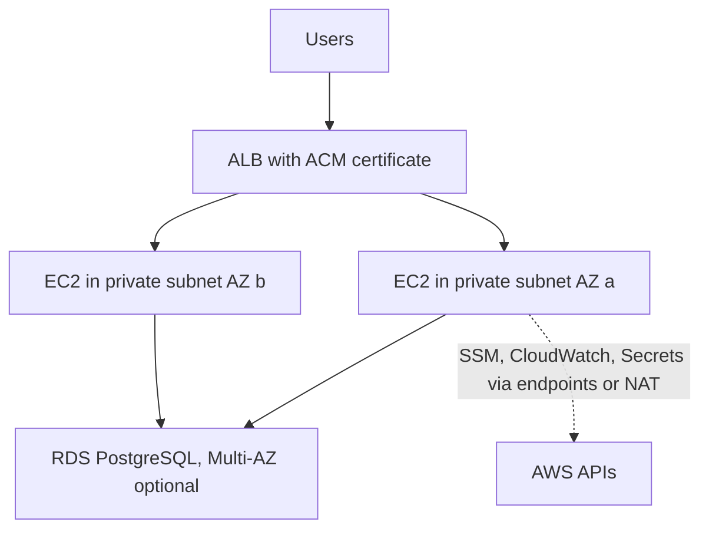

# Capstone: a production-style app on EC2

Build it, break it, fix it, then delete it.

## Requirements

1. VPC with public subnets (ALB, NAT) and private subnets (app, database) in 2 AZs.
2. Golden AMI (or user data) with nginx, the app as a systemd service, CloudWatch and SSM agents.
3. Auto Scaling group of 2 behind the ALB, `/health` check, HTTPS only.
4. **No port 22 anywhere**; all admin through Session Manager, sessions logged.
5. App reads its database password from Secrets Manager at boot.
6. CloudWatch: memory and disk metrics, nginx logs with 14-day retention, two alarms.
7. AWS Backup plan for the database by tag.
8. A patching approach (Patch Manager or new AMI + instance refresh), written down.

## Break and fix (do at least three)

- Remove the ALB rule from the app security group: what do you see? Fix it.
- Fill the disk on one instance (`fallocate -l 5G /data/big`): does the alarm fire?
- Stop the app service on one instance: does the ASG replace it, or does the ALB just route around it?
- Delete the instance role's Secrets Manager permission and reboot: find the error in CloudTrail.

## Clean up and report

Delete everything (NAT gateway, ALB, RDS and snapshots, EIPs, AMIs). Write a one-page runbook: how to deploy, patch, restore, and get a shell.
