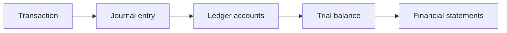

## Why we start here

Section A of your guide assumes you already know what a debit is. Most beginners do not, and that
single gap makes the first fifty pages feel like a foreign language. So this first module builds the
floor before we walk on it. Nothing here is wasted: every later unit uses these words.

## 1. What accounting actually does

Accounting records what a business owns, owes, earns and spends, then turns those records into
reports other people can trust. Three ideas cover most of it:

| 💡 Idea | 🧠 Plain meaning | 💡 Everyday example |
|---|---|---|
| Entity | The business is separate from its owner | The shop's cash is not the owner's pocket money |
| Money measurement | Only things measurable in money are recorded | A great team is valuable, but not on the balance sheet |
| Double entry | Every transaction touches two places | Buy stock for cash: stock up, cash down |

## 2. The accounting equation

Every business, from a kiosk to a multinational, obeys one line:

> **Assets = Liabilities + Equity**

| 🧾 Word | 🧠 Meaning | 💡 Example |
|---|---|---|
| Assets | Things the business owns or is owed | Cash, stock, machines, money owed by customers |
| Liabilities | What the business owes to outsiders | Bank loan, unpaid supplier bills |
| Equity | What belongs to the owners | Money put in plus profits kept in the business |

**Worked example:** Sara starts a bakery with $20,000 of her own money and a $30,000 bank loan.
She buys an oven for $25,000 and stock for $10,000.
Assets = 25,000 (oven) + 10,000 (stock) + 15,000 (cash) = 50,000.
Liabilities = 30,000. Equity = 20,000. Check: 50,000 = 30,000 + 20,000 ✓.

## 3. Accounts, debits and credits

An **account** is a labelled box that collects similar transactions (Cash, Inventory, Sales).
Every account has a left side and a right side:

| 🏷️ Account type | ➕ Increases on the... | ➖ Decreases on the... | 🧠 Memory trick |
|---|---|---|---|
| Asset | Debit (left) | Credit (right) | Assets like to be debited |
| Expense | Debit (left) | Credit (right) | Expenses behave like assets |
| Liability | Credit (right) | Debit (left) | Liabilities like to be credited |
| Equity | Credit (right) | Debit (left) | |
| Revenue | Credit (right) | Debit (left) | Revenue behaves like equity |

Debit simply means the left side. It does **not** mean good, bad, plus or minus. That is the single
most freeing sentence in beginner accounting.

**Worked example — three transactions, three pairs of entries:**

| 🧾 Transaction | 📝 Journal entry | 🧠 Effect |
|---|---|---|
| Sara puts in $20,000 cash | Dr Cash 20,000 / Cr Capital 20,000 | Asset up, equity up |
| Takes a $30,000 bank loan | Dr Cash 30,000 / Cr Loan 30,000 | Asset up, liability up |
| Buys stock for $10,000 cash | Dr Inventory 10,000 / Cr Cash 10,000 | One asset up, one down |

## 4. From entries to statements

The **trial balance** lists every account balance and proves total debits equal total credits. If they
do not, an entry was recorded on one side only. Then the balances are arranged into the statements:
income statement, balance sheet and cash flow statement — the subject of Module 2.

## 5. What you should be able to do now

| ✅ Skill | 🧪 Test yourself |
|---|---|
| Use the equation | Assets 90,000, liabilities 40,000 → equity? **50,000** |
| Choose debit or credit | Buy a van on credit: Dr Van, Cr Payable |
| Explain double entry | Two accounts change; total debits = total credits |

Keep these three words close for the rest of the course: **debit (left), credit (right), balance**.
