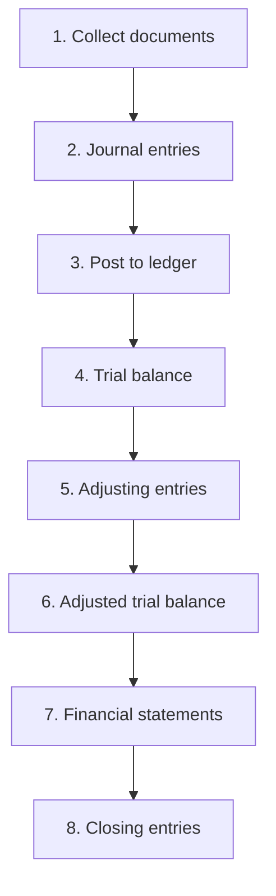

## 1. The accounting cycle in eight steps

The step beginners underestimate is **5, adjusting entries**: at period end we record things that
happened but were not yet written down, such as depreciation, unpaid wages and revenue earned but
not yet billed.

## 2. Accrual accounting versus cash accounting

| 🧮 Basis | 🧠 Rule | 💡 Example |
|---|---|---|
| Cash | Record when money moves | You pay rent in March: expense in March |
| **Accrual** | Record when the event happens | You sell in December, customer pays in February: revenue in December |

Accrual is what GAAP and IFRS require, and it creates the four adjusting types:

| 🔧 Adjustment | 🧠 Meaning | 💡 Example |
|---|---|---|
| Accrued revenue | Earned, not yet billed | Work finished, invoice not sent |
| Accrued expense | Incurred, not yet paid | December wages paid in January |
| Prepaid expense | Paid, not yet used | Insurance for next year |
| Unearned revenue | Cash received, not yet earned | Deposit for a course next month |

**Worked example:** a shop pays $12,000 in January for 12 months of insurance. In January it records
$1,000 of expense and keeps $11,000 as a prepaid asset. Each month, another $1,000 moves from asset to
expense. Profit is matched to the period that used the cover.

## 3. The vocabulary CMA uses constantly

| 🔤 Term | 🧠 Meaning | 🧠 Why the exam cares |
|---|---|---|
| Revenue vs gain | Revenue comes from normal trading; a gain is incidental | They appear in different places |
| Expense vs loss | Expense helps earn revenue; a loss is incidental or a write-down | Affects operating income |
| Gross profit | Sales − cost of goods sold | Shows pricing power |
| Operating income | Gross profit − operating expenses | Shows trading performance |
| Net income | Everything after interest and tax | Feeds EPS and retained earnings |
| Current vs non-current | Within one year or the operating cycle, or later | Drives ratio analysis |
| Book value | Cost − accumulated depreciation | Not the same as market value |
| Working capital | Current assets − current liabilities | Short-term financial health |

## 4. Two frameworks you must keep apart

| 🌍 Feature | 🇺🇸 US GAAP | 🌍 IFRS |
|---|---|---|
| Who sets it | FASB | IASB |
| Style | Rules and detailed guidance | Principles and judgement |
| Used by | US companies | Most of the world |
| Where differences bite | Inventory, impairment, development costs, contingencies | Same list, opposite answers |

The CMA exam tests **both**, and Section A ends with a comparison table you will meet in Module 4.
For now, remember: same transaction, two rulebooks, sometimes two different profit figures.

## 5. Ratios: the quick health check

| 📏 Ratio | 🧮 Formula | 💡 What it tells you |
|---|---|---|
| Current ratio | Current assets ÷ current liabilities | Can bills be paid this year? |
| Gross margin % | Gross profit ÷ sales | How much stays after product cost |
| Net margin % | Net income ÷ sales | Profit from every dollar of sales |
| Debt to equity | Total liabilities ÷ equity | How much is borrowed |
| Inventory turnover | COGS ÷ average inventory | How fast stock moves |

**Worked example:** current assets 120,000, current liabilities 80,000, sales 500,000, gross profit
200,000. Current ratio = **1.5**; gross margin = **40%**. Both are healthy-looking, but you would still
check the cash flow statement before celebrating.
