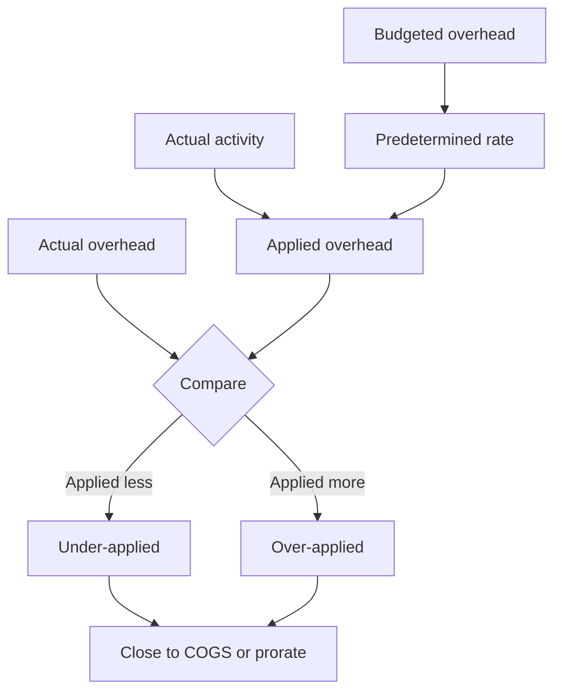

## 1. Where the balance comes from

Overhead is applied all year at a predetermined rate. At year end, applied and actual rarely agree.
Two causes:

| 🔍 Cause | 🧠 Explanation |
|---|---|
| Rate difference | Actual prices or spending differed from the budget |
| Volume difference | Actual activity differed from the budgeted activity base |

## 2. Disposing of the balance

| 📏 Materiality | 🧾 Treatment | 🧠 Effect |
|---|---|---|
| Immaterial | Close the whole amount to cost of goods sold | Simple, fast |
| Material | Prorate between WIP, finished goods and COGS | More accurate inventory values |

**Profit effects:** closing an **under-applied** balance to COGS **reduces** profit (costs were
understated all year). Closing an **over-applied** balance **increases** profit.

**Worked example:** applied 246,000, actual 251,000 → under-applied 5,000. If immaterial, debit COGS
5,000 and profit falls by 5,000. If material and inventory holds 20% of the year's cost, prorate:
1,000 to inventory, 4,000 to COGS.

## 3. The full overhead story

## 4. Section D first half in review

| 🎯 Question | 🧠 Answer pattern |
|---|---|
| What rate? | Budgeted overhead ÷ budgeted activity |
| What was charged? | Rate × actual activity |
| What went wrong? | Split budget (spending) from volume effect |
| Who should pay? | Support costs by direct, step-down or reciprocal |
| Capacity or usage? | Dual rate separates them |
