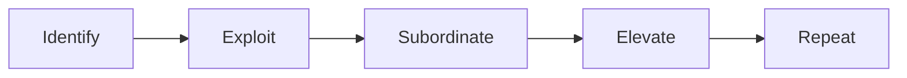

## 1. Supply chain and lean

**Supply chain management** coordinates every step from raw material to customer, aiming at the lowest
*total* cost, not the lowest purchase price.

| 🗑️ Waste | 💡 Example |
|---|---|
| Overproduction | Making before orders exist |
| Waiting | Parts queueing |
| Transport | Moving stock between sites |
| Over-processing | Inspecting three times |
| Inventory | Cash asleep in a warehouse |
| Motion | Walking to fetch tools |
| Defects | Rework and scrap |

**Just-in-time (JIT)** buys materials just before use.

| 👍 JIT | 👎 JIT |
|---|---|
| Less inventory and carrying cost | Vulnerable to supplier failure |
| Defects found faster | Needs reliable suppliers and forecasts |
| Less space, simpler flow | Small disruptions stop the line |

## 2. MRP, MRP II and ERP

| 🧾 System | 🧠 Plans |
|---|---|
| MRP | Materials and components from the master schedule and bill of materials |
| MRP II | MRP plus capacity, labour and machine hours |
| ERP | One integrated database for the whole enterprise |

**MRP example:** 100 bicycles, 2 wheels and 1 frame each, 30 wheels and 10 frames in stock → wheels
needed 170, frames needed 90.

## 3. Theory of constraints

| 💡 Term | 🧠 Meaning |
|---|---|
| Throughput | Sales revenue − direct material |
| Bottleneck | The step limiting total output |
| Buffer | Protection before the bottleneck |
| Rope | Paces material release into the bottleneck |

**Throughput costing** inventories only direct material, because in the short term it is the only truly
variable cost.

## 4. Capacity, outsourcing and improvement tools

| 📏 Capacity | 🧠 Meaning |
|---|---|
| Theoretical | Maximum with no interruptions |
| Practical | Achievable with normal downtime |
| Normal | Average demand over several periods |
| Budgeted | This period's plan |

**Make or buy:** compare the **avoidable** cost of making with the buying price, then weigh quality,
freed capacity, confidentiality and staff impact. Example: variable $18 + avoidable fixed $4 = $22
versus a $25 purchase price → keep making, unless freed capacity can earn more than $3 per unit.

| 🛠️ Tool | 🧠 What it does |
|---|---|
| Benchmarking | Compares with the best practice available |
| BPR | Radical redesign from scratch |
| Six Sigma (DMAIC) | Reduces variation and defects |
| Value chain analysis | Separates value-adding from non-value-adding |
| Kaizen | Many small improvements continuously |

## 5. Costs of quality

| 🏷️ Category | 💡 Example | 📉 Trend you want |
|---|---|---|
| Prevention | Training, supplier certification | Up |
| Appraisal | Inspection, testing | Down over time |
| Internal failure | Scrap, rework | Down |
| External failure | Warranty, returns, lost customers | Down hard |

**Worked example:** prevention 60,000 + appraisal 40,000 + internal failure 70,000 + external failure
130,000 = **$300,000**. On sales of $3,000,000 that is **10% of sales**. Spending more on prevention
usually cuts failure costs by more than it costs, and external failure is the most expensive category
because it includes customers you never win back.

## 6. Efficient accounting processes

Shared services, activity analysis inside finance, continuous close, standard charts of accounts,
automated reconciliations and exception reporting, and lean accounting all aim at the same thing:
fewer manual steps, faster and more reliable information.
