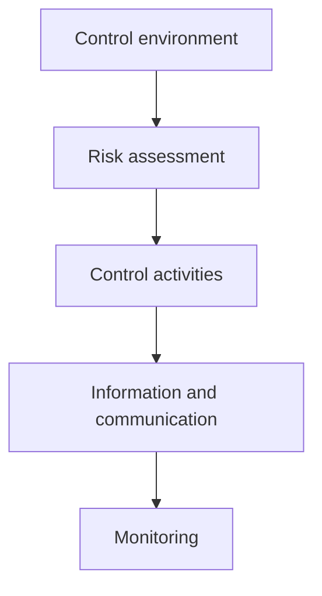

## 1. Governance: who watches the managers?

| 🏛️ Body | 🧠 Role | ✅ Good practice |
|---|---|---|
| Shareholders | Elect directors, approve auditors | Informed voting |
| Board | Strategy, oversight, appoints the CEO | Majority independent; chair ≠ CEO |
| Audit committee | Financial reporting, internal and external audit | Fully independent, with a financial expert |
| Management | Runs the business inside the controls | Clear accountability |
| Internal audit | Independent assurance | Reports to the audit committee |
| External auditor | Opinion on the statements | Answers to the audit committee |

Warning signs: a board dominated by the CEO, an audit committee member who is also a supplier, no
independent internal audit, and rewards based only on this year's profit.

## 2. COSO: the five components

| 🧩 Component | 🧠 Meaning | 💡 Example |
|---|---|---|
| Control environment | Culture, ethics, structure, authority | Code of conduct, board independence |
| Risk assessment | Identifying and analysing risks | Risk register, fraud risk assessment |
| Control activities | The specific procedures | Approvals, reconciliations, segregation |
| Information and communication | Timely information up, down and out | Reporting systems, whistleblower hotline |
| Monitoring | Checking the controls still work | Internal audit reviews, self-assessments |

The framework also contains **17 principles**; the exam rarely asks you to list them, but it often asks
you to place a described situation in the right component.

| 💬 Situation | 🧩 Component |
|---|---|
| The board adopts a code of ethics and trains staff | Control environment |
| Management assesses the risk of cyber attack | Risk assessment |
| Payments over $5,000 need a supervisor's approval | Control activities |
| Internal audit tests whether approvals happened | Monitoring |

## 3. Control activities

| 🛡️ Activity | 🧠 Prevents | 💡 Example |
|---|---|---|
| Segregation of duties | Committing and hiding a fraud | The buyer cannot also approve payment |
| Authorisation | Unauthorised spending | Signed purchase orders |
| Documentation | Disputes, unrecorded items | Pre-numbered invoices |
| Physical controls | Theft and loss | Locked stores, counts, access cards |
| Reconciliations | Errors and omissions | Monthly bank reconciliation |
| Performance reviews | Drift from plan | Budget vs actual reviews |

Three labels to know: **preventive** (stops it — approvals), **detective** (finds it — reconciliations,
audits) and **corrective** (fixes it — restore a backup, discipline staff).

Two limits on any control system: it must **cost less than the loss it prevents**, and it gives
**reasonable assurance**, not absolute assurance, because of collusion between people, management
override, human error and cost limits.
