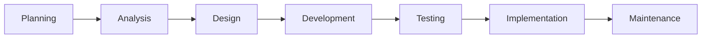

## 1. Data governance

| 👤 Role | 🧠 Responsible for |
|---|---|
| Data owner | Accountability for a data domain |
| Data steward | Quality, definitions, day-to-day fixes |
| Data custodian | Storage, access, backups |

| 🎯 Quality dimension | 💡 Failure example |
|---|---|
| Accuracy | Wrong price on an invoice |
| Completeness | Missing country code |
| Consistency | Two IDs for one customer |
| Timeliness | Yesterday's stock report used today |
| Validity | An impossible date |
| Uniqueness | Same supplier entered four times |

Related ideas: master data management (one golden record), data lineage, privacy, retention and the data
lifecycle.

## 2. Cyber threats and controls

| ⚠️ Threat | 💡 Warning sign |
|---|---|
| Phishing | Urgent message from an odd address |
| Ransomware | Files suddenly encrypted |
| Social engineering | A "supplier" calling to change bank details |
| Insider threat | Unusual downloads by a leaver |
| Weak access management | Shared admin passwords |

Controls: multi-factor authentication, least privilege, patching, encryption, monitoring, awareness
training, tested backups, an incident plan and vendor due diligence. Order of impact: **people, then
process, then technology**.

## 3. The system development life cycle

| 🪜 Phase | 🛡️ Control focus |
|---|---|
| Planning | Business case approval |
| Analysis | Documented requirements, user involvement |
| Design | Controls and audit trail designed in |
| Development | Change control, separate environments |
| Testing | Unit, integration, system, user acceptance testing |
| Implementation | Data conversion checks, training |
| Maintenance | Version control, re-testing |

| 🚀 Approach | 👍 / 👎 |
|---|---|
| Direct (big bang) | Fastest, riskiest |
| Parallel | Safest, most expensive |
| Phased | Balanced, slower |
| Pilot | Learn before rollout |

Two rules: no developer should touch live production data, and no system goes live without user
acceptance testing and a conversion reconciliation.

## 4. Finance transformation

| 🤖 Technology | 🧠 What it does |
|---|---|
| RPA | Software robots handle repetitive rule-based tasks |
| AI / machine learning | Predicts, classifies and flags anomalies |
| Cloud | Systems delivered over the internet |
| Blockchain | Shared, tamper-evident ledger |
| Continuous close | Records and reconciles continuously |

**Worked example:** invoices arrive → RPA extracts data → machine learning flags odd amounts → ERP posts
against purchase orders → a dashboard shows exceptions. The control shifts from checking every invoice
to designing the rules and investigating exceptions.
