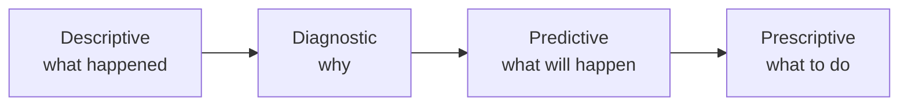

## 1. Big data and business intelligence

| 🅥 V | 🧠 Meaning |
|---|---|
| Volume | How much data |
| Velocity | How fast it arrives |
| Variety | How many formats |
| Veracity | How trustworthy it is |
| Value | What insight it produces |

## 2. The four types of analytics

| 🧠 Type | 💡 Finance example | 📊 Technique |
|---|---|---|
| Descriptive | Monthly margin report | Ratios, dashboards |
| Diagnostic | Why did material cost jump? | Drill-down, variance analysis |
| Predictive | Forecast next quarter's cash | Regression, time series, ML |
| Prescriptive | Best supplier mix | Optimisation, simulation |

**Descriptive reports, diagnostic explains, predictive guesses, prescriptive recommends.**

## 3. Data mining, cleaning and statistics

| 🔎 Technique | 🧠 What it does |
|---|---|
| Classification | Assigns items to known groups (fraud / not fraud) |
| Clustering | Finds natural groups without labels |
| Regression | Fits a relationship |
| Association rules | Finds items that occur together |

Cleaning is most of the work: remove duplicates, handle missing values, find outliers, standardise
formats, validate, and document the logic.

| 📏 Statistic | 💡 When it matters |
|---|---|
| Mean | Sensitive to outliers |
| Median | Better for skewed data such as salaries |
| Standard deviation | Spread and consistency |
| Correlation | Which drivers move together |

**Worked example:** costs 90, 95, 100, 105, 100, 110, 100, 900, 105. Mean = 189.4 (nonsense, the 900 is
an error); median = 100 and mode = 100 describe reality. Always hunt outliers before trusting an
average.

## 4. Models and visualisation

| 🧮 Model | 💡 Use |
|---|---|
| What-if / sensitivity | Change one input, watch the outcome |
| Scenario | Compare complete futures |
| Monte Carlo simulation | Many random runs |
| Optimisation | Best answer under constraints |
| Decision tree | Choices, chances and payoffs |

**Decision tree example:** 60% chance of 200,000 profit and 40% chance of a 50,000 loss → expected value
= 120,000 − 20,000 = **$100,000**.

| 🎯 Show | 📊 Best chart | ⚠️ Avoid |
|---|---|---|
| Change over time | Line | Pie charts |
| Compare categories | Bar | 3D effects |
| Part of a whole | Pie or stacked bar (few slices) | A pie with 12 slices |
| Relationship | Scatter | Bar chart |
| Distribution | Histogram | Averages alone |

Distortions to spot: truncated axes, inconsistent scales, 3D perspective, cherry-picked periods and
decoration that hides the data.

## 5. Analytics inside finance

| 🎯 Task | 📊 Applied analytics |
|---|---|
| Forecasting | Time series and driver-based models |
| Cost control | Variance drill-down |
| Profitability | Contribution and cost-to-serve |
| Fraud detection | Anomaly and duplicate checks |
| Audit | Full-population testing |
