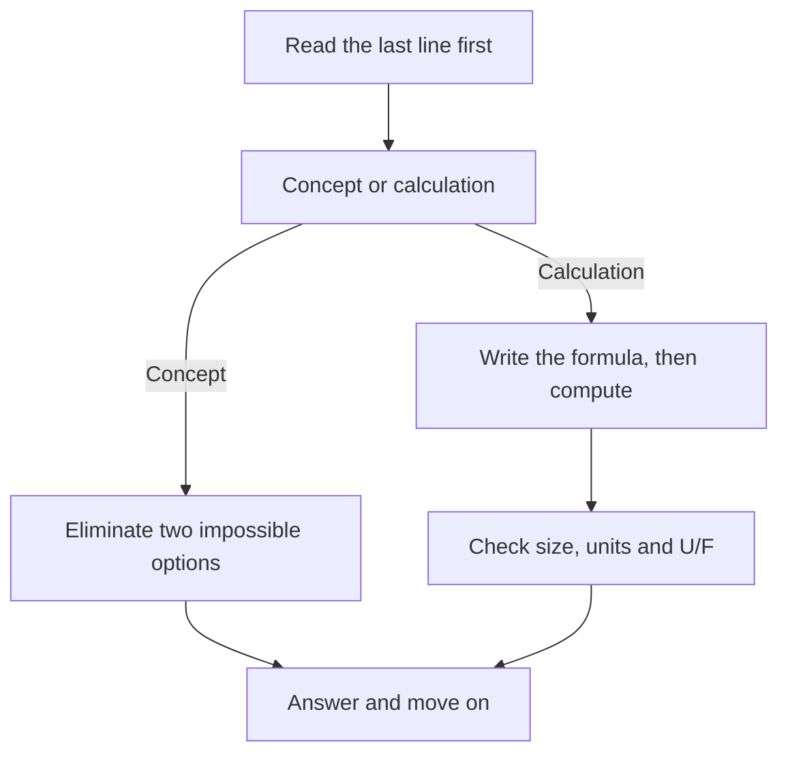

## 1. The formulas you must own

| 🧮 Area | 🧮 Formula |
|---|---|
| EPS | (net income − preferred dividends) ÷ weighted-average shares |
| Goodwill | Consideration + NCI − fair value of net identifiable assets |
| Depreciation (SL) | (cost − residual) ÷ life |
| High-low | b = Δcost ÷ Δactivity; a = total cost − b × activity |
| Production | Sales + ending FG − beginning FG |
| Purchases | Usage + ending materials − beginning materials |
| Flexible budget | (VC per unit × actual units) + budgeted fixed |
| Learning curve | Cumulative average × improvement rate at each doubling |
| Expected value | Σ (probability × outcome) |
| Material price / usage | AQ × (AP − SP) / SP × (AQ − SQ) |
| Labour rate / efficiency | AH × (AR − SR) / SR × (AH − SH) |
| Fixed overhead budget / volume | Actual − budget / budget − applied |
| Contribution margin | Sales − variable costs |
| Segment margin | Contribution − traceable fixed costs |
| ROI | Income ÷ capital = margin × turnover |
| Residual income | Income − (required rate × capital) |
| EVA | NOPAT − (WACC × capital) |
| Absorption vs variable difference | Change in inventory × fixed overhead per unit |
| EUP (weighted average) | Completed + ending WIP × % complete |
| Predetermined rate | Budgeted overhead ÷ budgeted activity |
| Target cost | Price − required profit |
| COQ | Prevention + appraisal + internal failure + external failure |

## 2. The last week, day by day

| 📅 Day | 🎯 Focus |
|---|---|
| 7 days out | Your own formula sheet, out loud; two variance and two budget questions |
| 6 days out | Section A weak spots: receivables, inventory, impairment, IFRS differences |
| 5 days out | Section B: one full master budget from scratch |
| 4 days out | Section C: variance set, ROI, RI, EVA, transfer pricing |
| 3 days out | Section D: EUP, ABC, overhead, joint costs, COQ |
| 2 days out | Sections E and F: COSO, control types, SDLC, analytics |
| 1 day out | One timed mixed set of 50 MCQs, review only the mistakes, sleep early |
| Exam day | 30 minutes on the formula sheet and your trap list |

## 3. Exam-day method

| ⏱️ Part | 📏 Typical time | 🧠 Strategy |
|---|---|---|
| MCQs | 1.5 to 2 minutes each | Two passes: easy first, flag the heavy ones |
| CBQs | About 30 minutes per case | Read the requirement before the scenario |

## 4. The traps that cost marks

| ⚠️ Trap | ✅ Fix |
|---|---|
| Buying material using sales units | Use production units |
| Depreciation treated as cash | Add it back |
| High-low using highest cost | Sort by activity |
| Volume variance called controllable | Only the budget variance is |
| Absorption assumed always higher | Only when inventory rises |
| Transfer at market with spare capacity | Variable cost is the floor |
| LIFO assumed under IFRS | It is not |
| Write-off assumed to change NRV | It does not |

## 5. Final words

Part 1 rewards structure more than brilliance. Almost every question is a familiar pattern in new
clothes: a budget chain, a variance pair, a cost flow, a control component, an analytics question.
Learn the patterns, practise them by hand, and in the exam slow down for the first ten seconds of each
question and speed up afterwards.

Your formula sheet, your trap list and your worked examples are the only materials you truly own,
because you wrote them. Trust them on the day.
