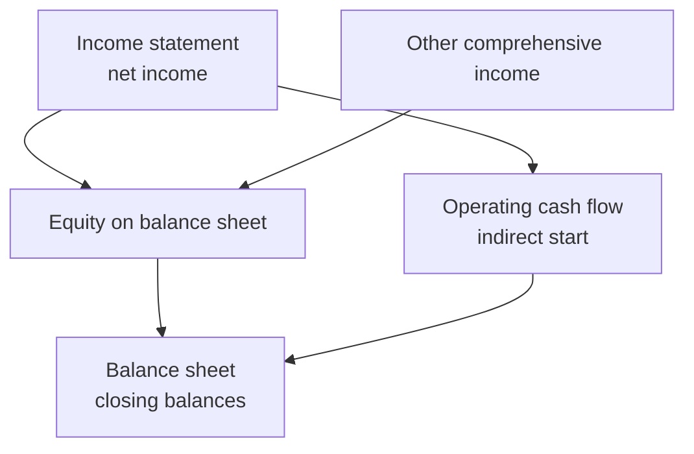

## 1. Other comprehensive income (OCI)

Some gains and losses are kept out of net income because they are volatile and unrealised.

| 🌍 OCI item | 🧾 Example |
|---|---|
| Foreign currency translation | An overseas subsidiary's results translated into dollars |
| Unrealised gains on available-for-sale debt securities | Bond price moves before you sell |
| Certain pension adjustments | Actuarial gains and losses |
| Cash-flow hedge effective portion | A hedge on a future purchase |
| Revaluation surplus (IFRS only) | Land revalued upwards |

**Comprehensive income = net income + OCI.** The **statement of changes in equity** then links the two
balance sheets: opening equity + share issues − buybacks + net income + OCI − dividends = closing equity.

## 2. The cash flow statement: the honesty check

| 🪣 Bucket | 📥 Money in | 📤 Money out |
|---|---|---|
| Operating | Cash from customers, interest received | Suppliers, wages, tax |
| Investing | Sale of PP&E or investments | Buying PP&E or investments |
| Financing | Loans, share issues | Repaying debt, dividends, buybacks |

**Direct method** lists real cash receipts and payments. **Indirect method** starts at profit and
adjusts. The three adjustment instincts:

- Depreciation is a non-cash expense → **add it back**.
- Receivables increased → revenue booked but not collected → **subtract**.
- Payables increased → costs incurred but not paid → **add**.

**Worked example (indirect):** net income 50,000 + depreciation 12,000 − receivables increase 8,000 −
inventory increase 5,000 + payables increase 3,000 = **operating cash 52,000**. Then − equipment
20,000 (investing), + loan 15,000 − dividends 10,000 (financing) → **net cash increase 37,000**.

## 3. How the statements articulate

| 🔗 Link | 🧠 Explanation |
|---|---|
| Net income → retained earnings | Profit is added to equity each period |
| Closing cash = balance sheet cash | One number, two places |
| Depreciation | Expense in income statement, added back in cash flow, reduces PP&E on balance sheet |
| Dividends | Financing outflow; reduces retained earnings |

**Limitations to mention in a CBQ:** statements are historical, rely on estimates (depreciation, bad
debts), ignore inflation, and leave out value creators such as brand building and staff skill.
