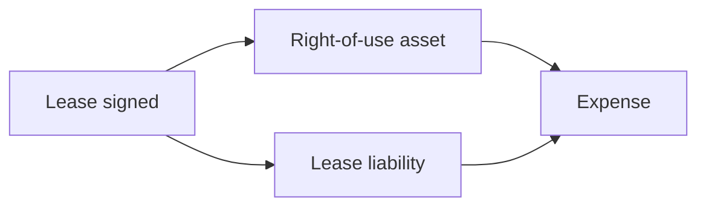

## 1. Current liabilities and the "maybe" items

Current liabilities are amounts due within a year: payables, accruals, unearned revenue, short-term
notes, the current portion of long-term debt and dividends payable. **Unearned revenue** is cash
received before you deliver — a liability until you perform.

**Contingencies** are the uncertain ones:

| 🎲 Likelihood | 💰 Estimable? | 📝 Treatment |
|---|---|---|
| Probable | Yes | Record a liability |
| Probable | No | Disclose only |
| Reasonably possible | Either | Disclose only |
| Remote | Either | Usually nothing |
| Gain contingency | Any | Never record; disclose if probable |

The asymmetry is deliberate: be quick to recognise bad news, slow to recognise good news.

## 2. Bonds payable

| 💹 Situation | 🔎 Issue price | 📈 Interest expense |
|---|---|---|
| Coupon > market rate | Above face (premium) | Less than the cash coupon |
| Coupon = market rate | At face | Equal to the coupon |
| Coupon < market rate | Below face (discount) | More than the cash coupon |

**Worked example:** $100,000 of 8% bonds issued for $96,000 when the market rate is 10%. The discount
of $4,000 is amortised over 5 years = $800 per year. Cash interest = $8,000. Interest **expense** =
8,000 + 800 = **$8,800**, and the carrying amount creeps up toward $100,000 by maturity.

## 3. Leases (ASC 842)

If you control the use of an identified asset, you now record a **right-of-use asset** and a **lease
liability** equal to the present value of the payments — even for operating leases.

| 🏷️ Lease | 📉 Expense pattern |
|---|---|
| Finance lease (US GAAP) / IFRS lessee model | Interest + depreciation, front-loaded |
| Operating lease (US GAAP lessee) | Single straight-line lease expense |

Short-term leases (12 months or less) and small assets may simply be expensed.
