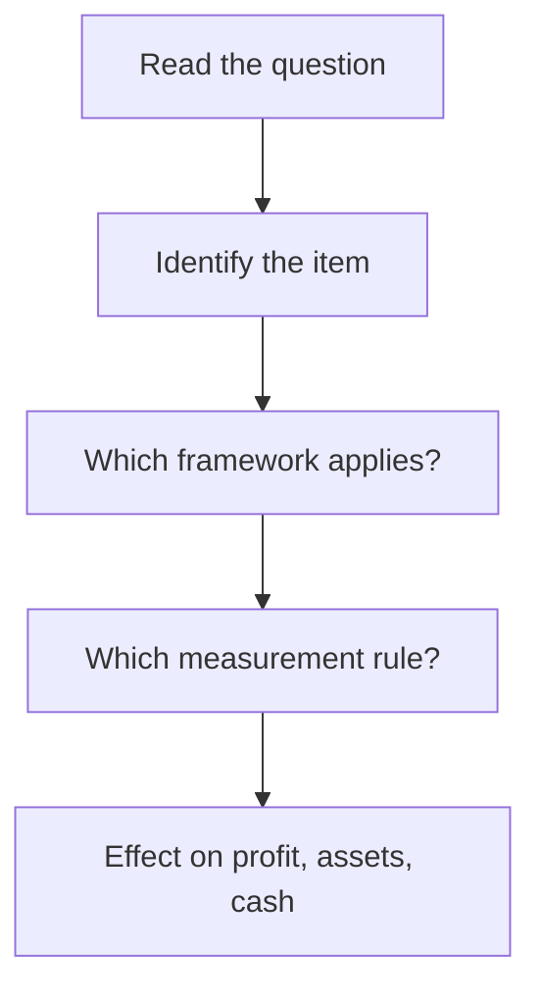

## 1. The differences that get tested

| 🎯 Topic | 🇺🇸 US GAAP | 🌍 IFRS |
|---|---|---|
| Inventory cost flow | LIFO allowed | LIFO **not allowed** |
| Inventory write-down reversal | Not allowed | Allowed up to original cost |
| Inventory benchmark | Lower of cost or market | Lower of cost or net realisable value |
| PP&E measurement | Cost only | Cost **or** revaluation |
| Investment property | No separate category | Fair value option |
| Development costs | Generally expensed | Capitalised if criteria met |
| Impairment test | Undiscounted cash-flow test first | One-step recoverable amount test |
| Impairment reversal | Prohibited | Allowed except goodwill |
| "Probable" | Roughly 70-75% likely | More likely than not (over 50%) |
| Leases | Two models for lessees | Single lessee model |
| Extraordinary items | Abolished | Not a category |

**Worked comparison:** a lawsuit loss is 60% likely and estimable. Under **IFRS** it is "probable", so
record the liability. Under **US GAAP** it is not yet probable enough, so disclose only. Same case,
two balance sheets — exactly the kind of CBQ scenario the exam builds.

## 2. Section A in one dashboard

| 🎯 Area | 🧠 What you must be able to do | 🔥 Likely question style |
|---|---|---|
| Statements | Classify items, compute EPS, read cash flow | "Which line and in what order?" |
| Assets | Apply cost flows, aging, depreciation, impairment | "What is the effect on profit?" |
| Liabilities | Bonds, leases, contingencies, deferred tax | "Record, disclose or ignore?" |
| Equity | Dividends, splits, treasury stock | "What changes and what does not?" |
| Revenue | Five steps, allocation, timing | "When is revenue recognised?" |
| Framework | US GAAP vs IFRS | "How would the other framework treat this?" |

## 3. How Section A shows up in a case

A typical CBQ gives you a company with several accounting policy choices and asks which policy
inflates profit, what the cash effect is, and what would change under IFRS. The method that works:

| ⚠️ Trap | ✅ Fix |
|---|---|
| Assuming every choice changes profit | Many choices only move amounts between statements |
| Forgetting the cash effect | Accruals change profit, not cash |
| Treating IFRS as stricter everywhere | Sometimes IFRS recognises more (contingencies) |
| Mixing OCI and profit | Ask: "is it realised and trading?" |
