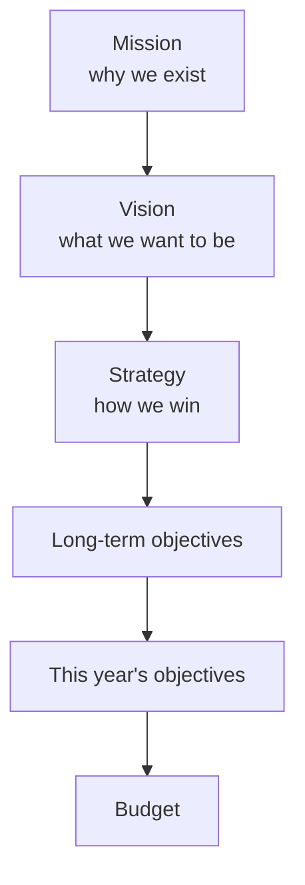

## 1. The hierarchy from mission to budget

| 🏗️ Level | ❓ Answers | 💡 Example (a dairy) |
|---|---|---|
| Mission | Why do we exist? | Safe dairy for every family |
| Vision | What do we want to become? | Most trusted brand in North Africa by 2030 |
| Strategy | How do we win? | Low-cost production plus a premium yoghurt line |
| Long-term objective | Where in 3-5 years? | 20% market share, 15% return on equity |
| Annual objective | What this year? | Two new depots, three new flavours |
| Budget | What numbers? | 120 million litres, EGP 3.4bn revenue |

Strategic planning is long-run; **tactical (operating) planning** converts it into the year ahead. The
budget is the year's numbers.

## 2. Looking outside: PESTEL and Porter

| 🔤 PESTEL | 💡 Dairy example |
|---|---|
| Political | New tariffs on imported equipment |
| Economic | Inflation and interest rates |
| Social | Shift to low-sugar products |
| Technological | Cold-chain sensors |
| Environmental | Water scarcity |
| Legal | New labelling rules |

| ⚔️ Porter's five forces | 🔺 Profit pressure when... |
|---|---|
| Rivalry | Many equal competitors, slow growth |
| New entrants | Low capital needs, weak regulation |
| Substitutes | Close alternatives exist |
| Supplier power | Few suppliers, unique inputs |
| Buyer power | Buyers are large and price-sensitive |

PESTEL answers "what is changing?"; the five forces answer "how much profit is available in this
industry at all?"

## 3. Looking inside: SWOT and the value chain

| | ➕ Helpful | ➖ Harmful |
|---|---|---|
| Internal | Strengths: own cold-chain fleet | Weaknesses: one ageing plant |
| External | Opportunities: growing yoghurt demand | Threats: cheap imported powder |

Strengths and weaknesses are internal; opportunities and threats are external — a classic trap. The
**value chain** then asks, activity by activity, where cost is added and where customer value is
created.

## 4. Competitive strategies

| 🎯 Strategy | 🧠 How you win | ⚠️ Risk |
|---|---|---|
| Cost leadership | Lowest cost per unit across a broad market | Quality slips, price war |
| Differentiation | Features, brand or service worth paying for | Cost gap grows too wide |
| Focus / niche | Serve one segment better than anyone | The segment disappears |
| Stuck in the middle | Try to be cheap and premium at once | Lose on both sides |

## 5. Planning for uncertainty and linking to the budget

| 🛡️ Tool | 🧠 What it does |
|---|---|
| Scenario planning | Builds several complete futures (base, best, worst) |
| Contingency planning | Pre-agrees the response to one specific event |
| Sensitivity analysis | Changes one variable to see the impact |
| Simulation | Varies many variables together, many times |
| Rolling forecasts | Refreshes the outlook every period |

**Strategy → budget chain:** critical success factor ("on-time delivery is how we win") → key
performance indicator ("% orders delivered on time") → budget target ("97%, with extra truck costs
budgeted") → balanced scorecard tracking → monthly review. A target with no success factor behind it
is just a number nobody defends.
